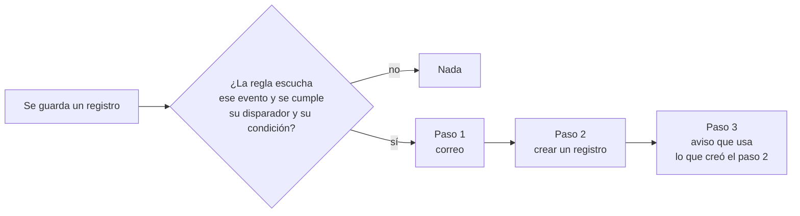

# Acciones al guardar 10.0+

Cuando se crea, se modifica o se borra un registro, Flexygo puede hacer cosas por ti **sin programar**: mandar un correo, avisar a alguien en la campana, crear o modificar otro registro, pedir una decisión, llamar a otro sistema o, si lo que necesitas no está en la lista, ejecutar un proceso propio.

Todo se configura con **reglas**. Una regla dice **cuándo** (al crear, al modificar o al borrar, con un disparador y una condición opcional) y **qué hace**, en forma de **pasos** que se ejecutan en orden.

¿Quieres probarlo en diez minutos? [Pruébalo: una regla de tres pasos](ActionsOnSaveTryIt.md).

**Dónde se configura**: en skin2026, en el **banco de trabajo del objeto**, sección **Rules and actions** (al final del carril, en el grupo *When a record is saved*). Las decisiones y los webhooks de salida siguen teniendo además sus pantallas propias, en las dos pieles: ver [Aprobaciones, tareas humanas y webhooks de salida](ApprovalsAndWebhooks.md).

!!! info "La configuración de pasos está en la piel 2026"
    Las reglas se **ejecutan** igual en las dos pieles, pero los pasos se **configuran** desde skin2026. En flexy2022 solo se configuran las decisiones y los webhooks, con sus pantallas propias; para los demás pasos (correo, aviso, crear o modificar un registro, proceso), cambia el perfil a 2026.

La lista enseña cada regla en una fila: cuándo se ejecuta, su disparador, su condición, los pasos que hace en orden y si está activa. El interruptor **On / Off** la activa o la desactiva sin abrirla.

!!! note "Nunca deshacen el guardado"
    Los pasos se ejecutan **después** de guardar el registro. Si un paso falla, el registro ya está guardado y se queda guardado; el fallo queda en las **últimas ejecuciones** de la regla.

---

## 1. Crear una regla

El botón **New ▾** de la sección abre la lista de tipos de paso. Se elige el primero y se abre la ficha de una regla nueva con ese paso ya puesto, para que una regla de un solo paso sea una sola pantalla.

Los tipos están agrupados:

- **Los que solo se configuran**: correo, aviso, crear un registro y modificar un registro.
- **Los que esperan o salen fuera**: decisión (espera a que una persona decida) y webhook (llama a otro sistema).
- **El personalizado**: ejecutar un proceso. Es la única puerta a código propio del proyecto.

La ficha de la regla tiene tres partes: **When** (cuándo), **Then, in this order** (sus pasos) y **Last runs** (sus últimas ejecuciones).

---

## 2. Cuándo se ejecuta

| Campo | Qué es |
|---|---|
| **Name** | El nombre de la regla, como lo verá quien la mantenga. |
| **Enabled** | Una regla desactivada no se ejecuta, pero se puede **probar** igual (§5). |
| **On create / On update / On delete** | Los eventos que escucha. Al menos uno. |
| **Trigger** | *Always*: cada vez. *When a field changes*: solo si el campo elegido tiene un valor nuevo. *When a field changes to a value*: solo si el campo pasa a un valor, opcionalmente desde otro (*From*, vacío es «cualquier valor»). |
| **Only if** (opcional) | Una condición más sobre el registro, en SQL, igual que el `where` de una lista: `Offers.Amount > 1000`. |

El disparador cubre sin SQL el caso más habitual, «cuando la oferta pasa a *Aceptada*»: *Trigger* = *When a field changes to a value*, *Field* = *Status*, *To* = *Accepted*. El desplegable *To* sugiere los valores que el campo tiene hoy.

---

## 3. Los pasos

Los pasos se ejecutan **uno detrás de otro**, en el orden de la lista. Se reordenan arrastrando la fila o con sus flechas, se editan con el lápiz (la ficha del paso se abre debajo de su fila) y se quitan con la papelera. **Add step ▾** añade otro.

| Paso | Qué configura | Cuándo ocurre | Dónde se sigue |
|---|---|---|---|
| **E-mail** | Plantilla (opcional), asunto, para (direcciones o `{{Campo}}`), también a un rol y a un usuario, y el cuerpo en HTML | Se encola al instante; sale en menos de un minuto, con reintentos | La cola de correo |
| **Notification** | Título, mensaje y a quién (rol o usuario) | Al instante | La campana, con el registro enlazado |
| **Create a record** | El objeto y sus campos: campo ← valor | Al instante, como el usuario que guardó | El registro creado y su auditoría |
| **Change a record** | El objeto, **qué registro** (un `where` sobre su tabla) y los campos a poner | Al instante, como el usuario que guardó | El registro cambiado y su auditoría |
| **Decision** | Título, para quién, prioridad, plazo, opciones | Abre la tarea al instante y **espera** a una persona | La bandeja de decisiones |
| **Webhook** | URL, método, qué envía (el registro, sus claves o una plantilla) y el secreto | Se encola al instante; **sale fuera** en menos de un minuto, con reintentos | Los envíos del webhook |
| **Run a process** | El proceso y sus parámetros | Al instante, sobre el registro, como el usuario que guardó | Lo que haga el proceso; su error, en *Last runs* |

En cualquier texto de un paso se puede usar **`{{Campo}}`** del registro que se guardó, y también `{{currentUserId}}` o `{{now}}`. En el cuerpo del correo, los valores del registro entran **como texto**: un `<` o un enlace se ven tal cual; los campos de tipo HTML entran como están.

!!! warning "Campos obligatorios al crear un registro"
    La ficha de *Create a record* avisa si el objeto de destino tiene un campo obligatorio, sin valor por defecto, al que el paso no da valor. Ese registro no se podría crear, y el paso fallaría cada vez.

!!! note "Los registros se guardan como el usuario que guardó"
    Crear, modificar y ejecutar un proceso se hacen **con los permisos del usuario que guardó el registro**: su seguridad, sus valores por defecto, su auditoría y las reglas del otro objeto se aplican igual que si lo hubiera hecho él.

---

## 4. Datos entre pasos y fallos

Un paso que **crea o modifica un registro** o que **ejecuta un proceso** deja sus valores a los pasos que van después: **`{{Step2.Title}}`** es el campo *Title* del registro que creó el paso 2. La fila del paso lo indica (*gives {{Step2.Title}}*), y la del paso que lo usa también (*uses step 2*).

- Un paso **no puede usar** a uno que va después, ni a uno que no deja nada (un correo, un aviso). La ficha no deja guardar la regla y dice por qué.
- **Si un paso falla, los demás siguen**, salvo los que usan lo que él produjo: esos se **saltan**, porque ejecutarlos con un valor vacío sería peor.
- **Sin bucles**: un paso que guarda un registro puede disparar las reglas de ese otro objeto, pero una cadena se para en **tres pasos uno dentro de otro**, y un paso nunca se ejecuta dentro de sí mismo.

---

## 5. Probar con un registro

**Test with a record** (al pie de la ficha) enseña qué haría cada paso con un registro real **sin hacer nada**: no guarda, no envía y no crea. Si la regla tiene cambios sin guardar, se guarda antes de probarla. Funciona también con la regla desactivada, que es justo cuando hace falta.

Se elige el evento (*On create*, *On update*, *On delete*) y un registro de la lista, que se puede buscar; o se escribe el `where` de uno.

Cada paso sale con todos sus valores **resueltos**: el asunto con el título del registro, los usuarios y los roles **por su nombre**, y lo que usa de un paso anterior ya puesto (*Follow-up created: Follow-up of Quarterly audit*). Un valor que un paso anterior solo conoce al ejecutarse (el número de un registro nuevo) se indica como tal. Un paso que fallaría lo dice, con el motivo, y los que dependen de él salen como saltados.

!!! note "El disparador no se comprueba al probar"
    Una prueba no tiene «valor de antes», así que si la regla es *When a field changes*, la prueba lo recuerda: *in a real save it runs only if Status changes to Accepted*.

---

## 6. Últimas ejecuciones

Cada vez que una regla se ejecuta deja una fila por paso: hecho, falló o saltado, con el mensaje. La ficha enseña las últimas en **Last runs**: cuándo, sobre qué registro, una marca por paso (✓ hecho, ✕ falló, – saltado) y el resultado.

No cuenta como fallo de la regla lo que tiene su propia cola: un correo que se encoló bien y luego no sale (se reintenta), o un webhook que se encoló y luego falla (se ve en sus envíos).

---

## 7. Para desarrolladores

| Qué | Dónde |
|---|---|
| Reglas | Tabla `Objects_Rules`: eventos (`OnInsert`, `OnUpdate`, `OnDelete`), `TriggerType` (`always`, `changed`, `changedto`), `TriggerField/From/To`, `Condition`, `Enabled` |
| Pasos | Tabla `Objects_Actions`, una fila por paso con `StepOrder` y `ActionType`; sus campos campo = valor, en `Objects_Actions_Fields` |
| Tipos de paso | Tabla `Objects_Actions_Types`, con la clase que lo ejecuta (`Handler`). Un tipo nuevo es una fila y una clase que implementa `IObjectAction` |
| Ejecuciones | Tabla `Objects_Rules_Log` (`done`, `failed`, `skipped`) |

Las reglas, como el resto de la configuración, viajan con el origen: una regla creada con el origen 0 forma parte del producto.
