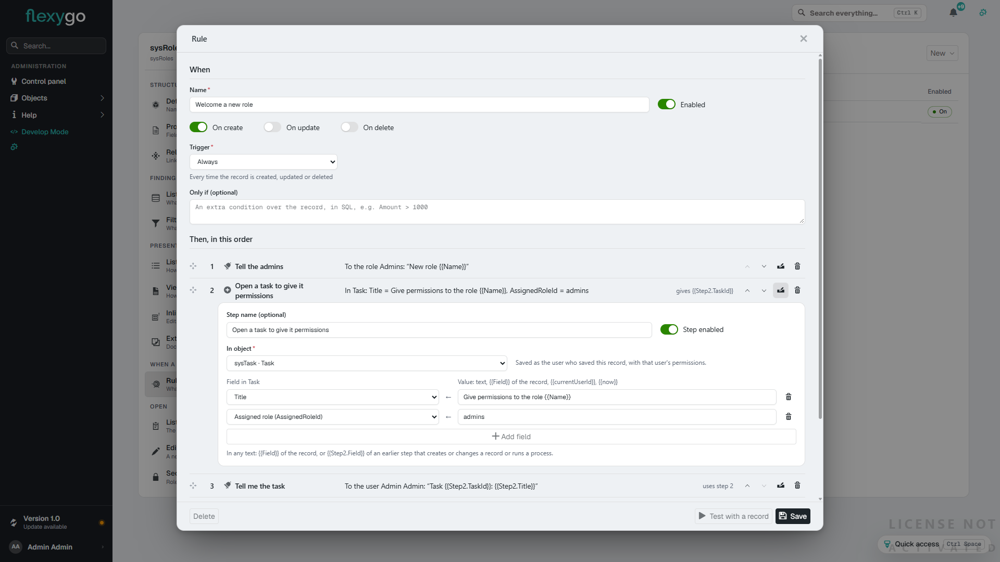
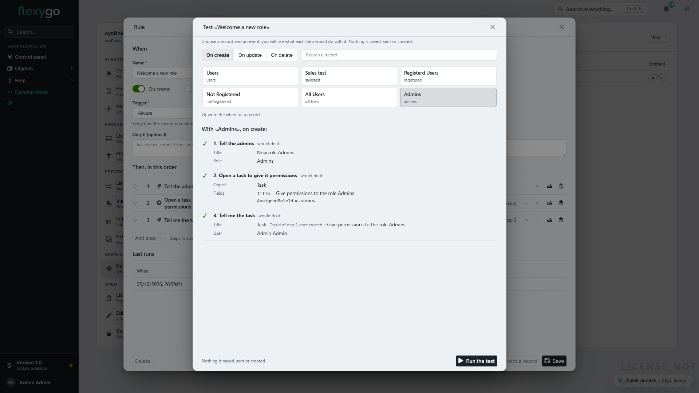
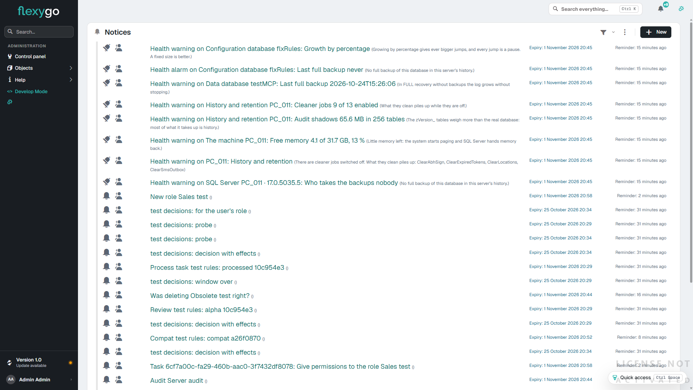

# Try it: a rule with three steps 10.0+

In ten minutes you will have a rule working, without a line of code: **every time someone creates a role**,

1. the administrators get a notification in the bell;
2. a task is opened to give that role its permissions;
3. and you get another notification with the **number of that task**, which step 2 has just created.

We use **Roles** because every application has them; any other object works the same. No mail server or other system is needed.

This page is the **short way to try it**. What each step type does, the triggers and the failures are in the reference: [Actions on save](ActionsOnSave.md).

---

## What you need

| | |
|---|---|
| **A Flexygo application, version 10** | A local development install will do. Log in as an **administrator**. |
| **The skin2026 skin** | Steps are configured in skin2026. If your profile is flexy2022, switch it to 2026 to configure; the rule runs the same in both skins. |

---

## 1. Open the rules of the Role object

In the control panel, **Objects**, find **sysRole** and open it: that is the object workbench. At the end of the rail, **Rules and actions**.

## 2. Create the rule with its first step

**New ▾ › Notification**. The form of a new rule opens with a notification already in it. Fill in:

| Field | Value |
|---|---|
| **Name** | `Welcome a new role` |
| **On create** | on (it is by default) |
| **Trigger** | *Always* |
| Step 1, **Step name** | `Tell the admins` |
| Step 1, **Title** | `New role {{Name}}` (the braces read the record's field) |
| Step 1, **To the role** | *Admins* |

## 3. Add the step that creates the task

**Add step ▾ › Create a record**:

| Field | Value |
|---|---|
| **Step name** | `Open a task to give it permissions` |
| **In object** | *sysTask* (the tasks of the decisions inbox) |
| **Add field**: *Title* ← | `Give permissions to the role {{Name}}` |
| **Add field**: *Assigned role* ← | `admins` |

## 4. Add the notification that uses step 2

**Add step ▾ › Notification**:

| Field | Value |
|---|---|
| **Step name** | `Tell me the task` |
| **Title** | `Task {{Step2.TaskId}}: {{Step2.Title}}` |
| **To the user** | you |

`{{Step2.TaskId}}` is the number of the task step 2 will create. The row of step 2 now says *gives {{Step2.TaskId}}*, and the row of step 3, *uses step 2*. **Save**.

## 5. Test it without doing anything

**Test with a record**, event **On create**, and pick the role *Admins* from the list.

Each step shows its values resolved: *New role Admins* for the role *Admins*, the task it would open and your notification with its title. The task number is marked *TaskId of step 2, once created*: it is only known once the task exists. **Nothing has been saved, sent or created.**

## 6. Create a role

Open the list of roles and create one: Id `salestest`, name *Sales test*. Save.

**Check**:

- In the bell (or the list of notices), *New role Sales test* and *Task 6cf7…: Give permissions to the role Sales test*.
- In the decisions inbox, the task *Give permissions to the role Sales test*, for *Admins*.
- In the rule's form, **Last runs**: ✓ ✓ ✓ and *All done*.

---

## What next

- Switch the trigger to **When a field changes to a value**, so the rule acts only when a field goes to a given value.
- Add an **E-mail** step if mail is configured.
- To remove the test: delete the rule from its form (**Delete**) and, if you like, the role *salestest* and its task.
