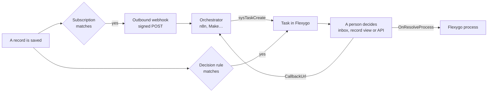
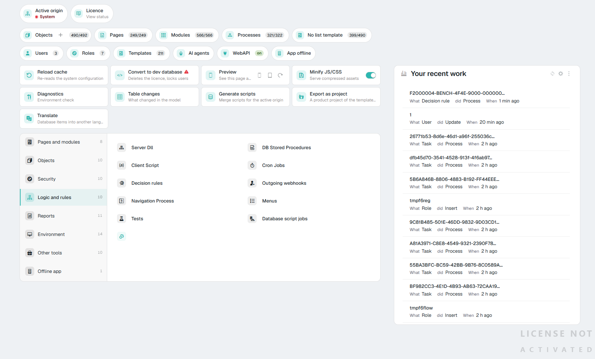
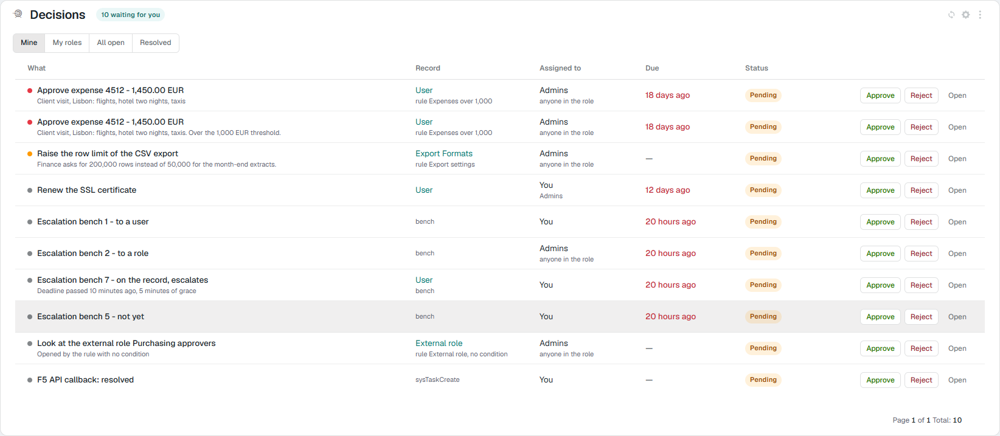
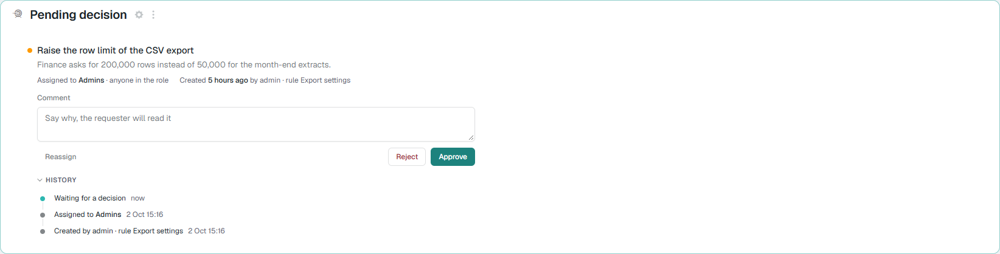
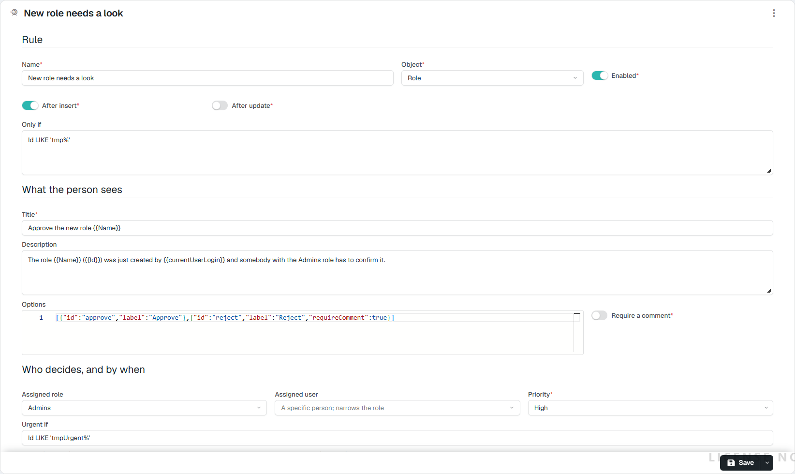
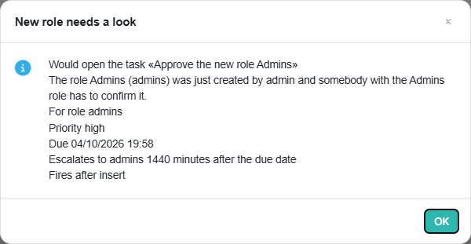
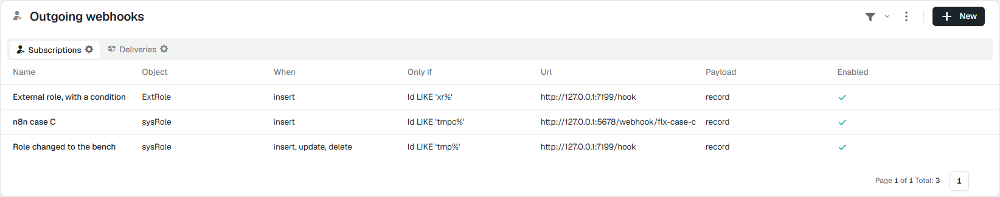
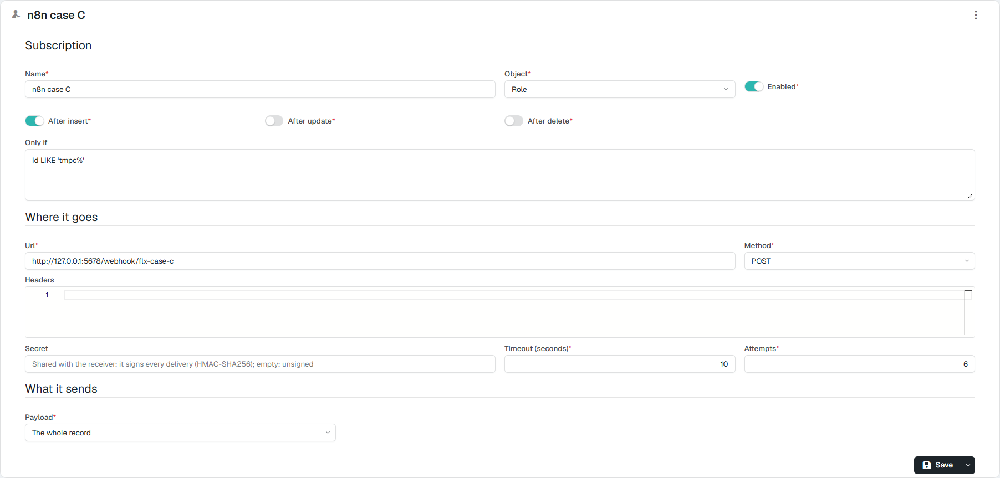
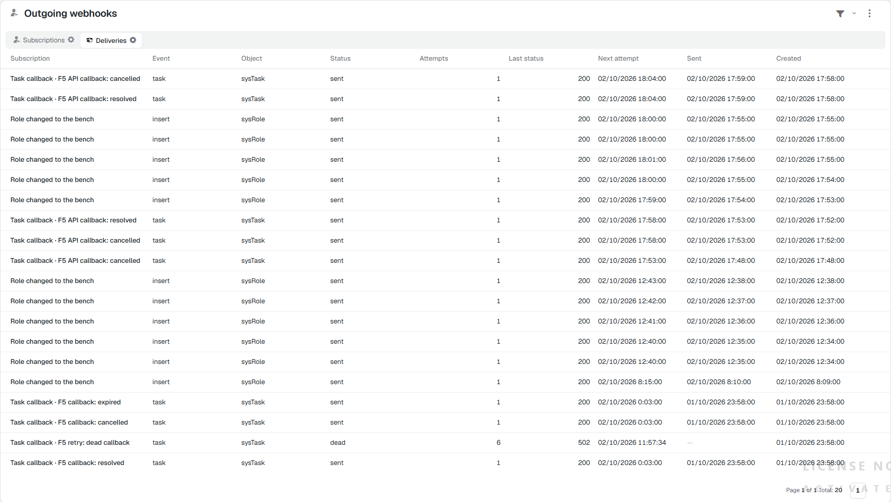

# Approvals, human tasks and outbound webhooks <span class="fh-version-tag" title="Available since version 10">10.0+</span>

Flexygo does not orchestrate automations: that is what n8n, Make, Zapier or any other orchestrator is for. What it does do is **what an orchestrator cannot do on its own**: open a **decision** to a person or a role inside the application, with its inbox, its deadline and its escalation, and **notify the outside world** when a record changes (**outbound webhooks**). The two pieces combine into a circuit:



The orchestrator and the callback are optional: a **decision rule** opens tasks on save without leaving Flexygo, and an outbound webhook serves any HTTP receiver even if there is no task behind it.

Want to try it in fifteen minutes? [Try it: a decision and an outbound webhook](ApprovalsAndWebhooksTryIt.md).

Everything looks and is configured the same way in both skins (skin2026 and flexy2022):

| What | skin2026 | flexy2022 |
|---|---|---|
| The inbox | **Decisions** menu node, with a counter | **Decisiones** menu node, with a counter |
| Decision rules | **Control panel › Logic and rules › Decision rules** | **Admin › Lógica y reglas › Reglas de decisión** |
| Outbound webhooks and their deliveries | **Control panel › Logic and rules › Outgoing webhooks** | **Admin › Lógica y reglas › Webhooks de salida** |
| From the object | The object's workbench, *Decisions* and *Webhooks* sections | — |



---

## 1. Human tasks (decisions)

A **task** is a question with options —*Approve* / *Reject* by default— addressed to a role, to a person, or to a person within a role, about a record or without one. It lives in the `Tasks` table (`sysTask` object), with its history in `Tasks_Log`.

| Where it is decided | What is there |
|---|---|
| **Decisions** (menu node, with a counter) | The inbox: *Mine* · *My roles* · *All open* · *Resolved*, with the options on the row and the link to the record. |
| **The task record view** (`sysTask`) | The *Resolve*, *Reassign* and *Cancel* processes in the process menu (only while it is pending). |
| **The record's record view** | The *Pending decision* card (`sysmod-task-decision-2026` module) shows the pending tasks of that record with their buttons, the comment and the history. It comes **out of the box at the top of the default record views** (view and edit) of every object that has no record view of its own, and takes no space if the record has nothing pending. On an object with its own record view (users, roles…) it is placed by hand like any module. |
| **The bell** | Each pending task leaves a notice (`Notices`) for the user or the role members; it expires when the task is decided, cancelled, reassigned or expires. |
| **The web API** | The same processes, see §3. |





!!! note "What the card costs"
    Opening a default record view runs one more query, the record's pending tasks, backed by the `IX_Tasks_Status_Object` index on `Tasks`. Measured with 50,000 tasks in the table: between 44 and 57 ms per opening. Lists do not carry it.

### Statuses and priorities

| `Status` | When |
|---|---|
| `pending` | Open, waiting for someone. |
| `resolved` | Someone chose an option (`Outcome`), with or without a `Comment`. |
| `cancelled` | It was cancelled without a decision. |
| `expired` | The deadline passed and there was no one to escalate to. |

`Priority`: `0` normal, `1` high, `2` urgent.

### Deadline and escalation

The **`flxTaskEscalation`** job (every 5 minutes, `sysTaskEscalation` process) looks at overdue pending tasks:

- At `DueDate + EscalateAfter` minutes, if the task names a target (`EscalateToRoleId` or `EscalateToUserId`), it **escalates only once**: the target becomes the assignee, `escalated` is recorded in the log and the new assignee is notified.
- If it names no target, it **expires** (`expired`, `expired` action in the log).
- Without `EscalateAfter`, the task only shows as overdue: nobody moves it.

### What happens on decision

1. It checks that the person deciding is allowed —the assigned user, anyone with the assigned role, an administrator, or anyone if the task is not assigned; role membership is read from the database at that moment— and that there is a comment if the task or the option requires one (`RequireComment`, or `requireComment` on the option).
2. `resolved` is written with `Outcome`, `Comment`, `ResolvedBy` and `ResolvedDate`, along with the log.
3. If the task has an **`OnResolveProcess`**, that Flexygo process is run with `TaskId`, `Outcome`, `Comment`, `ObjectName`, `ObjectWhere` and `CorrelationId`, bound to the task's record if it has one. **The decision stands even if the process fails**: the failure comes back as a warning (`WarningMessage`) and in `Data` (`OnResolveProcessSuccess: false`).
4. If the task has a **`CallbackUrl`**, a webhook with the result is queued (§5). The same happens on cancel and on expiry.

---

## 2. Decision rules

A **rule** (`Tasks_Rules`, `sysTaskRule` object, *Decision rules* / *Reglas de decisión* node under *Logic and rules*, and the *Decisions* section of the object's workbench) opens a task when a record of the object is saved, with no code. It is evaluated after the save is committed, whether it comes from a screen or from the web API; whoever saves does not need permission on the task processes.



| Field | What for |
|---|---|
| **Object** | The object being watched. |
| **After insert / After update** | On which saves it is evaluated. |
| **Only if** (`Condition`) | A `WHERE` on the object's table; the rule fires if the saved record meets it. Empty: always. |
| **Title / Description** | Templates with `{{Field}}` from the record (and `{{currentUserLogin}}` and the rest of Flexygo's placeholders). |
| **Options** | JSON `[{"id":"approve","label":"Approve"},{"id":"reject","label":"Reject","requireComment":true}]`. Empty: *Approve* / *Reject*. |
| **Require a comment** | Makes a comment mandatory for any option. |
| **Assigned role / user** | Who it is opened to. Role and user together: the person within the role. |
| **Priority** and **Urgent if** | A fixed priority, and a `WHERE` that raises it to urgent when the record meets it. |
| **Due in (minutes)** | Deadline from the moment it is opened. |
| **Escalate after / to role / to user** | The escalation from §1. |
| **On resolve process** | Process that receives the result (§1). |
| **Callback URL / Callback secret** | To notify an orchestrator on decision (§5). The secret is stored in the rule, is shown masked and is passed on to every task the rule opens. |
| **Enabled** | A disabled rule does not fire. |

!!! warning "External objects: no condition"
    On an external object (its records live behind an API, see [External entities](ExternalEntities.md)) there is no table to evaluate a `WHERE` on. That is why, when an external object is chosen, **Only if** and **Urgent if** are disabled, and the server rejects a condition that arrives by another route (the web API, or a value that was already written) with *«An external object takes no condition»*. A rule without a condition works just as on any other object.

!!! tip "Test with a record"
    In the rule's record view, the **Test with a record** process asks for a `WHERE` that names a record (`Id = 'admins'`) and shows, **without creating it**, the task it would open: rendered title, assignee, priority, due date, escalation and events. The answer comes up in a dialog titled with the rule's name, closed with **OK**. If the record does not meet the condition, or the rule is disabled, it says so. Through the web API, the same text arrives in `Data.Message`.

    { width="600" }

An object's rules are read once along with its configuration and are reloaded when a rule is saved or deleted from its record view: no restart is needed. An object without rules pays nothing on save.

---

## 3. Tasks API

Everything goes through the Flexygo **web API**: `POST /token` (`grant_type=password`, `username`, `password`) and `Authorization: Bearer …`. The user needs API access (`WebAPI_Users`), and the processes and the `sysTask` object must be published in it (`WebAPI_Processes`, `WebAPI_Objects`), like any other.

| Call | What it does |
|---|---|
| `POST /webapi/exec/sysTaskCreate` | Opens a task. Parameters in the body (JSON), below. |
| `POST /webapi/exec/sysTaskResolve/sysTask/{TaskId}` | Decides: `Outcome` (mandatory, the `id` of an option) and `Comment`. |
| `POST /webapi/exec/sysTaskCancel/sysTask/{TaskId}` | Cancels: `Comment`. |
| `POST /webapi/exec/sysTaskReassign/sysTask/{TaskId}` | Reassigns: `AssignedRoleId`, `AssignedUserId`, `Comment`. |
| `GET /webapi/object/sysTask` · `GET /webapi/object/sysTask/{TaskId}` | Reads tasks like any object. |
| `POST /webapi/exec/sysTaskRuleTest/sysTaskRule/{RuleId}` | A rule's **Test with a record**: `Record` (a `WHERE` that names a record, `Id = 'admins'`). Creates nothing; the text of the task it would open comes back in `Data.Message`. |
| `POST /webapi/exec/sysWebhookTest/sysWebhookSubscription/{SubscriptionId}` | A subscription's **Send a test**: `Record`, as above. Queues a real delivery with `event: test`. |
| `POST /webapi/exec/sysWebhookRetry/sysWebhookDelivery/{DeliveryId}` | **Retry**: queues a `failed` or `dead` delivery again. |

!!! note "A process of an object is called with its object and its record"
    Every process that hangs from an object is called as `/webapi/exec/<process>/<object>/<id>`: the web API requires it and, without
    the object and the record in the route, answers *«send the object and the record (id or filter) to run it on»*. An id that does not exist
    gives 404 *«record not found»*, and a process that the record does not allow (a **Retry** of a delivery already sent) gives *«not available
    for this record»*. Only `sysTaskCreate`, which hangs from no object, goes without a record. Rules, subscriptions and deliveries are
    **administrators only**: the API user that tests or retries them has to be one.

### `sysTaskCreate` parameters

| Parameter | Type | Notes |
|---|---|---|
| `Title` | text | **Mandatory.** Accepts `{{Field}}` from the record if `ObjectName`/`ObjectWhere` is given. |
| `Descrip` | long text | Context for whoever decides; also with `{{Field}}`. |
| `ObjectName`, `ObjectWhere` | text | The record being decided on. `ObjectWhere` can be plain (`Id = 'x'`, or a webhook's `objectWhere` as is) or encrypted as a Flexygo screen delivers it; **it is always stored in plain form**, as the record's key (`[AspNetRoles].[Id] = N'x'`), so that the task keeps finding its record even if the application moves to another server. No record is also fine. |
| `AssignedRoleId`, `AssignedUserId` | text | To whom. Both: the person within the role. Neither: the task stays open to anyone. |
| `Priority` | 0 · 1 · 2 | normal · high · urgent. |
| `DueDate` | date-time | Deadline. |
| `EscalateAfter`, `EscalateToRoleId`, `EscalateToUserId` | | The escalation from §1. |
| `Options` | JSON | The options; empty: *Approve* / *Reject*. |
| `RequireComment` | boolean | |
| `OnResolveProcess` | text | Flexygo process that receives `TaskId`, `Outcome`, `Comment`, `ObjectName`, `ObjectWhere` and `CorrelationId`. |
| `CallbackUrl` | URL | `POST` with the result on decision, cancellation or expiry (§5). |
| `CallbackSecret` | text | The secret shared with whoever receives the callback, to sign it (§4, *Headers and signature*). It is stored in the task and shown masked in its record view. Empty: the callback goes unsigned. |
| `CorrelationId` | text | Whatever the caller wants to get back (its execution id, for example). |

The response is that of any process: `Success`, `SuccessMessage`, `WarningMessage`, `LastException` and `Data` (`TaskId` and `Status`; on resolve, also `Outcome` and the result of the `OnResolveProcess`).

```json
POST /webapi/exec/sysTaskCreate
{
  "Title": "Approve the new role {{Name}}",
  "ObjectName": "sysRole",
  "ObjectWhere": "Id = 'sales'",
  "AssignedRoleId": "admins",
  "Priority": 1,
  "DueDate": "2026-09-17T18:00:00",
  "EscalateAfter": 1440,
  "EscalateToRoleId": "admins",
  "CallbackUrl": "https://n8n.example.com/webhook-waiting/1234",
  "CallbackSecret": "a-long-random-string-shared-with-n8n",
  "CorrelationId": "1234"
}
```

When resolving through the API, `Outcome` goes in the body with the option's `id`:

```json
POST /webapi/exec/sysTaskResolve/sysTask/0F12D8AC-…
{ "Outcome": "reject", "Comment": "Not this quarter" }
```

---

## 4. Outbound webhooks

A **subscription** (`WebHooks_Subscriptions`, `sysWebhookSubscription` object) sends a `POST` to a URL when a record of the object is saved or deleted. The save **never waits for the receiver**: the delivery is queued (`WebHooks_Deliveries`) and the **`flxWebhookDispatcher`** job (every minute, `SendPendingWebhooks` process) sends it.

Subscriptions and their deliveries live on **a single screen**, *Outgoing webhooks* / *Webhooks de salida*, with two tabs: **Subscriptions** (*Suscripciones*) and **Deliveries** (*Envíos*), the log of everything that has been sent. It is the same in both skins. It can also be reached from the *Webhooks* section of the object's workbench.



!!! note "Outbound and inbound webhooks"
    This screen is the **outbound** one: Flexygo notifies another system. **Inbound** webhooks (another system calls Flexygo, `/webhook/{id}`, `sysWebHook` object) belong to the web API and have no menu node.

| Field | What for |
|---|---|
| **Object** | The object being watched. |
| **After insert / update / delete** | The events it listens to. |
| **Only if** (`Condition`) | A `WHERE` on the table; on delete it is evaluated **before** deleting. Not allowed on an external object (as with rules, §2). |
| **Url**, **Method** | Where and how (`POST` by default). |
| **Headers** | Fixed headers, in JSON: `{"X-Api-Key": "…"}`. |
| **Secret** | The secret shared with the receiver, which signs every delivery (below). It is stored in the subscription and shown masked. Empty: the delivery goes unsigned. |
| **Payload** | `record` (*The whole record*: all fields of the record), `keys` (only the keys) or `template` (**Template** rendered with `{{Field}}`, as is). |
| **Timeout (seconds)**, **Attempts** | 10 s and 6 attempts by default. |
| **Enabled** | A disabled subscription does not queue. |



An object's subscriptions are read once along with its configuration and are reloaded when a subscription is saved from its record view. An object without subscriptions pays nothing on save.

### The body

With `record` and `keys`, the body is a fixed envelope with the record in `data` (binary fields are omitted):

```json
{
  "event": "insert",
  "object": "sysRole",
  "objectWhere": "[AspNetRoles].[Id] = N'sales'",
  "subscriptionId": "2eebc76e-…",
  "firedAt": "2026-09-15T20:03:11.4+02:00",
  "firedBy": "admin",
  "data": { "Id": "sales", "Name": "Sales", "…": "…" }
}
```

`event` is `insert`, `update`, `delete`, `test` (a test delivery) or `task` (a task callback, §5). `objectWhere` is the record's key in plain form: it can be used as is for `sysTaskCreate` or to read the record through the web API. With `template`, the body is exactly the rendered template.

### Headers and signature

| Header | Value |
|---|---|
| `Content-Type` | `application/json; charset=utf-8` |
| `User-Agent` | `Flexygo-Webhooks` |
| `X-Flexygo-Delivery` | Delivery id (to deduplicate retries). |
| `X-Flexygo-Event` | The event. |
| `X-Flexygo-Object` | The object. |
| `X-Flexygo-Signature` | `sha256=` + HMAC-SHA256 of the body (UTF-8 bytes) with the secret, in lowercase hexadecimal. Only when there is a secret. |

To verify it, the receiver recomputes the HMAC over the **raw** body and compares:

```js
const crypto = require('crypto');
const expected = 'sha256=' + crypto.createHmac('sha256', secret).update(rawBody).digest('hex');
const ok = crypto.timingSafeEqual(Buffer.from(expected), Buffer.from(req.headers['x-flexygo-signature'] || ''));
```

!!! warning "The secret lives in the subscription"
    Like that of an external service (`External_Services.Secret`), the secret is written in the record view (the subscription's **Secret**, the rule's **Callback secret**, the task's `CallbackSecret`) and stored in the configuration database. It is shown masked and does not travel in the body. It is the same value that is set in the receiver: in n8n, for example, the one in the *Crypto* (HMAC) node or the code that checks the signature. Changing it means editing the record view; there is no need to touch `appsettings.json` or restart.

### Retries and statuses

A `2xx` response marks the delivery `sent`. Any other —or no response within the timeout— leaves it `failed` and schedules the next attempt: **1 · 5 · 15 · 60 · 240 · 720 minutes** after the 1st, 2nd, 3rd, 4th, 5th and subsequent failures. Once the attempts (`MaxAttempts`) are used up, it becomes `dead`. The last code, the response (up to 4,000 characters) and the error are stored.

| `Status` | What it is |
|---|---|
| `pending` | Queued, waiting for the dispatcher. |
| `sent` | Delivered (`2xx`). |
| `failed` | It failed and will be retried at `NextAttempt`. |
| `dead` | It used up its attempts. |

All deliveries, including task callbacks (§5), are on the **Deliveries** tab (*Envíos*). In the record view of a `failed` or `dead` delivery, the **Retry** process queues it again right away (a failure leaves it `dead` again).



!!! tip "Send a test"
    In the subscription's record view, **Send a test** asks for a `WHERE` that names a record and queues a **real delivery** with `event: test`, even if the subscription is disabled or the record does not meet the condition —the message says whether a save would have fired it—. It goes out within a minute and stays on the **Deliveries** tab.

---

## 5. A task's callback

When a task with a `CallbackUrl` is **decided, cancelled or expires**, a `task` delivery to that URL is queued, through the same queue and with the same headers and retries (`POST` method, 10 s, 6 attempts); signed if the task has a `CallbackSecret` (if a rule opened it, the rule's *Callback secret*). The task log records `callback_sent` or `callback_failed`.

```json
{
  "event": "task",
  "object": "sysTask",
  "objectWhere": "(TaskId='0F12D8AC-…')",
  "taskId": "0F12D8AC-…",
  "firedAt": "2026-09-15T20:05:40.1+02:00",
  "firedBy": "admin",
  "data": {
    "taskId": "0F12D8AC-…",
    "title": "Approve the new role Sales",
    "status": "resolved",
    "outcome": "approve",
    "comment": null,
    "correlationId": "1234",
    "objectName": "sysRole",
    "objectWhere": "…",
    "resolvedBy": "admin",
    "resolvedDate": "2026-09-15T20:05:38",
    "sourceProcess": "rule New role needs a look"
  }
}
```

An expired task arrives with `"status": "expired"` and `"outcome": null`; a cancelled one, with `"status": "cancelled"`.

### Public addresses only

The `CallbackUrl` is set by whoever opens the task through the API, not by an administrator, so Flexygo only calls it when its server is at a **public address**. It does not call it if the name resolves to an internal address: loopback (`127.0.0.1`, `::1`), private networks (`10.x`, `172.16-31.x`, `192.168.x`), link-local (`169.254.x`, including the cloud metadata address `169.254.169.254`, and `fe80::`), CGNAT (`100.64.x`), multicast, broadcast, and IPv6 unique-local addresses (`fc00::/7`) or ones that carry a private IPv4 inside. Every address of the name is checked when connecting, the connection goes to the address that was checked, and a redirect to an internal address is refused too.

If the orchestrator is on the internal network (an n8n on the intranet, for example), its host is added to the **`DecisionCallbackAllowedHosts`** setting (security group): a comma-separated list of host names, or of `host:port` to allow that port only. For example, `n8n.intranet, 10.0.0.5:5678`. Empty by default.

The server's certificate is validated: a self-signed or invalid one is only accepted from a host listed in `DecisionCallbackAllowedHosts`. Callbacks do not go through a proxy: a server that can only reach the Internet through one cannot deliver them.

A refused call does not lose the decision: the task stays resolved and the delivery fails with the error *Internal address not allowed: …* on the **Deliveries** tab, which names the host and the setting. It is retried like any other delivery, so once the host is added to the setting the next attempt goes out; **Retry** sends it right away. If the address is written in the URL (`http://127.0.0.1:5678/...`, `http://localhost/...`), `sysTaskCreate` says so when the task is created. Only the first 500 characters of the callback's answer are kept.

---

## 6. Example: n8n orchestrates, Flexygo decides

1. A subscription on `sysRole` (*After insert*) points to the n8n **Webhook** node.
2. n8n requests a token (`POST /token`), calls `sysTaskCreate` with the payload's `objectWhere`, `CallbackUrl = {{ $execution.resumeUrl }}`, `CorrelationId = {{ $execution.id }}` and, if it wants to check who calls it, a `CallbackSecret`, and waits in a **Wait** node (*resume on webhook*).
   If n8n is on the internal network, its host goes in `DecisionCallbackAllowedHosts` (§5).
3. A person decides in the Flexygo inbox.
4. The callback reaches the resume URL; n8n continues along the `approve` or `reject` branch by reading `body.data.outcome`.

Without n8n, the same circuit is built with a **decision rule** on `sysRole` and, if a reaction is needed, an `OnResolveProcess`.
