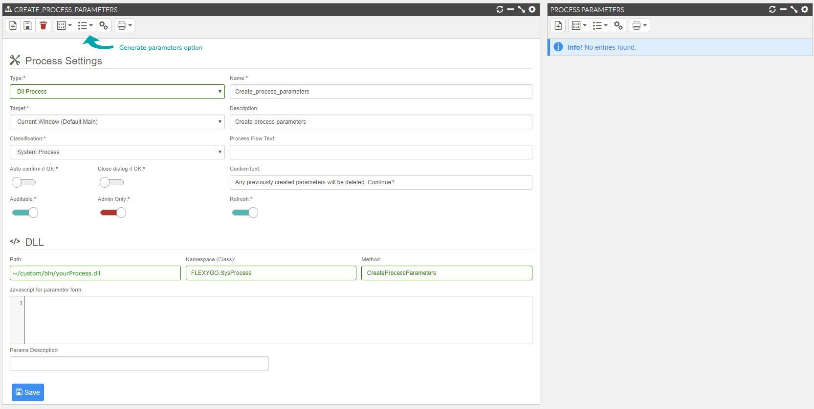
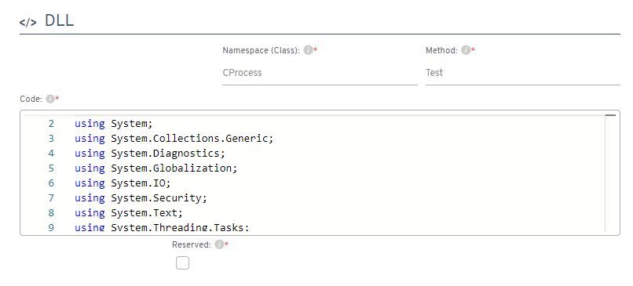

# Custom DLL

In some cases it's necessary to program functionalities which **flexygo** doesn't have. For this, it's possible to customize our own DLLs. It's necessary:

1.  Create a new C# class library for **.NET 9** (`net9.0`, the same version as the **flexygo** libraries), for example with `dotnet new classlib -f net9.0`.
2.  Add a reference to the **Flexygo.Library** NuGet package, which brings the **flexygo** libraries (Table 1). Use the same **flexygo** version as the application:

     ```xml
     <ItemGroup>
       <PackageReference Include="Flexygo.Library" Version="x.x.x" />
     </ItemGroup>
     ```

| Table 1. Some **flexygo** libraries included in the package |     |     |
| --- | --- | --- |
| flxDataManager | flxEntity | flxGlobals |
| flxLocalization | flxMail | flxObjectConfig |
| flxSession | flxSettings | flxUtilities |

3.  See the C# sample code:

     <fh-modal class="button" modal_id="fhmodal_insert" modal_title="Insert object function">Insert, Update And Delete object function</fh-modal>

     <fh-modal class="button" modal_id="fhmodal_process" modal_title="Process with parameters">Object Process with parameters</fh-modal>

     <fh-modal class="button" modal_id="fhmodal_process_no_params" modal_title="Process without parameters">Object Process without parameters</fh-modal>

     <fh-modal class="button" modal_id="fhmodal_collection" modal_title="Collection Process with parameters">Collection Process with parameters *</fh-modal>

     <fh-modal class="button" modal_id="fhmodal_collection_no_params" modal_title="Collection Process without parameters">Collection Process without parameters *</fh-modal>

     <fh-modal class="button" modal_id="fhmodal_load" modal_title="Load Object/Process/Report or Change Property">Load Object or Change Property</fh-modal>

     Methods must be `public static`. **flexygo** passes each process parameter by name, as well as `Entity` and `Ret`.
     {: .flx-info-card }

     Don't forget to configure Unique Identifier in object configuration
     {: .flx-warning-card }
    
4.  Compile the custom DLL and copy it to the `custom/bin` folder of the **Backend** (in the process, the file is set as `~/custom/bin/MyLibrary.dll`; `~` is the Backend folder).
5.  Configure your process inside **flexygo**, visualize image (Image 1.)
    

    

## Custom C\#

Embedded C# processes serve the same purpose as custom DLL processes.

References to libraries and the code of the process are directly inserted into the flexygo form (Image 2.)



When you save your C# process in flexygo, it is compiled to check for any errors.

To start debugging a C# process:

1.  Turn on the **DebugProcesses** setting: control panel → **Environment** area → *Settings*, *System* group (in the flexy2022 skin: *Admin Work Area > Environment > Settings*).
2.  To set a breakpoint at a specific location in your C# code, you can insert:
```csharp
System.Diagnostics.Debugger.Break();
```

This will open the generated C# code in Visual Studio, enabling you to debug the process.


```csharp { #fhmodal_process }
/// <summary>
/// Sample object process executed from object with params
/// </summary>
/// <param name="Entity">The entity.</param>
/// <param name="Ret">Returns a Process Helper.</param>
/// <param name="Param1">Sample string param</param>
/// <param name="Param2">Sample integer param</param>
/// <returns><c>true</c> if no error, <c>false</c> otherwise.</returns>
public static bool SampleUserProcessWithParams(EntityObject Entity, ref ProcessHelper Ret, string Param1, int Param2)
{
    try
    {
        // Do something

        Ret.Success = true;
        Ret.SuccessMessage = "Process finished";
        return true;
    }
    catch (Exception ex)
    {
        Ret.Success = false;
        Ret.LastException = ex;
        return false;
    }
}
```
```csharp { #fhmodal_insert }
using System;
using System.Data;
using FLEXYGO.Exceptions;
using FLEXYGO.Objects;
using FLEXYGO.Objects.Settings;
using static FLEXYGO.Processing.ProcessManager;

namespace MyCompany.Processes
{
    public class SampleDataProcesses
    {
        /// <summary>
        /// Insert new object
        /// </summary>
        /// <param name="Entity">User Entity object with all info</param>
        /// <param name="Ret">ProcessHelper for returning results</param>
        public static bool InsertObj(EntityObject Entity, ref ProcessHelper Ret)
        {
            try
            {
                if (!Entity.CanInsert)
                {
                    Ret.LastException = new LocalizedException("You do Not have enough credentials to insert this Object.");
                    return false;
                }

                // Do something here before insert

                if (Entity.InsertProcess(Entity.TableName, ObjectSettings.eUpdateType.Standard, ""))
                {
                    // Do something here after insert

                    Ret.Success = true;
                    return true;
                }
                else
                {
                    Ret.Success = false;
                    Ret.LastException = Entity.LastException;
                    return false;
                }
            }
            catch (Exception ex)
            {
                Ret.Success = false;
                Ret.LastException = ex;
                return false;
            }
        }

        public static bool UpdateObj(EntityObject Entity, ref ProcessHelper Ret)
        {
            try
            {
                if (!Entity.CanUpdate)
                {
                    Ret.LastException = new LocalizedException("You do Not have enough credentials to update this Object.");
                    return false;
                }

                DataTable lTabla = Entity.GetData.Tables[0].GetChanges();

                // string OldValue = lTabla.Rows[0]["my_data_field", DataRowVersion.Original].ToString();
                // string NewValue = lTabla.Rows[0]["my_data_field", DataRowVersion.Current].ToString();
                // Use this syntax to compare old and new values

                // Do something here before update

                if (Entity.UpdateProcess(ObjectSettings.eUpdateType.Standard, ""))
                {
                    // Do something here after update

                    Ret.Success = true;
                    return true;
                }
                else
                {
                    Ret.Success = false;
                    Ret.LastException = Entity.LastException;
                    return false;
                }
            }
            catch (Exception ex)
            {
                Ret.Success = false;
                Ret.LastException = ex;
                return false;
            }
        }

        public static bool DeleteObj(EntityObject Entity, ref ProcessHelper Ret)
        {
            try
            {
                if (!Entity.CanDelete)
                {
                    Ret.LastException = new LocalizedException("You do Not have enough credentials to delete this Object.");
                    return false;
                }

                // Do something here before delete

                if (Entity.DeleteProcess(Entity.TableName, ObjectSettings.eUpdateType.Standard, ""))
                {
                    // Do something here after delete

                    Ret.Success = true;
                    return true;
                }
                else
                {
                    Ret.Success = false;
                    Ret.LastException = Entity.LastException;
                    return false;
                }
            }
            catch (Exception ex)
            {
                Ret.Success = false;
                Ret.LastException = ex;
                return false;
            }
        }
    }
}
```
```csharp { #fhmodal_collection_no_params }
using System;
using FLEXYGO.Objects;
using static FLEXYGO.Processing.ProcessManager;

namespace MyCompany.Processes
{
    public class SampleUserProcesses
    {
        /// <summary>
        /// Sample collection process executed from collection
        /// </summary>
        /// <param name="Entity">The entity collection.</param>
        /// <param name="Ret">Returns a Process Helper.</param>
        /// <returns><c>true</c> if no error, <c>false</c> otherwise.</returns>
        public static bool SampleUserProcess(EntityCollection Entity, ref ProcessHelper Ret)
        {
            try
            {
                foreach (EntityObject obj in Entity)
                {
                    // Do something
                }

                Ret.Success = true;
                return true;
            }
            catch (Exception ex)
            {
                Ret.Success = false;
                Ret.LastException = ex;
                return false;
            }
        }
    }
}
```
```csharp { #fhmodal_collection }
/// <summary>
/// Sample collection process executed from collection with params
/// </summary>
/// <param name="Entity">The entity collection.</param>
/// <param name="Ret">Returns a Process Helper.</param>
/// <param name="Param1">Sample string param</param>
/// <param name="Param2">Sample integer param</param>
/// <returns><c>true</c> if no error, <c>false</c> otherwise.</returns>
public static bool SampleUserProcessWithParams(EntityCollection Entity, ref ProcessHelper Ret, string Param1, int Param2)
{
    try
    {
        foreach (EntityObject obj in Entity)
        {
            // Do something
        }

        Ret.Success = true;
        return true;
    }
    catch (Exception ex)
    {
        Ret.Success = false;
        Ret.LastException = ex;
        return false;
    }
}
```
```csharp { #fhmodal_load }
/// <summary>
/// Sample load object/change property custom process.
/// </summary>
/// <param name="aSender">FormSender with objectname, processname or reportname, entity if proceeded and current form values.</param>
/// <param name="Ret">Returns a Process Helper.</param>
/// <returns>List of FormAction with actions to do with properties.</returns>
public static List<FormAction> SampleLoadProcess(FormSender aSender, ref ProcessHelper Ret)
{
    try
    {
        // Define new action after load/change
        FormAction action = new FormAction();
        action.PropertyName = "OriginId";

        // Set new value to this property
        action.changeValue = true;
        action.newValue = "1";

        // Change default class to one property
        action.changeClass = true;
        action.newClass = "box-danger";

        // Define if property is required
        action.changeRequired = true;
        action.newRequired = true;

        // Define if property is enabled
        action.changeEnabled = true;
        action.newEnabled = false;

        // Define current visibility to this property
        action.changeVisibility = true;
        action.newVisibility = true;

        // Set new sql for this property
        action.changeSQL = true;
        action.newSQL = "select ObjectName from objects where objectname like '%docu%'";

        // Append to afterload action list
        List<FormAction> actionResult = new List<FormAction>();
        actionResult.Add(action);

        Ret.Success = true;
        return actionResult;
    }
    catch (Exception ex)
    {
        Ret.Success = false;
        Ret.LastException = ex;
        return null;
    }
}
```
```csharp { #fhmodal_process_no_params }
/// <summary>
/// Sample object process executed from object without params
/// </summary>
/// <param name="Entity">The entity.</param>
/// <param name="Ret">Returns a Process Helper.</param>
/// <returns><c>true</c> if no error, <c>false</c> otherwise.</returns>
public static bool SampleUserProcess(EntityObject Entity, ref ProcessHelper Ret)
{
    try
    {
        // Do something

        Ret.Success = true;
        Ret.SuccessMessage = "Process finished";
        return true;
    }
    catch (Exception ex)
    {
        Ret.Success = false;
        Ret.LastException = ex;
        return false;
    }
}
```
