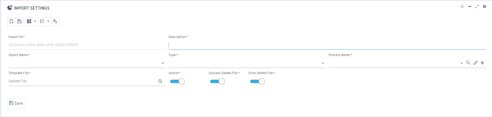
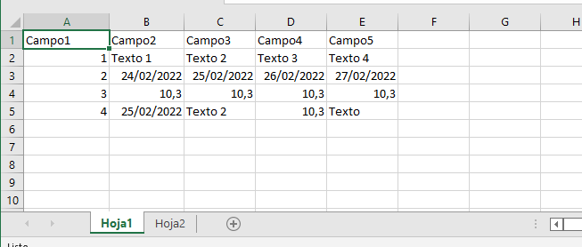
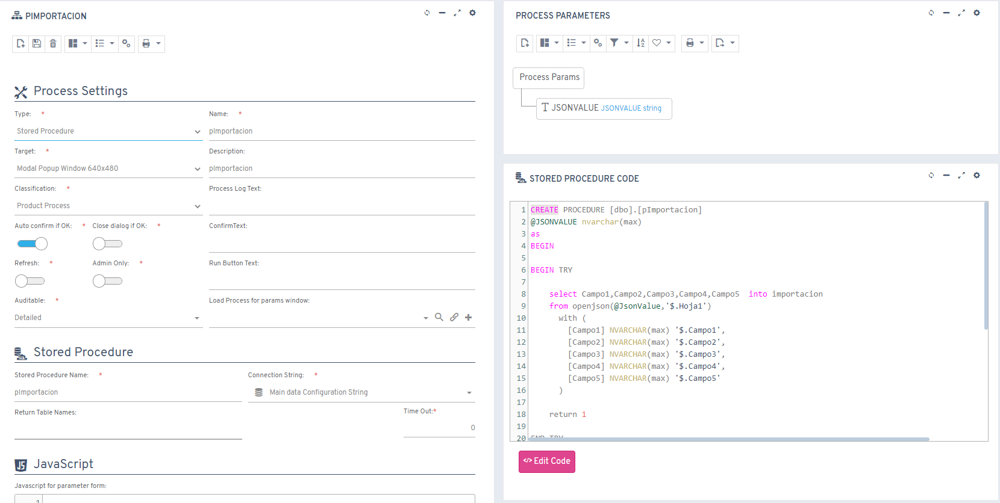
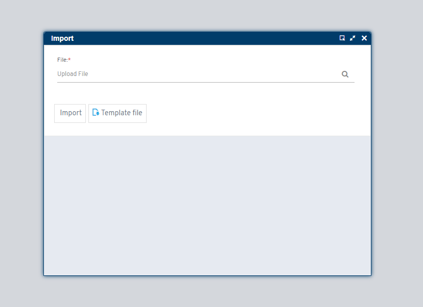

# Importaciones

Las importaciones nos permiten transferir información desde archivos al sistema, por ejemplo, desde un archivo de Excel. Se configura en la herramienta *Imports* del área **Other tools** del [panel de control](../Administration/ControlPanel.md) (en la skin flexy2022: *Admin Work Area > Other Tools > Imports*) o simplemente haga <flx-navbutton class="link" type="openPage" pagetypeid="list" objectname="sysImportSettings">clic aquí</flx-navbutton>.

## Creando configuración

* Descripción
* Nombre del Objeto
* Tipo: Excel solo por ahora.
* Nombre del Proceso: Especificaremos el proceso que se ejecutará después de procesar el archivo a importar, es responsable de insertar/eliminar/actualizar los datos. El   proceso, con solo 1 parámetro **@JSONVALUE**, contiene toda la información del archivo.
* Archivo de Plantilla: Es el archivo que sirve como plantilla para el usuario, el archivo se almacena en ~/custom/imports/templates/{{ImportId}}
* Activo: Habilitar/Deshabilitar la configuración de importación.
* Eliminar Archivo Exitoso
    *  Habilitado: Cuando la importación se ejecuta con éxito, el archivo importado se elimina.
    *  Deshabilitado: Cuando la importación se ejecuta con éxito, el archivo importado se almacena en ~/custom/imports/{{ImportId}}.
* Eliminar Archivo Erróneo
    *  Habilitado: Cuando la importación falla, el archivo importado se elimina.
    *  Deshabilitado: Cuando la importación falla, el archivo importado se almacena en ~/custom/imports/{{ImportId}}.




## Excel

El formato que deben seguir los archivos tipo Excel es como se muestra en la siguiente imagen.

La primera fila debe ser los nombres de las columnas, no pueden estar vacías, no pueden contener caracteres especiales, espacios ni la letra ñ. En cualquier caso, el sistema reemplazará cualquier carácter no aceptado.

Se pueden agregar más de una hoja como en el ejemplo, el nombre de las hojas sigue los mismos criterios que las columnas.



## Ejemplo de Proceso

1.  Agregarlo al repositorio de procesos de flexygo: panel de control → área **Logic and rules** → *DB Stored Procedures* o *Server Dll* (en la skin flexy2022: *Admin Work Area > Logic and Rules*).
    

    
<fh-modal class="button" modal_id="fhmodal_stored" modal_title="Proceso almacenado">Ejemplo Almacenado</fh-modal>
<fh-modal class="button" modal_id="fhmodal_dll" modal_title="Dll">Ejemplo DLL</fh-modal>
<fh-modal class="button" modal_id="fhmodal_json" modal_title="Json">Ejemplo de valor Json</fh-modal>

## Ejecutar importación

La importación se ejecuta desde la entrada **Importar** del menú lateral (en la skin flexy2022, desde el menú superior **Tools > Import**): salen los objetos con alguna configuración activa y, dentro de cada uno, sus configuraciones.

Cada configuración ejecuta el proceso **sysImportsSettings** con su `ImportId` como valor por defecto. Si no hay ninguna configuración, la entrada muestra *No import settings found.*

En la ventana del proceso aparece un botón para descargar la plantilla del archivo que se ha colocado previamente en la creación de la configuración.



```sql { #fhmodal_stored }
CREATE PROCEDURE [dbo].[pImportacion]
@JSONVALUE nvarchar(max)
as
BEGIN

BEGIN TRY 

	select Campo1,Campo2,Campo3,Campo4,Campo5  into importacion
	from openjson(@JsonValue,'$.Hoja1')
	  with (
		[Campo1] NVARCHAR(max) '$.Campo1',
		[Campo2] NVARCHAR(max) '$.Campo2',
		[Campo3] NVARCHAR(max) '$.Campo3',
		[Campo4] NVARCHAR(max) '$.Campo4',
		[Campo5] NVARCHAR(max) '$.Campo5'
	  )
      
    select ...
	from openjson(@JsonValue,'$.Hoja2')
	  with (
		...
	  )

	return 1

END TRY
BEGIN CATCH

      IF @@TRANCOUNT >0 BEGIN
            ROLLBACK TRAN
      END

      DECLARE @CatchError NVARCHAR(MAX)

      SET @CatchError=dbo.funPrintError(ERROR_MESSAGE(),ERROR_NUMBER(),ERROR_PROCEDURE(),@@PROCID ,ERROR_LINE())

      RAISERROR(@CatchError,12,1)

      RETURN 0

END CATCH

END
```

```csharp { #fhmodal_dll }
using System;
using FLEXYGO.Objects;
using FLEXYGO.Objects.Settings;
using Newtonsoft.Json.Linq;
using static FLEXYGO.Processing.ProcessManager;

public static bool Importacion(EntityObject Entity, string JSONVALUE, ref ProcessHelper Ret)
{
    try
    {
        JObject table = JObject.Parse(JSONVALUE);

        foreach (JObject row in table["Hoja1"])
        {
            EntityObject importacionObj = new EntityObject("Importacion", Ret.ConfToken);
            importacionObj["Campo1"] = (string)row["Campo1"];
            importacionObj["Campo2"] = (string)row["Campo2"];
            importacionObj["Campo3"] = (string)row["Campo3"];
            importacionObj["Campo4"] = (string)row["Campo4"];
            importacionObj["Campo5"] = (string)row["Campo5"];

            importacionObj.InsertProcess(importacionObj.TableName, ObjectSettings.eUpdateType.Standard, "");
        }

        foreach (JObject row in table["Hoja2"])
        {
            // ...
        }

        Ret.Success = true;
        return Ret.Success;
    }
    catch (Exception ex)
    {
        Ret.Success = false;
        Ret.LastException = ex;
        return false;
    }
}
```

```json { #fhmodal_json }
{
    "Hoja1": [
        {
            "Campo1": "1",
            "Campo2": "Texto 1",
            "Campo3": "Texto 2",
            "Campo4": "Texto 3",
            "Campo5": "Texto 4"
        },
        {
            "Campo1": "2",
            "Campo2": "24/02/2022",
            "Campo3": "25/02/2022",
            "Campo4": "26/02/2022",
            "Campo5": "27/02/2022"
        },
        {
            "Campo1": "3",
            "Campo2": "10.3",
            "Campo3": "10.3",
            "Campo4": "10.3",
            "Campo5": "10.3"
        },
        {
            "Campo1": "4",
            "Campo2": "25/02/2022",
            "Campo3": "Texto 2",
            "Campo4": "10.3",
            "Campo5": "Texto"
        }
    ],
    "Hoja2": [
        {
            "Campo1": "1",
            "Campo2": "Texto 1",
            "Campo3": "Texto 2",
            "Campo4": "Texto 3",
            "Campo5": "Texto 4"
        },
        {
            "Campo1": "2",
            "Campo2": "24/02/2022",
            "Campo3": "25/02/2022",
            "Campo4": "26/02/2022",
            "Campo5": "27/02/2022"
        },
        {
            "Campo1": "3",
            "Campo2": "10.3",
            "Campo3": "10.3",
            "Campo4": "10.3",
            "Campo5": "10.3"
        },
        {
            "Campo1": "4",
            "Campo2": "25/02/2022",
            "Campo3": "Texto 2",
            "Campo4": "10.3",
            "Campo5": "Texto"
        }
    ]
}
```