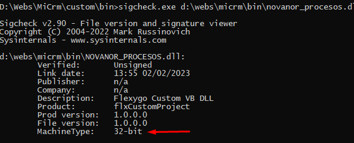
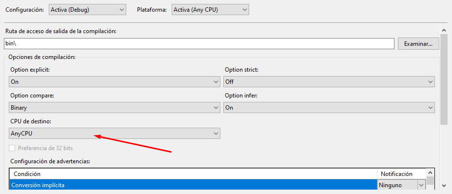

# I've generated a DLL and Flexygo doesn't recognize it

When setting up the parameters for the function whose process we want to add to the Flexygo environment, we get an error saying the DLL can't be loaded because its format isn't recognized.

## Check the framework and the location

Starting with version 10, processes run in the Backend, which runs on .NET 9. The DLL must be built for .NET 9 (`<TargetFramework>net9.0</TargetFramework>` in the `.csproj`). A DLL built for .NET Framework doesn't load, whether it's built as `AnyCPU` or `x86`.

Copy the DLL to the Backend folder. In the process's file path, `~` is the Backend folder (for example, `~/bin/MyLibrary.dll`); if the DLL isn't in `bin`, Flexygo looks for it in the root of that folder.

## Check the platform

Another possible reason is that it wasn't compiled for all CPUs: it was built as x86 (32-bit), while Flexygo's application pool is configured as incompatible with 32-bit.

There is a tool, `sigcheck.exe`, that gives us that information.

### Solution

The solution is to recompile the DLL in the right format, i.e. `AnyCPU` instead of `x86`:

