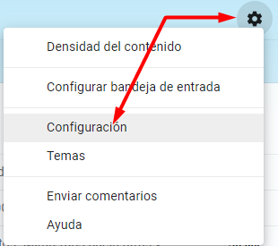
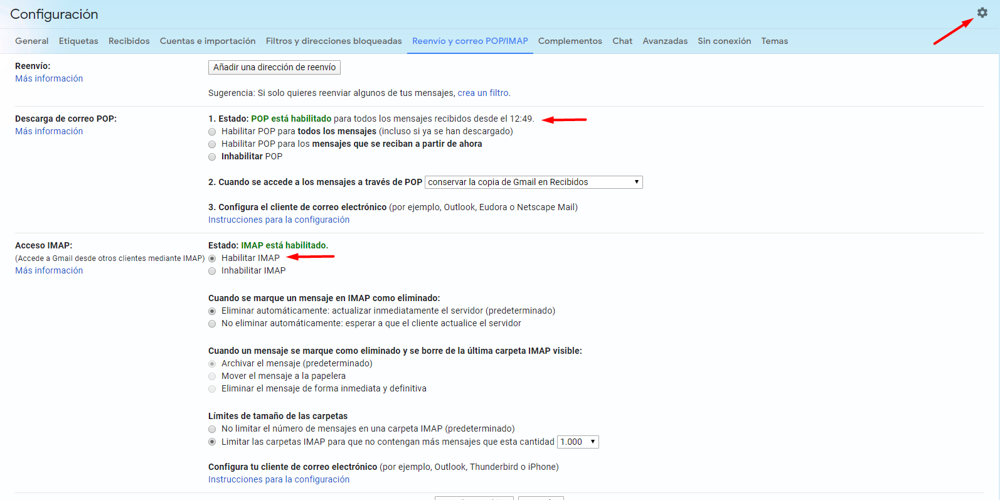
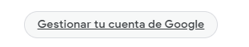
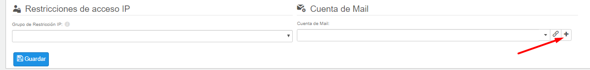
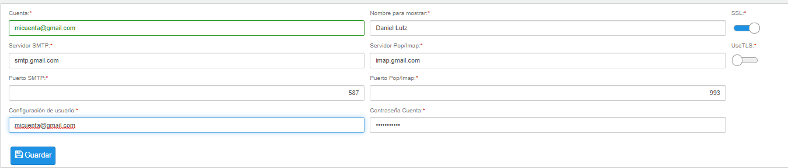
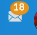

# Cómo configurar el buzón de correos con una cuenta de Gmail

## Paso 1. Habilitar POP e IMAP

Entra en Gmail, en el apartado de configuración, para habilitar POP e IMAP.

## Paso 2. Prepara el acceso de Flexygo a la cuenta

Google ya no permite el acceso de aplicaciones poco seguras con el usuario y la contraseña de la cuenta. Tienes dos opciones:

* **Contraseña de aplicación:** accede a tu perfil de Google, entra en el apartado de seguridad, activa la verificación en dos pasos y genera una contraseña de aplicación. Es la contraseña que indicarás en Flexygo, con el tipo de autenticación básica.

* **OAuth 2.0:** Flexygo también admite cuentas de Google con autenticación *Bearer token*, sin guardar ninguna contraseña. Consulta [¿Sabías que ahora puedes configurar las cuentas de correo y Web Mail de las aplicaciones con el protocolo OAuth 2.0?](../3DidYouKnow/OAuthMailAccounts.md).

## Paso 3. Configura la cuenta de usuario de Flexygo

Entra en la ficha del usuario de Flexygo, en el apartado de cuenta de email, añade una nueva, créala y guarda los cambios del usuario indicando las credenciales de acceso (la contraseña de aplicación, si usas autenticación básica).

## Paso 4. Recarga la caché y la aplicación

Flexygo conectará con tu bandeja de correo y podrás gestionarla desde la plataforma.

## Véase también

* [Sincronización con la agenda de mi cuenta de correo](https://help.flexygo.com/support/solutions/articles/154000130134-sincronizaci%C3%B3n-con-la-agenda-de-mi-cuenta-de-correo)
* [Configuración de notificaciones](https://help.flexygo.com/support/solutions/articles/154000215685-configuraci%C3%B3n-de-notificaciones)
