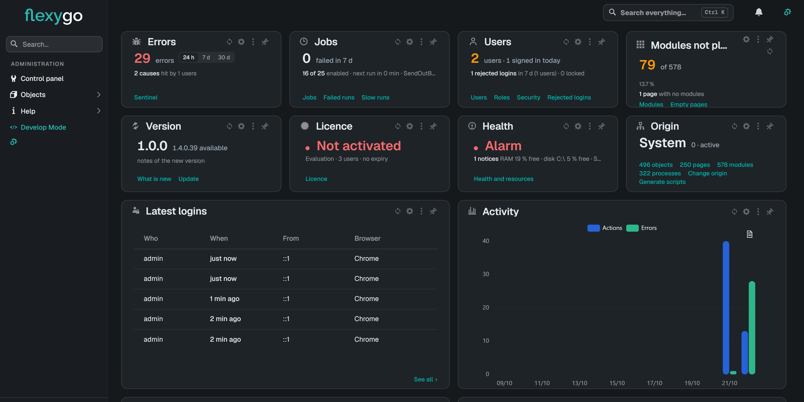

# Version 10.0

Try the 2026 skin, with responsive side navigation and light and dark modes.

## New features

### Skins

- **Introducing the 2026 skin, with adaptable side navigation and light and dark modes.** You can collapse the sidebar and access alerts and your profile from the new interface. It also includes the Ctrl+K shortcut and keeps the previous skin available.

    
- **The 2026 skin configuration is preserved when publishing database scripts.** Publishing preserves the skin's appearance, menus, dashboards, and pages. Publications from an empty database also include its elements.
- **Customize account page resources from your product.** You can customize styles, scripts, and icons at different levels. This lets you adjust the login, registration, and password recovery pages.
- **You can switch between light, dark, and system themes.** The interface and some built-in elements adapt their appearance to the selected theme. If you choose the system theme, Flexygo follows the device's appearance preference.
- **You can use custom CSS variables in your styles.** This expands the options for customizing the application's appearance. Style loading also no longer fails if a style variable is missing.

### Artificial Intelligence

- **New GPT models are added for the artificial intelligence features.** The list of models available for configuring artificial intelligence is updated. You can choose which models to use in these settings.
- **The WebAPI provides an AI description of the sysOfflineApp object.** Developers can retrieve this description along with the object's information through the WebAPI. This makes it easier to learn about the object when working with the mobile application.

### Charts

- **ECharts displays error messages in English and restores the chart when you fix the configuration.** If the chart cannot be rendered, a message appears in English. When you fix the configuration, the chart is displayed again without reloading the page.
- **ECharts configuration preserves query options and lets you edit its settings without losing the rest.** The form includes ECharts-specific fields, and HTML modules no longer display options that do not apply to them. When you change the chart type, query options are preserved, and you can modify nested settings without overwriting the others. The module loads even if it has no associated configuration; JSON options remain available for the components that use them.
- **Configure chart series, labels, tooltips, and reference lines.** The settings let you change the value format, add indicators, and choose the label position. In pie charts, you can highlight a specific value and limit labels for small slices; reference lines can indicate the average or a fixed value. In doughnut charts, you can display the sum, average, maximum, or count in the center, with or without the user culture’s number format.
- **Statistics cards display trends, empty states, and numbers with a thousands separator.** You can choose different display modes and semantic colors. Trends and targets are enabled when you include their data.
- **Chart themes adapt to Flexygo’s appearance and let you customize their style.** You can choose a monochrome theme or one inspired by shadcn, and adjust aspects such as spacing, labels, and series shapes. Colors adapt to the visual theme and light or dark mode, with contrast to make labels easier to read. Theme changes are reflected without reloading the page, and each module keeps its own colors; the Flexygo theme also has a cleaner grid.
- **The new ECharts module expands display options and works alongside the existing chart module.** It includes line, horizontal bar, radar, bubble, pie, doughnut, semicircular, and polar area charts. You can also combine series types in the same chart. Bubble and radar charts correctly display data with zero or negative values, or no variation.
- **You can synchronize legends across ECharts charts and display charts using data from a list.** Synchronization applies to charts in the same group. Charts included in lists use data that has already been loaded.
- **ECharts charts adjust their size when displayed, when a tab is opened, or when the module is resized.** This keeps them at the correct size, even when they are initialized while hidden or collapsed.

### Configuration

- **Maintenance mode changes take effect immediately and let you display a notification while the application is unavailable.** Administrators can turn the mode on or off from the administration panel. Open pages update to reflect the new status, and people can return to their page when maintenance ends.
- **You can configure the separator used when exporting CSV files.** Adjust this option to adapt the format of exported files to each application's needs.
- **Configure offline applications from a screen organized into sections.** The screen brings together objects, menus, pages, code, resources, and synchronization, and lets you view the synchronization history. It also includes an emulator to preview the application on a mobile device.
- **Refresh the screens of all connected users or select specific sessions.** You can find this action in the version information menu. Search for and select users to send them the update.
- **View process configuration and status in read-only screens.** Configuration is shown separately for the application and the server. You can also review the status of processes, the database, and available resources.
- **Open the page configuration from a button beside the module organization tool.** The option is available in development mode and follows the current page when you navigate to another one, without rebuilding the header.
- **Configure the application with values specific to each environment.** You can load and save settings for environments such as development without mixing them with the application's general configuration.
- **Publish a database from the configurator.** The tool lets you do this directly from the configuration process, without leaving it.

### Deployment

- **Export large projects with control over their content, template, and source.** Export supports files larger than 2 GB and checks the available space before starting. From the administration tools, authorized users can choose custom folders and files; document and image repositories and other large files are excluded by default. You can also modify the template or restore the values from the installed product, and the window shows the selected template and version. The wizard prepares a ZIP file, shows progress, and lets you view the elapsed time; it also logs exports and errors, warns if the source is reserved, and suggests an available destination.
- **File operations work between separate frontend and backend servers.** The application can transfer files between the two servers during upload, download, and deletion. This support also covers access through impersonation.
- **You can integrate RDS into Docker deployments and update the configuration.** The integration expands the available deployment options. The update process lets you apply configuration changes.
- **Publish databases from the configurator, even if they are empty or have no definition file.** An error when updating databases in Docker environments is also fixed.
- **You can deploy the database and generate Flexygo images with Docker.** The files needed to deploy the database and a configuration to start the application components together are included.

### Development Tools

- **External objects can be used in more areas of Flexygo and retain more options when projects are exported.** You can query and update data through REST services and use these objects in lists, forms, calendars, Kanban boards, and HTML reports. Lists support pagination, forms show the source of selection fields, and when records are inserted, the key generated by the service is retrieved. You can also query totals and measures, display data in dashboards, and preserve modified settings when exporting, except for environment-specific settings.
- **Add sliders with a visible value to your applications.** The value is confirmed when you release the control, but you can also respond while it is being dragged. It is available among the shared elements.
- **Create tabbed interfaces using the new shared controls.** You can link tabs and their content using a value. This lets you manage which section stays active.
- **Create, organize, and customize tabs from the designer ribbon.** The ribbon appears even if the object does not yet have tabs, and lets you add the first tab, rename existing ones, choose their icons, or delete them. Options are managed from the tab itself, without taking up the design area.
- **Configure properties from a larger quick settings panel.** When editing a property, the panel opens next to the object bank, and you can close it without reopening the navigation. Fields have more space, and scrolling stays within the panel.
- **Browse and select icons using a visual explorer.** You can browse libraries and categories and preview icons before choosing them.
- **Define links to records in SQL list templates.** The template can build links even when rows contain different object types. Column sorting and resizing are maintained, without relying on automatic link detection.
- **The WebAPI getView operation applies the appropriate default values.** When you query a view, its correct default values are returned.
- **View errors in a filterable, paginated list with expandable details.** You can combine filters to narrow down results and view the options available for each criterion. Access from the home dashboard displays errors from the last 24 hours.
- **Create guided tours by highlighting elements on each screen.** The editor groups steps by screen, lets you reorder them, and shows the selected element before saving. You can customize the welcome card with an image or Flexygo branding, which can be displayed with a typing animation.
- **The 2026 skin adds tabs to processes and reports, object wizards, and document and image managers.** Image managers let you display content as a gallery or a list. Tabs extend the organization of properties beyond object editing.
- **Choose the source for the new skin and close the dialog without changing it.** The current source is highlighted, and options are distinguished with a colored badge. Sources fit in the dialog and are displayed by name; the addon is shown separately. The active label updates when you change the source, without reloading the screen.
- **In development mode, a module’s menu provides shortcuts to its object configuration.** The options are grouped at the end of the menu and are not displayed in the classic skin.
- **Organize a page’s modules directly from the page itself.** You can move modules between zones, choose a different layout, and create modules without going to the manager. Before saving, a warning appears if the change leaves positions unassigned or if the page comes from a distribution and will revert when refreshed.
- **Integrate Flexygo with other systems using webhooks.** Developers can use this feature to connect their applications with other systems.
- **Change package optimization from the development menu.** You can toggle this setting without leaving the menu.
- **Developers can subscribe to DataManager SQL informational messages.** This option lets external code that uses DataManager receive those messages.
- **Developers can now make GET requests using flexygo.ajax.get.** This function provides access to operations that require this type of request. The version check used by the footer also works again.
- **Default values are applied to friendly URLs.** These addresses now have default values for resolution.

### Document and Image Management

- **Upload files in parts and check their progress from the upload and edit controls.** The feature is available in upload controls and file fields. During the operation, the maximum allowed size is reported and upload messages are displayed in several languages.
- **Manage documents and images from Flexygo, with an improved display in the 2026 skin.** The managers are available for Flexygo and ERP and correctly display documents, images, and gallery views. Added text is also translated, and changes are included in Crystal Reports report generation.
- **Proxy-based file management supports uploads and downloads with the correct context and paths.** Uploads through the proxy prevent files from being incorrectly overwritten and preserve the user’s identity, the document name, and its path. If the application and service are on the same server, the proxy is not used; when they are on different servers, downloads work correctly. The option to delete the file after downloading it is also respected.

### Email

- **The webmail integration lets you renew your access credentials.** A notification lets you manage authentication when needed. The credential renewal process is also fixed.

### Filters

- **In the 2026 skin, filters appear as editable chips and are applied automatically when their values change.** Each chip shows the filter name and its value; you can open it to edit it or clear the filters from the row. Results update when you finish typing or leave the row, and the update waits while a dropdown is open. You can also change a checkbox by clicking anywhere on its chip, and the search keeps an appearance consistent with the other controls.

### Forms

- **View records newly created by other users in lists without reloading the page.** New rows appear when you request to show them, and your permissions and filters are applied before they are displayed. Notifications show the visible rows and stay next to the relevant list, even if its header is not shown. Dismissing a notification preserves rows already displayed, and other lists are not updated by that notification.

### Home

- **Customize the layout of modules and view a refreshed home dashboard in skin 2026.** On each page, you can reorder, pin, and collapse modules, or restore the layout defined by the administrator. The dashboard brings together cards with information about errors, tasks, users, the license, and activity, and displays the license expiry date correctly.

### Installation

- **Unattended installation can be completed automatically when the application service starts.** You can choose whether databases are created, updated, or reused, and specify the project name and administrator password. If a step fails, the error is reported and setup is not marked as complete.
- **The setup wizard dynamically configures each active data connection that is still pending.** A step is added for each connection that needs configuration. This means the wizard adapts to the connections defined for each installation.
- **The configurator lets you prepare the connection and check database deployment progress.** It displays the connection when the database is already configured and reports the deployment stages. It also lets you deploy in development environments.
- **You can start installing a database from the Configurator.** The database setup starts from the Flexygo Configurator itself.
- **You can install, update and configure Flexygo from the setup wizard.** The initial screens bring these tasks together and let you create the database. The flow also guides you through project and email setup, and includes user registration.

### Interface

- **In the 2026 skin, you can edit values directly in lists and add rows from the list or form.** Each row is saved when you leave it and keeps its record actions menu. The experience adapts to phones and tablets and is available in light and dark modes; the flexy2022 skin is unchanged.
- **From the 2026 control panel, you can view and edit the home page for each profile.** Each profile has a schematic preview based on its configuration. The preview does not run the page or save changes.
- **New calendars are introduced with annual view, filters and range selection.** They include a legend and options for configuring overlap and working hours. In annual view, you can view the records for each day, and changes made by other people appear in monthly view; markers remain readable in different display modes.
- **The new interface includes administration screens and updated navigation.** It includes administration for users, roles, properties, processes, settings and other items. Navigation adds quick access, a collapsible sidebar and a resizable panel.
- **Administrator and guest profiles now have avatars, and the profile photo appears in the footer and header.** The profile image is shared between both skins, including the classic skin. Initials and pop-up messages are also easier to read.
- **Administrators can organize and resize modules directly on a free-layout page.** They can enable this layout while keeping the current arrangement, drag modules, and adjust their size. Changes can be saved or discarded; when leaving design mode without saving, the previous layout can be restored. On narrow screens, modules are displayed in a single column and keep their reading order.
- **Developers can open global search settings from the palette.** The option appears at the bottom of the palette and lets you return to the generic filters manager to configure the search. It is available only in development mode.
- **When organizing a page, you can drag modules without headers and open settings from the organization tools.** Modules without headers display a drag strip while this mode is active. Settings open in a side panel, leaving the content you are organizing visible. If you switch pages, the mode closes and warns you about unsaved changes; reloading the same page rebuilds the layout.
- **You can display search results over the page without replacing its content.** Palette mode is optional and groups results by criteria, with their title, description, and destination. Search responds faster and avoids sending the browser data it does not need to display.
- **Indicator cards offer optional descriptions, variations, and trends, with a more consistent presentation.** When displayed within a list, they avoid showing a duplicate frame and retain their content and layout. Cards in the same row have the same width and height, aligning values and footers even when some include extra information.
- **You can access Flexygo pages through friendly URLs.** This new way of resolving addresses is available in the Flexygo core.

### Licenses

- **The licenses page identifies Flexygo Core as a product.** When viewing licenses, Flexygo Core appears as an available product type.
- **You can view license information on a dedicated page and see its status in a watermark.** The page brings together the license details, while the watermark lets you identify its status as you use the application.

### Login

- **You can configure how many failed attempts trigger an account lockout and how long it lasts.** Adjust the attempt limit and lockout duration in the settings to tailor this protection to your application’s needs.
- **You can view and disable the news displayed on the login page.** This option lets you decide whether news is displayed when accessing the application.
- **You can sign in with Cl@ve, with improvements to authentication and its error messages.** Authentication responses are handled correctly, and the registration link and loading during sign-in have been adjusted. Some login and password-change errors are also displayed more clearly.
- **You can sign in with LDAP.** LDAP authentication is integrated into the sign-in process and completes sign-in correctly. You can configure this option in the relevant settings.
- **You can sign in offline using SSO with ABH or LDAP.** This option lets you access the application with these SSO methods when there is no connection.
- **You can customize the login, password recovery, and registration pages.** Customization is also available on the authentication and password management pages of products created with Flexygo.
- **You can sign in with SSO.** The option is integrated into the sign-in process, and the screen does not offer SSO types that are unavailable.
- **You can manage access to your account, with improvements to retries and password recovery.** If the connection fails during sign-in, the application retries up to three times. You can also sign in with your new password after recovering it, and the login, registration, and recovery templates have been adjusted.
- **You can manage your account password through a dedicated process.** This option lets you manage your password from the account sign-in process.
- **You can protect sign-in with multifactor authentication.** Sign-in can require an additional verification step. The screens, messages, and emails related to this option have been adjusted, as have those for registration and password recovery.
- **You can create an account with an updated registration process.** The registration page, its translations, and associated emails have been updated.
- **You can sign in and keep your session active so you do not have to enter your credentials again.** Sign-in lets you use your email address and remember your session. Sign-out, cookies, and the handling of keys that differ by case have also been adjusted; the login screen has a refreshed design.

### Notifications

- **Define which records for each object should generate notifications.** You can set the conditions in the object configuration, alongside its notification events. They are combined with the security rules so that a notification is sent only when the record meets the specified conditions.
- **Receive real-time notifications about new records only when you can view the record.** The notification appears in the bottom-right corner and lets you open the record or its list. List filters and each recipient's permissions are checked; if several records of the same type are created, the notification is updated instead of accumulating. The connection for receiving live updates is also fixed.
- **Enable notifications to track insertions, modifications, and deletions in the objects you choose.** Each user receives notifications according to their own session and permissions. This lets you track changes to records in the objects you have configured.
- **The application includes a push notification service.** The service integrates with the application's offline features. You can use push notifications together with this mode of operation.

### Processes

- **Manage approvals from an inbox and configure decision rules and webhooks for each object.** Responsible users receive notifications and can review decisions in the inbox or on the record form; each person sees their own decisions and those of their roles, while administrators can view them all. Rules let you open decisions when saving, set deadlines, and escalate them. You can also send webhooks when saving or deleting, test them, and configure retries; decisions can be opened and resolved through the WebAPI.
- **The scheduler, agenda views, and kanban board show new cards without changing screens.** Cards appear in the cell, day, or column they belong in, respecting filters and permissions; in the kanban board, a notification helps you find them even if they are outside the visible area. When saved, the views update the changes and retain the rest of the content, including the selection and scroll position; new cards can be marked temporarily. Updating the planning calendar without leaving the view blank is available in the 2026 skin.
- **Administrators can start creating a guided tour from its record.** Creation opens the first step's page and the configuration panel, and indicates if the tour has no steps. Invitations appear on the page where the tour starts, and users' responses are retained.
- **Integrated processes and active modules are available in the application context.** Product developers can access this information from the context. The displayed colors are also adjusted, and errors are avoided when searching for paths to nonexistent processes.

### Reports

- **You can manage color themes and apply them to Flexygo charts, including embedded charts and ECharts.** Themes and options for editing their configuration are available. You can also view the theme of an embedded chart and choose one when generating its content.
- **You can generate Crystal reports from Flexygo projects.** You can add reports created with Crystal Reports to projects. Compatibility and location issues, as well as the loading of editor definitions, have also been corrected.
- **You can get PDF reports in base64 format from both Crystal Reports and DevExpress.** This format lets you use the generated PDF from other application functions. Parameter reading has also been corrected when opening a report from a link.
- **You can customize the DevExpress report designer and export reports to PDF without errors.** Customization lets you adapt the designer’s appearance and configuration. In addition, parameter reading is no longer case-sensitive.
- **You can design reports from Flexygo.** The application includes a designer for creating and editing reports. You can use it to prepare reports directly from Flexygo.

### Scheduled Tasks

- **Run scripts as scheduled tasks.** You can configure scripts to run as scheduled jobs. The application includes the configuration needed to define and run them.
- **You can disable scheduled tasks from the application settings.** Use this option when you want to prevent scheduled tasks from running in the application. Configure it in the application settings.

### Security

- **The 2026 skin includes a unified manager for viewing and managing the security of users, roles, faculties, and Flexygo elements.** It opens from the workspace or the relevant forms, with the element selected; when changing scope, the object is retained, and a new search clears the filter. The table shows the applied rules and the default policy, explains the order of roles, faculties, and users, and lets you compare permissions between objects and view conditions. You can create, modify, or delete rules, add conditions, block them, filter elements with rules, and remove all rules for a family; actions on roles and users include a preview. It also groups field permissions under their object, shows when a module condition determines access, and lets you manage navigation elements identified by their path. It is translated into the seven available languages; access to object security is not shown if the object has no connection, and the 2022 skin retains the previous screen.
- **You can control who runs each process, even if it is not linked to an object, and restrict it using SQL conditions.** Configure permissions for users, roles, and faculties from their security screens or from the process form. The condition is checked each time permission is validated and only allows execution if it returns 1 or true; if it is not met, the process is hidden from menus and toolbars. The rule is applied before object-specific permissions, and the security screen lets you review who can run each process and which condition restricts it.
- **Configure object security conditions by choosing a property, an operator, and a value.** The wizard shows the available properties and lets you select context values, without needing to remember table names or special markers. Before saving, you can test the condition and view the SQL that is run.

### Updater

- **Follow updater operations in progress, including those started by other administrators.** You can see who is running each operation and follow it in read-only mode if someone else started it. The wizard prevents incompatible operations from running at the same time, preserves progress, and lets you resume interrupted preparations from another tab.
- **Manage version updates, rollbacks, changes, and deletions from a guided wizard.** The wizard shows the progress and result of each operation and lets you return to earlier steps during the process. The deletion screen stays visible before the deletion starts, and an operation can finish starting even if the tab is closed.
- **View the history and results of operations, with access to their logs and errors.** You can open the results and logs of previous operations, view error details, and copy their technical information. You can clear the history without affecting an active operation, and the pending result remains available when you return to the versions page.
- **The 2026 skin shows the installed version and can notify you about available new features.** The version appears in the sidebar footer, and the notification is shown once per major and minor version. From the notification, you can open the update details in the version manager.
- **View update logs in real time with filters and search.** Advanced mode lets you filter by level and context, as well as search the logs. The progress and log display adapts to small screens.
- **Resolve configuration conflicts during an update and view application versions.** The conflict screen lets you review differences and choose a blank, previous, custom, or new-version initial value. You can also resume an interrupted update from where it stopped and expand the dialog to full screen.
- **View and manage available, installed, or deleted versions from the versions page.** You can see the status of application versions and manage the available versions from Flexygo. You can also update to the latest version and delete downloaded versions.
- **The updater searches for and compares packages correctly, including preview versions.** You can configure whether beta or preview versions are searched for. The updater recognizes their naming conventions and package versions to find and compare the options that correspond to the installed version.
- **The wizard guides you through updating Flexygo and shows its steps and progress.** The experience brings together the steps needed to update, check requirements, and view progress from the application. It also communicates the status, errors, and process settings more clearly.
- **Update the Flexygo database in Docker environments.** The process lets you keep the database up to date when Flexygo runs in Docker, and displays more descriptive messages if an error occurs. Session and redirection issues during the update have also been fixed.
- **Install and update the database from the configurator, with progress and error tracking.** Tasks can run in the background and show their progress and error details. You can also validate ERP databases and keep the required tasks running during maintenance mode.
- **The update process can update the database and use connection credentials.** Credential support allows updates on installations that need credentials to connect to the database. The process also supports returning to the application when finished and download paths on Linux.
- **Update Flexygo in Docker from the maintenance page.** The process displays information about the update and lets you manage installation maintenance. This option makes it easier to update Flexygo in Docker deployments.
- **The wizard checks for locks before continuing with the update.** The new check is included as a step in the update process, along with the requirements check.
- **You can update Flexygo from a wizard that guides you through the process and shows its progress.** The wizard guides you through the update and displays its different stages. This lets you follow progress from within the application.
- **You can follow version updates, changes, and deletions in real time.** Communication between Flexygo and the interface displays the progress of these operations as they run.
- **You can roll back an update if the process does not finish successfully.** The update process includes an option to roll back. This lets you restore the previous state if problems occur during the update.
- **View and manage the application's available, installed, or deleted versions.** Version information is available from Flexygo. This lets you review which versions you have and manage those that are available or installed.
- **You can roll back an update if the process does not finish successfully.** The rollback option lets you restore the previous state if problems occur during the update. Use it to undo an update that did not complete successfully.
- **Update Flexygo from the configurator with a process that installs the new version and updates the database.** The process downloads and installs the required packages and deploys the new version. It also manages database changes and accounts for operations that may be affected by locked files or resources.
- **You can install and update Flexygo from the initial configuration screens.** The wizard brings together installation and update options so you can perform these tasks from within the application.

### WebAPI Security

- **The WebAPI and MCP limit exposed data to the properties defined for each object.** The option is enabled by default and includes defined properties and keys. Responses and schemas omit columns that are not available in all installations.
- **Flexygo includes an MCP server for assistants and applies token permissions in the WebAPI.** The MCP server is disabled initially and has its own permissions by user and role, as well as administration screens. The WebAPI rejects disallowed operations with a reason and does not show them in OpenAPI.
- **Navigation includes search, and the WebAPI supports bulk operations and relationship queries.** Search helps you find content from navigation. Developers can also perform bulk operations and query relationships through the WebAPI.
- **Scalar lets you view the backend and WebAPI definitions.** The view provides Flexygo developers with a reference to the available APIs. They can use it to view the definitions for the backend and the WebAPI.
- **You can expose application entities through the WebAPI.** The WebAPI includes token authentication and options for defining and querying entities, allowing you to connect other applications to Flexygo. The allowed origins configuration supports wildcards.

## Improvements

### Artificial Intelligence

- **Requests to artificial intelligence services no longer wait indefinitely.** If the service does not respond, the wait ends when it reaches the configured limit. This prevents a request from remaining pending forever.

### Charts

- **Charts make better use of space and prevent labels from overlapping the legend.** In pie charts, the size and position adjust to the legend when there are no outer labels. In charts with many categories, labels are hidden if there is not enough room to read them; in pie charts, they do not overlap the outer labels.

### Configuration

- **The administrator profile is now 2026admin, and the option to change profiles is only shown to administrators.** The menu also no longer includes the “Decisions” option. This ensures that each person sees only the administration actions they can use.
- **SQL connection errors are correctly identified for different network issues.** This helps distinguish between problems finding the server, timeouts, and rejected connections.
- **The option to enable push notifications is now translated into Italian.** The description keeps the same Italian format as the update and deletion notification options.
- **The quick configuration panel is easier to read in the 2026 skin.** Labels, titles, and help text are easier to read, and the appearance of the save button has been adjusted.
- **When you enable SSL in the email settings, the default port is suggested and the selected option is applied.** The configuration wizard fills in the port for SSL connections and respects the selected value. This means you do not need to enter the port manually in this case.
- **Configuration groups in the 2026 skin show how many options they contain and appear in clearer cards.** The new layout takes up less space and makes each group easier to find. The edit action remains visible when you hover over it.
- **The action to convert the development database explains its effect and warns of its consequences.** Its name can no longer be confused with the interface's development mode, and the action is identified as dangerous before it is run.
- **You can search for and configure chart themes from Flexygo administration.** Themes appear in navigation and configuration searches, and can be assigned to chart modules.
- **When telemetry is enabled, the cache is reloaded and the project's default configuration is updated.** A telemetry setting is also removed from the configuration. These changes affect the application's initial configuration.
- **Flexygo creates a default configuration if the application starts without a configuration file.** This lets you start the application even if that file has not yet been created.
- **You can configure the Flexygo port, scheme, and URL.** These values let you adapt the application to the environment where it runs.

### Deployment

- **Product translations are preserved when publishing configuration data.** The publication can include translations associated with product items and exclude those belonging to test modules.
- **Publication scripts include recent configuration changes.** This lets you transfer changes to routes, placers, navigation badges, and parameter trees to other databases.
- **Docker installations get connection strings from the application configuration.** This lets you configure connections using the settings available in the deployment environment.
- **Deployment scripts are compatible with Linux.** This compatibility makes it easier to deploy Flexygo in Linux environments.
- **You can choose which JavaScript and CSS files are included in bundled files.** Bundling separates custom plugins from system plugins and improves compatibility with installations hosted inside an IIS application. Custom stylesheets also load correctly, and PDF plugin errors are prevented when optimizing files.

### Development Tools

- **Configure more options in shared controls.** You can add a button to clear the selection, choose when a dialog fills the screen, and control the text field’s focus. Option cards also support an accent color.
- **Configure documents and images, and access lists, forms, and security from the object workspace.** The files section lets you switch between documents and images and loads the corresponding configuration. You can also open the list or a new form; access to the list appears when the object has an associated collection.
- **The view design section in the object bank has a clearer name.** The new name avoids confusion with record design. It is available in all seven included languages.
- **Group and collapse modules by type in the placement panel.** You can keep the groups you are using open. When you search, groups containing results expand.
- **The tour editor and page configurator display translated text.** Both tools are available in seven languages, and if a translation is missing, the original English text is displayed. In the tour editor, Flexygo anchor names are also translated; text entered by the person configuring the tour is kept as is.
- **During development, modified files are updated when requested again.** The browser can load changes without restarting the application. This improvement also lets derived products start up even if they do not have the same development folders; it is not needed in production.
- **When placing modules, you can view details, find modules already added, and move around the page.** Cards show module information and the pages where it appears. You can move modules even if they have no header, and the resize controls are aligned with their corners; the menu keeps responding to clicks even when it overlaps those controls. You can also close placement layers one at a time with Escape and continue moving modules after canceling a drag with that key.
- **The addons marketplace displays options in rows and handles results more effectively.** The new layout makes better use of space and keeps each addon’s information and actions visible. It also fixes loading when a query fails, controls on installed addon cards, and excess space when there are no results.
- **Users with design permissions can access development mode directly and disable it from the menu.** The mode retains the selected state when you return, and access is only shown to users with the corresponding role. Disabling it works even if there is no side panel to close; the source selector displays the addon separately.
- **In the new skin, development tools are available in their respective areas, and previews have their own card.** Object, page, and catalog settings are in their specific locations instead of being duplicated in the side panel. The rotation control sets the orientation for the next time the preview is opened.
- **The create object shortcut is easier to distinguish and lets you start creating from the catalog.** The plus button has more contrast on hover and its own background. Clicking it opens the wizard without activating the catalog shortcut that contains it.
- **Mobile and tablet previews let you choose a device and change the orientation.** You can switch devices without losing the current orientation. Rotation affects the open preview and has no effect if none is open.
- **Turn Minify JS/CSS on or off from a dashboard card.** The card fits in with the other options and lets you change the setting from anywhere on its surface.
- **Processes support different response types when communicating with the proxy.** This lets you handle the responses needed for document operations.
- **Developers can debug application code using source maps.** This improvement makes it easier to locate the source of a problem during debugging and is intended for people developing on Flexygo.
- **Flexygo documentation expands its content on training, addons, and connectors.** It includes courses, tutorials, and documentation about various addons and integrations.
- **The translation tool includes localized text.** This makes it easier to use for people working on application localization.
- **Object configuration displays translated text in all seven available languages.** The translation includes section titles and their descriptions.
- **The views manager displays correctly and is easier to read in skin 2026.** The layout of its fields, text colors, and hover states have been corrected. These improvements also apply when the manager is opened as a template.

### Filters

- **Filters and panels in the 2026 interface work better on mobile devices and show clearer information.** You can view filter label values in a tooltip and use the filter manager on small screens. The selection panel and development menu search are also adjusted.
- **You can sort results by adding field and direction criteria.** The field list lets you search, and the dialog takes up only the space it needs. Criteria appear in the order in which they will be applied.
- **The dependency manager keeps highlighted items readable.** Highlighted rows and labels use the accent color in both light and dark modes.
- **The filter manager organizes its panels better and makes it easier to edit fields and searches.** The properties tree and field rows appear in separate panels, and dependencies are identified with text. You can also access field security, clear searches, and view properties after saving; the content fits the dialog and can be scrolled within it.

### Forms

- **Forms work better on small screens and reposition fields when dependencies change.** On narrow screens, fields appear in a single column, and forms work on mobile devices. Moving fields to the property bank preserves their layout, and the minimum heights of images and editors are maintained when they are resized.
- **The save bar stays aligned and visible as you scroll through long forms.** It keeps its usual position in short forms. In long forms, the bar stays beside the bottom edge of the window, and the Save button is not hidden by the object label.
- **Labels in the new skin are clearer and better positioned next to fields.** In forms, views, and quick settings, the period at the end of labels is removed. Long labels are visually shortened, and you can view the full text by hovering over them; switches stay next to their labels. The flexy2022 skin keeps its previous appearance.
- **Inline editable fields in lists keep the same appearance as form fields.** The appearance is consistent in insertion rows and editable lists too.
- **Module position and size are managed from the page configurator.** The row, column, width, and height fields no longer appear in the page-module relationship form. This means saving an open form does not overwrite the configured position; other fields with the same names are unchanged.
- **The image field uses its assigned space and displays the photo at a larger size.** The image and its editing control are no longer cropped in tall fields. The behavior adapts to the defined space, even when the field is empty.
- **Property editing keeps the open tab selected and offers tab controls only in the compatible skin.** When you save a record, the selected tab is restored and remains visible in the tab strip. Creating tabs is not offered in flexy2022, where they cannot be displayed.
- **In the new skin, fields and the Save button are aligned with their card title.** The alignment is maintained even if the first item in the form changes.
- **More fields are readable in the new skin when dark mode is enabled.** Fields in mailing lists, the data model viewer, and the relationship editor adapt their background, text, and borders. Editing forms keep their current size and spacing.

### Home

- **Text on home cards and indicators is displayed in translation.** The translation includes variation labels and text associated with indicator values. If no translation is available, the original text is kept.
- **The home page and dashboard make better use of space and highlight useful information for taking action.** On the home page, lists and information blocks are arranged to reduce gaps, and errors are grouped by cause. On the dashboard, shortcuts and recent activity are more compact, and object and module counts are shown alongside updated indicators that provide more relevant information.
- **You can open related lists from the home page status indicators.** Selecting an indicator takes you to the corresponding records, including job execution results. List links lead to the correct destination, and their totals match the displayed content.
- **The new Flexygo web application displays the home page correctly.** Access to the home page in the new web application has been adjusted. You can now reach that page when you enter the application.

### Installation

- **The initial Flexygo setup introduces a new flow for registering and configuring the application.** The flow covers project, database and email setup, as well as user registration. It also adjusts how the flow is displayed and how empty fields, such as the project name or status title, are handled.
- **The installation wizard presents its steps in a different order.** This change modifies the path you follow during the installation process.
- **The status text shown during installation is updated.** The installer messages now use updated text to show the process status.

### Interface

- **The 2026 skin updates email, notifications and AI chat to make them easier to use.** In email, you can view folders alongside the list, filter by read messages, search by subject and open messages in a side panel. Notifications include filters and an option to mark them all as read; AI chat appears in a compact panel. The flexy2022 skin keeps its current look.
- **The 2026 interface quick access menu lets you return to the control panel or dashboard from any page.** These shortcuts appear in an administration section of the menu, even if the project menu does not include that group.
- **The 2026 skin improves the use of windows, lists, combos and wizards, and adds settings for working on mobile devices and offline.** Button help and the template wizard are restored, and lists and tabs are better organized. Creating offline objects is also easier, combos and property settings are improved, and the side navigation and controls are adapted for mobile use.
- **New Flexygo installations start with the 2026 interface, and new users inherit the profile of the person who creates them.** Existing installations keep their profile, and products are not affected. The 2026 administration profile is available only to users with the administrator role.
- **You can copy an error's technical details without displaying additional notices.** The button confirms the copy visually by changing its icon. It is also available as a shared item for developers.
- **Loading screens use a new animation.** The animation shows the logo or the default indicator, depending on the loading context.
- **Dropdown menus are displayed without being clipped by their container.** Their position is adjusted relative to the control that opens them, including within scrollable areas.
- **Calendars in flexy2022 return to an appearance similar to the previous one.** The monthly and annual views, the position of pop-up messages and the alignment of the planning view are adjusted. This change affects only the flexy2022 skin.
- **Views in the 2026 skin display their fields and labels more clearly.** Labels and long values stay on one line and are truncated when they do not fit. Spacing between rows and the display of headings are also improved.
- **Logos can adapt to the light or dark theme and display correctly even when their paths contain backslashes.** You can use a logo variant for the dark theme, and the mode change takes effect when the page is refreshed. If no dark variant exists, the configured logo is retained.
- **Side panels in the 2026 skin have a top bar that separates their controls from the content.** The title is on the left and the controls are on the right, with the content below. This makes the side panel actions easier to distinguish from the icons of the module that contains it.
- **The offline application emulator improves viewing across different devices and window sizes.** It shows an iPhone 17 or Samsung Galaxy S25, depending on the selected device, and keeps the model visible while the rest of the screen scrolls. It also rearranges its sections in narrow windows; the size of the application view does not change.
- **The 2026 skin's side navigation remains accessible while viewing the offline configuration.** The sidebar collapses instead of disappearing and restores its saved state when another page loads.
- **The security screen has a clearer, more spacious layout in the 2026 skin.** Titles, labels, controls and the save button are easier to distinguish within the module.
- **New card markers are easier to see in the 2026 skin.** This change improves visibility both on dashboard cards and in the column indicator.
- **Links and clickable labels are easier to distinguish in the 2026 skin, in both light and dark modes.** Actual links are underlined and have their own color. Labels that act as controls use the text color and are underlined on hover.
- **Module administration options open in side panels that are easier to use.** Configuration has more space to display fields and buttons on a single row, while the security, events and page relationship panels leave part of the screen visible. The panels adapt to their content and arrange their header controls more clearly.
- **Branches in the 2026 navigation panel show whether they are open or closed and expand without closing the panel.** Indicators show the state of each branch, and icons stay in the expected order. Opening a group closes any open options menu; final options still navigate to their destination and close the panel.
- **The gear opens the module, while the other administration options are grouped in a separate menu.** In development mode, the additional menu contains the security, events and page relationship options. The option to configure the module is no longer in that menu.
- **Notices and tips in the page configurator are easier to read in the 2026 skin.** The contrast is increased for the notice about the page source and the tip that appears when you hover over a module.
- **The interface displays available translations in lists, managers, charts, menus, and templates.** Existing translations are applied to titles, buttons, column headers, item types, start-up messages, and chart themes. Menus, wizards, and 2026 skin templates are also translated; names assigned by each user and the identifiers needed to sort and save widths are preserved.
- **Navigation in the 2026 skin keeps the menu footer when refreshed.** This means footer options no longer disappear when you refresh the menu.
- **The 2026 skin profile menu brings together the options to change the language, password, photo, and theme, and to log out.** You can access it from the footer, and it displays the details of the person who is signed in. You can switch between the light and dark themes, open the language, password, and photo actions directly, and log out; the language option displays the corresponding flag when available. Changes and menu options work correctly and can be displayed in different languages.
- **The timeline and annual calendar are clearer in the 2026 skin.** Selected items and days with activity are easier to distinguish. The current day is marked, and pop-up messages and empty states are more readable.
- **The grid keeps row controls in place when you interact with rows.** When you select a row, its icons no longer move outside the visible area. You can still drag and save the layout.
- **The parameter view fits better with the 2026 skin.** The new presentation applies only to this view and does not change how it appears in the Flexygo 2022 skin.
- **Pages in the 2026 skin balance the space between content and the window edges.** Space is added below the last module, the space taken up by the sidebar is accounted for, and the gap above pages is reduced. The branding is visually separated from the side shortcuts, and the resize cursor appears only in the relevant areas.
- **Guided tours offer translated and reviewed walkthroughs of the product screens.** Administrators can configure them with steps and add them to a page as a module; their security settings determine who can view and restart them. Steps point to specific elements, perform predefined actions, and adapt to available screens; the tour continues even if a screen or step is unavailable. Text is displayed in the selected language, and the tour no longer leaves overlays that block the page when navigating.
- **Related items are displayed as compact tags that are easier to browse.** Links to objects, processes, and reports take up less space and are easier to distinguish when you hover over them. Titles that do not perform an action are no longer highlighted as interactive.
- **The agenda distinguishes events more clearly and keeps their category visible in light and dark modes.** Events are displayed as cards, and their color is retained as a side marker. Controls and the grid are also updated to match the new skin.
- **The new skin groups module actions next to the title and hides secondary options in a menu.** The main action is within easy reach, and the toolbar takes up less space, especially in narrow modules. Less frequently used options remain available from the three-dot menu.
- **The agenda displays the month alongside the events for the selected day.** Days, events, and the current date are easier to distinguish, and the panel lets you view all events for the day. The month selector also adapts to the language and color mode.
- **Text and labels in the 2026 skin are easier to read in light and dark modes.** The colors of semantic, secondary, and highlighted text are adjusted to improve contrast without changing the appearance of backgrounds and buttons. Card labels also remain readable in both modes.
- **Read-only fields have a clear separation between rows and display a dash when they have no value.** The view avoids gaps for empty values and displays rows so they are not mistaken for editable fields. The visual separation of headers is also simplified.
- **Palette search indicates when it is working and distinguishes empty results from errors.** While results are loading, the screen keeps its space and displays a waiting indicator. If there are no matches or the search fails, each situation is reported separately.
- **Modules fit better in narrow columns in the new skin.** The toolbar can wrap onto multiple lines instead of widening the module and causing horizontal scrolling on the page. The layout does not change at wider widths.
- **Row actions appear at the end of the list in a column sized more closely to their buttons.** The column takes up less empty space and leaves more room for list data.
- **In the new skin, module headers display fewer maximize and minimize buttons.** The refresh and collapse buttons are retained. The classic skin keeps its current buttons.
- **Editable lists display the add-data row at the same height as the other rows and place actions in a narrower final column.** Buttons are placed at the end of each row so the data can be read first. The layout also remains aligned between the two skins.
- **The new skin displays a progress bar while a page loads.** The bar lets you track navigation progress and replaces the spinning indicator during loading.
- **The Kanban board has clearer, more readable columns and cards, including in dark mode and when moving or archiving cards.** Cards stand out better from the background, and drop zones fill the entire column, even when it is empty. When dragging a card, the archive area stays within its strip, and destination areas are easier to identify.
- **Filter, process, and notification pop-up menus have a more consistent appearance.** They share the same shadow and border style, so the different surfaces fit together better.
- **The planner has a more organized toolbar and side panel.** Buttons highlight the active option and reserve red for dangerous actions. Labels and types in the panel are easier to read, align with the grid, and take up only the space they need; the panel also collapses without visual delay.
- **Module tabs have a clearer design and can be browsed when they do not fit on screen.** The active tab is easier to distinguish, and the module selector adopts the style of the other controls. Long tabs can be scrolled without extending beyond the module.
- **Navigation items and modules fit better with dark mode.** Maps, network charts, and the agenda no longer display light backgrounds that contrasted with the rest of the application. Controls and navigation items in the new skin also adapt better to dark mode; the light skin is unchanged.
- **Submenus are displayed with nesting, and the last column can fill the table's remaining space.** When you resize a table, the last column adjusts to avoid gaps. Context menus preserve the hierarchy of their options.
- **Updates replace affected web files, and sign-in handles server interruptions better.** Files that have not changed can be kept in the browser. Single sign-on (SSO) labels are also translated.
- **The warning displays the list of missing files.** When the application detects missing files, it displays their paths individually so you can identify which ones to check.
- **The Flexygo Core interface adopts a more modern design.** The color palette is renewed, and navigation and user menu elements are updated. The menu includes the missing translations, and the new style is applied across different skins.
- **Application errors are displayed more consistently and clearly.** Their presentation is standardized across different operations so that messages are more consistent.
- **Version information opens in a new tab.** This lets you view that information without leaving the tab you were working in.
- **License, language, and export errors are fixed, and style customization is improved.** You can configure the start-up language; if you do not specify one, the browser language is used. Changing the language no longer requires signing in again, and the license branding and database change export are also fixed.
- **New pages include visual adjustments.** Some page styles have been refined to improve their appearance.

### Licenses

- **The licenses page presents license, extension, and request code details more clearly.** The rate level appears next to the license type when applicable, and a confirmation appears when the identifier is copied. Portal links and extension status are also clarified; if the request code is missing, this is indicated and no copy option is offered.
- **Rate recognition is extended to additional products.** License management supports new rates for more compatible products, making it possible to manage their licenses as well.
- **You can validate a license that includes multiple computer names.** Enter the names in the license's computer list and separate them with the "|" character.
- **The configuration correctly generates the evaluation license.** This change affects the setup process and the evaluation license obtained during that flow.
- **Flexygo can generate licenses for applications in production.** This lets you have a license when running the application in that environment.

### Login

- **The post-login process runs only once, including for guest users and access with SSO or a second factor.** If the process fails, access to the application is not blocked: the error is logged and displayed once on the first page. This ensures the intended actions run consistently each time you sign in.
- **Navigation through account pages and password recovery provides clearer information.** Going back in the browser no longer leaves pages stuck in a loading state. Issues with unconfirmed email addresses are also distinguished from email delivery configuration issues, and account process error messages are translated.
- **You can create users whose names contain backslashes and sign in even if the account has no alias.** Validation allows backslashes when creating an account, and user lookup no longer fails when the alias is missing.
- **Flexygo checks security conditions and the license before allowing access.** IP address, lockouts, and coverage for active modules are taken into account. Errors when checking older licenses are also avoided.
- **The password reset process has a refreshed experience and redirects to the correct addresses.** The page, messages, and emails related to password reset have been updated. Links and paths work under a base path, and you can sign in once the process is complete, with confirmation.
- **You can sign in with SSO and keep your session active using the remember me option.** Flexygo also checks that the active modules are covered by the license. The change includes related adjustments to reports and long-running processes.
- **The login page adopts Flexygo’s standard style and lets you press Enter to sign in.** The design applies Flexygo’s standard styles and avoids trying to load scripts that do not exist.

### Notifications

- **Keep error or warning messages on screen until you close them.** This option is useful when you need to read a message carefully before dismissing it. You can configure it to prevent the message from disappearing automatically.

### Performance

- **Served resources are compressed, and style changes are reflected in their file versions.** Compression reduces the data transferred when loading the application, especially on slow connections. The URL of the style files changes when they are modified.
- **A silent cache reload also updates data stored in memory.** Memory data is updated as part of the reload, with no additional action needed to refresh it. This means the operation covers both the cache and data stored in memory.

### Processes

- **ABH Sign can read documents through the application's proxy.** This lets you manage documents when the signature process and the application are on different servers.
- **When reviewing errors, you can also view chained exceptions from processes.** The error trace includes information about exceptions that occur within chained processes, making it easier to review the failure.
- **Process and report parameters are retained when their configuration is saved.** This keeps the values associated with processes and reports when the configuration is saved.

### Reports

- **The map path used in reports has been updated.** This change affects the map associated with reports. Reports will use the updated path when displaying it.

### Scheduled Tasks

- **Scheduler icons remain legible in light and dark modes.** The configuration and refresh icons adapt their color to the selected display mode.

### Security

- **Role and permission changes take effect on subsequent requests, without requiring the user to log in again.** The update includes permissions associated with roles and those for objects, pages, and reports. This means security changes are reflected in the user's next request.
- **The licensing API separates status queries from status updates and sends the activation code in the request.** This change affects integrations that query or update the license status and those that send an activation code. Review these integrations and adapt them to the new way of making requests.
- **The security rules catalog includes pages, templates, and reports.** It also indicates families that have no view available and prevents templates from appearing more than once in the results.
- **New objects display their name in the singular, and a view for page faculties is added.** The view lets you consult page faculties through the security layer. When creating objects, the singular name is used instead of the collection's plural title.
- **The password change page displays form errors and validation messages.** This lets you identify problems when entering or updating the password and fix them before continuing.

### Skins

- **The 2026 skin improves the contrast and legibility of controls, menus, cards, and alerts.** Elements such as dialogs, danger options, process buttons, wizard steps, and scheduler alerts are adjusted. Dimmed links and validation messages are also easier to read.
- **The 2026 skin uses the Geist font instead of IBM Plex.** This change alters the appearance of text and reduces the size of the font files used by this skin.
- **In the 2026 skin, processes with visible text stay in the toolbar.** Processes without text remain grouped in the three-dot menu. This makes it easier to find the main processes without overcrowding the toolbar.
- **Filters and the actions menu take up less space above the content in the 2026 skin.** Controls are positioned next to the module title. If there are no filters, an empty row is not shown.
- **Standard dashboard elements share the same side margin in the 2026 skin.** The alignment of views, compact modules, and dashboard cards is standardized. Database templates are unchanged.
- **The link for creating a card in the kanban regains its hover fade effect.** This adjustment applies to the kanban when you use the 2026 skin.
- **You can open the module organizer from the 2026 skin header.** A button next to notifications and the Ctrl+Shift+M shortcut are readily available. Access respects design permissions.
- **You can access skin variables without distinguishing between uppercase and lowercase letters.** The search finds a variable even if you type its letters with different capitalization.
- **You can display a different logo for each interface mode.** The application selects the version for the active mode. The main logo path is also fixed, and the default logo now has a gray background.

### Updater

- **Read the complete notes for each version and find out what’s new when you update.** The page displays published notes, including preview versions, and lets you review five versions per page. It also compares new features with the installed version and loads more results when you request them.
- **The wizard keeps the progress and transition screen visible during a version change.** The screen shows the application status and the versions involved while the change is in progress. Reconnection respects the planned interruption, the animation remains active, and the progress steps are linked correctly.
- **Progress distinguishes completed steps and keeps the most advanced status, even during a rollback.** Completed steps are marked as done so you can identify where a failure occurred. Rollback progress does not undo update steps or replace a final error with an earlier status.
- **The wizard presents conflicts, requirements, and update progress more clearly.** The conflict and requirements steps have been reorganized, and the progress screen and activity log have been improved. You can continue if there are non-blocking warnings, while errors still prevent you from proceeding.
- **The wizard identifies who is locking the application, including some network locks.** When it can identify them, it shows the user and computer associated with the lock. This helps you identify who needs to release the application before you continue.
- **The update progress interface and versions page have been redesigned.** The versions page displays information in an improved, translated interface and sorts versions by status and number. It also fixes an error that could occur while loading them.
- **You can view updater logs separately for each project.** Logs are saved in the folder for each project. This makes it easier to find the logs for a specific installation.
- **The updater retries file operations after temporary failures and creates a report if database deployment fails.** Retries help complete updates when occasional errors occur while managing files. The report provides information to help investigate database deployment problems.
- **The updater checks local repositories and displays a notification if it cannot retrieve the latest version.** Information from a local repository is retrieved correctly. If the available version cannot be checked, the process reports the error instead of leaving it unexplained.

### WebAPI Security

- **The WebAPI temporarily blocks IPs that exceed 50 failed token attempts per minute.** The default limit can be changed using the relevant setting. The protection distinguishes the client's IP, including when accessing through the frontend, and applies to access using a password, LDAP, SSO, and token renewal; blocked users cannot access the system.
- **Access to WebAPI tools requires a valid license.** Validation prevents the use of WebAPI tools that are not covered by the Flexygo license. This means access to those tools is subject to the available license.
- **WebAPI and OpenAPI documentation is clearer and is generated using only exposed objects.** The specification better organizes operations, responses, and error models, and groups shared schemas. It also shows object descriptions when available and indicates the value from which pages start and how to write dates in filters. Objects without permission to be accessed through the WebAPI are not processed when generating the documentation.
- **The WebAPI includes the server's date, time, and time zone in the context information.** This data is added to the existing context information without replacing it. This also lets applications access the server's time reference.
- **Navigation node counters are calculated without sending their queries to the browser.** The application sends the node identifiers and receives the counter values. The change applies to nodes that have a counter configured.
- **The WebAPI returns dates in an updated format.** The format received by consuming applications changes to allow dates to be handled consistently when integrating with the WebAPI.
- **Flexygo checks the security conditions of users who are already signed in again.** If those conditions are no longer met, access is not maintained as though they were still valid. This check ensures the session reflects changes to security conditions.

## Fixes

### Artificial Intelligence

- **The artificial intelligence interface is displayed correctly at different screen sizes.** The layout adapts correctly to the screen size. This improves how the interface looks on different devices.
- **Artificial intelligence processes run again when the global context is missing.** This fixes the failure that could prevent them from running in this situation. The absence of this context no longer blocks the processes.
- **ChatGPT requests process their responses correctly.** This fixes the failure that prevented some responses from being interpreted. Affected requests can now continue processing as usual.

### Charts

- **EasyInfo modules without an associated object can use context variables.** This lets you include data such as the current user or date in their queries, even if the module has no associated object.

### Configuration

- **Flexygo handles secure connections correctly when accessed through a reverse proxy.** This prevents repeated redirections in installations where the proxy terminates the secure connection. If needed, you can disable automatic redirection with the HttpsRedirection setting.
- **The availability of administration screens according to the skin and the opening of the 2026 objects page have been fixed.** The 2022 skin no longer displays screens exclusive to the 2026 skin, and the section counter has been fixed. The 2026 objects page can also be opened without selecting an object and uses the data connection configured for it.
- **Translations have been restored and the execution log list has been fixed.** Translations for the new administration screens have been completed, and the translation scripts used during installation have been consolidated. The list includes the identifier needed to recognize each row.
- **Administrators can configure and remove navigation node badges.** Nodes with badges can be opened and their properties edited in the interface, even if they already existed.
- **You can copy and paste the administrator password in the configurator.** The issue that prevented you from pasting it during configuration has been fixed.
- **Configuration no longer gets stuck in a loading loop.** Requests made at the same time are also prevented from interfering with each other when accessing configuration.
- **Errors when saving dependencies and retrieving license values are fixed.** Both operations now work correctly from the configuration.
- **The configuration tables script now includes the missing columns.** This ensures that these tables are created or updated with the expected columns.

### Conversations

- **Type errors that prevented conversation data from being processed correctly are fixed.** You can now view and manage conversations without these errors interrupting their use.
- **Conversations open with records identified by text keys.** This lets you work with records of this type without opening errors. Their appearance is also improved with the new skin in light and dark modes.
- **Mentions in conversations work correctly, and their notifications include the page's default values.** You can mention other people when taking part in a conversation. The person mentioned receives the relevant default information for the page.
- **You can send emails with attachments even when the application uses different servers.** Attachment handling is fixed in this configuration so that the email can be sent successfully.

### Deployment

- **Database deployment correctly prepares changes to icons.** This prevents errors related to changes in the icon tables during deployment.
- **Database publications exclude test modules, pages, and locations.** The filter is fixed so these items are not included in published databases. This means they do not appear in the application after publication.
- **Product folder detection supports different paths and uses the theme file.** The folder is identified using the theme file. The configured path can end with a slash or not without affecting detection.
- **Paths are handled correctly on Linux, and the real reason for token validation errors is shown.** Validation errors no longer appear as empty responses, making it easier to identify what went wrong.
- **Database deployment respects the option to ignore permissions when composite objects are not included.** The setting applies both when creating and updating the database.

### Development Tools

- **Objects created on a new table can be reloaded correctly.** This fix prevents the data source configuration from stopping the object from opening after it is created.
- **Documentation redirects correctly in derived products.** Path resolution when using static web resources is fixed, so that the documentation for each product can be found.
- **LESS style loading in custom plugins is fixed.** Developers can use these styles in their plugins without the issues that have been fixed.
- **Custom LESS variables and the path for files exported with database changes are fixed.** Custom styles are processed correctly, and the database changes export uses the corrected path.
- **Monaco editor parsing and loading errors are fixed.** Loading of TypeScript definitions in the editor is also fixed.
- **Errors are prevented when publishing the database from Visual Studio using the configuration wizard.** This makes it easier for developers to publish the database while configuring Flexygo.
- **You can change the order of nodes without errors when loading their properties.** Behavior when editing nodes and loading their properties is fixed.
- **Toolbar cloning is fixed.** When you clone a toolbar, its data is preserved correctly.
- **Changes to properties are saved correctly, and the assistant opens the appropriate manager.** Moving properties between tabs and reordering them also works in processes and reports. When you edit the configuration of a process, report, or object, an empty or untitled manager no longer opens.

### Document and Image Management

- **The image control works when files are saved in an external folder.** You can use the image control even when files are saved outside the usual location, in an external folder.
- **Downloads of files with certain extensions are fixed.** Files that could not previously be downloaded because of their extension are available for download again.

### Documentation

- **Documentation links redirect to the documentation for the corresponding product.** The redirect takes into account the documentation available for each derived product.

### Email

- **The email setup wizard correctly applies the selected SSL option.** When you configure an email account, your choice about using an SSL connection is respected. The connection uses the option selected in the wizard.
- **The email consent window stays open if an error occurs.** You can continue viewing the error message and decide how to proceed without it disappearing when the window closes.

### Filters

- **Lists with descriptions work correctly with searches and different data connections.** The use of conditions that include unselected columns and searches hosted on another connection is fixed. If a description cannot be retrieved, the list continues to show the rest of the data.
- **Fields and other items are aligned within filter labels.** Text, fields, and checkboxes stay precisely aligned, including when the bar is displayed at normal size. The adjustment works in light and dark modes and does not change the 2022 skin.
- **Dependent filters keep their preset values and update when loaded.** When the filter loads, dependencies run to update related controls. The selected value and text are also preserved.
- **You can save filter dependencies and receive clear confirmation.** In list mode, controls and their actions are easier to identify. Confirmation messages are available in several languages, including Spanish.
- **In the classic skin, multiple-selection options open below the field again.** The dropdown list no longer appears shifted to the left of its field.
- **Filters work correctly when applied with an empty value.** This fix prevents filtering from failing if the selected value is empty.

### Forms

- **When creating a record from the calendar, the selected day is preserved.** The date no longer shifts to the previous day when you open the record. The fix applies to both the scheduler and the monthly calendar.
- **You can save Boolean values in byte-type numeric properties without conversion errors.** The fix affects data insertion and lets you save these values successfully.
- **Processes and reports without a description show “General” on their main tab.** This gives the tab a recognizable name even if the description is missing. Text related to opening reports is also fixed.
- **Icons and field values are aligned in views.** The fix applies to fields that display an icon next to the value, including when the view uses a template.
- **The row for adding data in an editable list is aligned with its header.** The inner spacing matches on both sides, so labels and fields stay aligned.
- **Code fields in template views display their content in the new skin.** The editor has a limited height and lets you scroll through the rest of the content without overlapping other fields.
- **Call, email, and link buttons stay inside their field in the new skin.** The buttons are centered within the field border, like dropdown controls.
- **Icons in some fields appear next to the field again without shifting the rows below.** The fix affects, for example, the description, dates, and code in action cards. This means the icon does not take up a line of its own or cover the next label.
- **The database selector works even if the page size has not been defined.** You can use the selector without configuring that size first.
- **An error when using decimal values is fixed.** The fix prevents the error that could occur when working with these values.

### Home

- **The “Default objects” node is displayed again in the 2026 workspace.** The node is available again in the 2026 workspace. You can once more access the default objects from this view.
- **The application no longer gets stuck in a request loop during startup.** An issue that could block startup has been corrected. You can now access the application without the loop preventing it from starting.

### Installation

- **The diagnostics screen displays only installation tests.** The list now focuses on installation checks, making it easier to review their results.
- **You can check installation progress and status even when maintenance mode is active.** This lets you track deployment and see when it is complete, without maintenance mode preventing you from checking its progress.
- **The installer can download databases from a private NuGet repository using credentials.** If the repository cannot be accessed, an error is reported instead of treating an empty database as complete.
- **The setup wizard keeps the completed step when you continue.** After submitting the information for a step, you can continue setup without returning to the connection screen.
- **You can publish the configuration database from scratch without errors related to chart themes.** Publishing also includes the elements needed to manage application versions in new installations.
- **Addon installation correctly recognizes beta versions.** The “-beta” suffix in the addon version is interpreted correctly.
- **Installation works when the application and installation service are on different servers.** Encrypted communication between them has been corrected to prevent failures in this setup.
- **An issue when configuring the database during installation has been corrected.** The wizard reloads the configuration before continuing with this step.
- **The installation correctly retrieves the project name and product version.** This information is used when creating or updating the database, so it matches the installed product.
- **Installing the database tool on Linux no longer fails because of certificates.** You can complete the installation in this environment without the certificate-related error.
- **Errors during installation, SSO login and saving views are fixed.** These fixes prevent failures when performing these three operations.
- **Errors that could interrupt the installation are fixed.** These changes make it easier to complete the application setup.
- **Installation setup no longer fails when recycling the application pool.** The Configurator can continue setting up the application without getting stuck in this case.
- **Errors in the database schema scripts are fixed.** The employee view and script syntax are fixed so the scripts can be applied while preparing the database.
- **An error affecting applications hosted on subdomains with an additional path is fixed.** This fix prevents issues when accessing applications whose address includes a subdomain and an additional path.
- **Retrieving connection details after installation is fixed.** The fix affects how this information is retrieved once the process is complete.
- **A compatibility error affecting Windows 10 is fixed.** The application no longer displays the unsupported platform error on Windows 10.

### Integrations

- **Errors when retrieving Google, email and Office tokens are handled.** This improvement affects token retrieval for these services.

### Interface

- **The kanban and HTML editor display, the menu logo and other interface details are fixed.** The response of annual calendar days and information cells when you interact with them is also adjusted. In addition, the options to disable scheduled tasks and script tasks work again.
- **EasyInfo and charts load correctly for users who are not designers.** These modules no longer fail when a user does not have access to debugging tools. Users can now work with EasyInfo and view charts without being designers.
- **Layout issues in forms, the control panel, the annual calendar and flexy2022 icons are fixed.** Form fields are laid out correctly again, and the control panel keeps its modules. The annual calendar adapts to the available width and lets you open days with a tap; its appearance and some icons are also fixed.
- **Help for disabled buttons appears next to the button, including inside windows.** The message no longer appears in the wrong place or causes unexpected scrollbars.
- **Icons display correctly again on Linux and Docker servers.** This fixes an issue that prevented icon files from loading on systems that distinguish between uppercase and lowercase letters.
- **Offline application views and their module descriptions display correctly.** Module and page descriptions are also translated into the languages included in the application.
- **Combos in list rows fit the width of their column in the 2026 skin.** When space is limited, row buttons remain visible instead of being cut off.
- **Generic views continue to display when you move a module or change the page layout.** These actions no longer leave the view blank because of an error when reloading it.
- **Documentation opens from the Help group in the 2026 skin.** Help remains a navigation group, and Documentation is a separate option that opens the relevant page.
- **Sidebar search also works when the sidebar is expanded in compact mode.** When you click the search button, the sidebar expands and the cursor is placed in the search box.
- **The profile picture updates when you change it from the menu, without reloading the page.** The new image is also reflected in interface elements that display the profile. The change works when you edit the picture from the menu or the user form.
- **Row actions are displayed in the expected position again in each skin.** In flexy2022, they appear before the columns; in the 2026 skin, they appear after them. Headings and rows remain aligned.
- **An invitation to a tour no longer appears on top of other notices or windows.** If the screen is busy, the invitation waits until it is free. If the screen does not become free within a minute, the invitation appears on the next visit.
- **Page errors are no longer hidden behind a blank screen.** Errors are sent to the error management system, and the application responds with a 500 error. This ensures the problem is recorded instead of being silently discarded.
- **An unformatted counter no longer appears on settings group cards in the 2022 skin.** The counter remains visible as a badge in the 2026 skin. It is hidden in the 2022 skin, where it does not have a suitable design.
- **Information cards once again fill the width of their space and display their data with more contrast in the 2022 skin.** Icons return to the edge of each card, and important data is easier to read. Standalone information cards keep their usual size.
- **The error log translation when the list is empty and sorting from the options menu are fixed.** The error list displays its text and filters in the selected language even when there are no records yet. The intermittent issue when sorting from the options menu is also fixed.
- **Pages in the 2026 skin have fewer unnecessary scrollbars and more consistent spacing.** Margins and heights are adjusted to make better use of space and avoid unnecessary scrollbars. Resize controls, placement mode tips, and modules whose content was not displayed correctly are also fixed; actual columns can still be resized.
- **Empty scrollbars are removed, and responding to a tour invitation is fixed.** Scrollbars no longer appear when the content fits in the module, but remain when a table actually needs space. The invitation options let you respond and save your decision.
- **Object menus no longer repeat processes and actions that already appear in the toolbar.** The option explicitly configured in the toolbar is retained, including actions that open a new window. The menu also opens in the correct position again and no longer disappears.
- **The three-dot menu in the object catalog displays its options again.** You can access the six available actions from this menu, including the sorting option.
- **When you adjust a column's width, the actions column no longer expands to fill the remaining space.** The distribution of available width in lists is fixed to prevent the actions column from becoming disproportionate.
- **Template cards in the classic skin are readable in dark mode.** The text color adapts to the dark background without changing the appearance in light mode.
- **Editable lists and their dropdowns stay within the available width.** The width of the list and its items is limited so that columns and actions do not move outside their container.
- **In the new skin, labels keep their color when you hover over them.** For interactive items, the background indicates that you can interact with them without reducing text readability.
- **Copying exceptions to the clipboard works with special characters.** Certain characters in the exception text no longer interrupt the copy action.
- **Duplicate keys that could interfere with application translations are fixed.** Affected strings are translated correctly even when they share a key in the application data.
- **The application reloads automatically when the server recovers from a disconnection.** If the connection is rejected, the application checks whether the server is available again and reloads when it recovers.
- **Errors when converting dates with extreme values are prevented.** The conversion validates the minimum and maximum values to prevent exceptions related to the time difference.
- **Date compatibility is fixed, and page styles are prevented from affecting other pages.** Dates keep the format expected by the existing interface. Blazor page styles are also isolated so they do not change the appearance of other pages.
- **Content with integrated styles is generated and displayed correctly on Linux.** Issues affecting the creation of the styles package and its display in that environment are fixed.
- **Resource paths and redirects are fixed so pages hosted under subdomains load correctly.** Images, files, scripts, and styles use their correct relative paths, including when the application is hosted in IIS under a subdomain.
- **Errors when loading interface elements grouped in JavaScript are fixed.** The fix affects several interface elements, such as menus and tabs.
- **String translation is fixed when duplicate primary keys exist.** Affected strings are translated correctly even when they share a primary key.
- **Style and script paths are fixed so they are interpreted correctly.** CSS and JavaScript files in the application resources can be loaded with normalized paths.

### Licenses

- **Product identification between Flexygo and its framework is corrected.** The license recognizes the same identifier in both, avoiding discrepancies when checking its status.
- **An error that could prevent a license from being generated is fixed.** The issue was caused by a discrepancy in the project name, which no longer prevents generation from being completed.
- **License generation is fixed for databases published from the configurator.** An issue that could affect licenses generated during publishing is resolved. No additional adjustments are needed.

### Login

- **If the server rejects a session, Flexygo returns you to the login page instead of displaying an error.** This can happen when the session is no longer valid for the current configuration. You can sign in again from the login page.
- **Sign-in with MFA and SSO has been corrected, and the administrator password is retained during updates.** The update no longer replaces the administrator password. Issues that could affect sign-in with multifactor authentication or SSO have also been resolved.
- **SSO redirection has been corrected when the provider is unavailable.** Sign-in handles this situation without sending the user to the wrong destination.
- **Sign-in to multiple portals over HTTP connections has been restored.** Users can sign in to multiple portals again when the connection is not secure.
- **Loading of static resources and the icon on account pages has been corrected.** The files needed to display these pages now load correctly.
- **Access has been corrected for installations hosted under a custom path or subfolder.** Authentication cookies work correctly in these installations. The default theme and the screen displayed when restoring a connection have also been adjusted.
- **After signing in with SSO or Cl@ve, you are returned to the expected address.** Redirection after authentication or two-step verification has also been corrected.
- **Sign-in displays errors and avoids loading missing style files or scripts.** This makes it easier to identify access issues and prevents missing files from interfering with the process.

### Notifications

- **Open unread emails from the bell and see the counter update immediately.** When you open an email, the bell closes and the unread message counter decreases without waiting for a later update.
- **The notification sound no longer repeats when many notifications arrive at once.** The fix prevents the chime from sounding continuously while scheduled processes are running.

### Performance

- **Repeated and simultaneous reloads are prevented when the service recovers after a restart.** This reduces the load during recovery and improves stability. It also prevents unnecessary data rebuilds when loading pages.

### Processes

- **The post-login ERP process also runs for the guest user.** This means guest logins follow the same post-login flow as other users.
- **Downloads from integrated processes handle decoding and references correctly.** The fix affects the handling of documents downloaded while an integrated process is running.
- **ABH Sign correctly interprets signature credit information.** This prevents errors when processing credits received from the signature service.
- **Downloading the template and importing data from Excel work correctly.** You can download the template from the import process, prepare the data in it, and load it without the issues that have been fixed.
- **Jobs in an error state are restarted so they can run again.** This means jobs that did not finish successfully can be restarted.
- **Translation and serialization errors when using the application offline are fixed.** Data is processed correctly when working in offline mode.
- **The Redsys integration is fixed.** The integration processes its operations correctly again.
- **Parameter creation processes find libraries even when they are in different paths.** The fix makes it possible to locate the required library even if it is not in the expected path.
- **Errors when running processes with C# code are fixed.** Processes that include C# code can run without the issues fixed in this version.
- **Errors are reduced for operations that take longer to complete.** Flexygo waits longer before marking a request as failed, which helps with long-running processes.

### Reports

- **Existing projects remain compatible when generating PDF reports with their current code.** Existing solutions can continue generating documents without adapting the generated code. They keep working as before.
- **Reports are displayed with their name again.** The report name is displayed instead of its description. This makes it easier to identify the report in the application.
- **DevExpress reports work correctly in applications installed under a base path.** The location of reports is resolved for this type of installation. Their paths are therefore interpreted correctly when you use them.
- **DevExpress connection detection has been corrected.** When configuring DevExpress reports, developers can correctly discover the available connections. This makes them easier to select during configuration.
- **Report parameters are now loaded correctly.** Parameters are interpreted correctly when you open a report. This lets the report load with the expected values.
- **A DevExpress visual issue that occurred when applying translations has been corrected.** The report designer interface now displays correctly with translations applied. Translated text no longer causes the previous visual issue.
- **Errors in the report designer and PDF export have been corrected.** You can now design reports and generate their PDF version without the corrected issues. This makes it easier to complete both tasks in Flexygo.

### Scheduled Tasks

- **Scheduled task information processing is fixed.** Information is processed in a format that prevents previous errors. This allows scheduled tasks to work correctly.
- **Objects related to scheduled tasks respect the configured security settings.** This fix ensures these objects are not left without the security measures that apply to them. As a result, the intended security configuration is applied when working with them.

### Security

- **You can log in and access downloads and reports using a token included in the URL.** The token is retained during redirects. This means that if the link requests a login before opening a download or report, authorization is retained so you can continue.
- **Errors when obtaining Google, Mail, and Office tokens are handled.** Error handling applies to token acquisition in all three integrations.
- **Access validation after reloading server data is fixed.** This prevents token validation from failing in this situation.

### Skins

- **The 2026 skin styles are loaded in compressed form and updates are correctly reflected in production.** The display of error alerts is also fixed. This prevents style changes from being hidden by older versions saved in the browser.

### Updater

- **The wizard keeps the process in the correct state when notifications arrive late or at the same time.** Preparation notifications do not mark a version change that has already started as failed, and progress does not reactivate expired operations. If an operation is no longer active during preparation, the downloaded version is not applied.
- **The wizard can start operations even if tips do not load, and prevents duplicate downloads.** If the tips source does not respond, the process continues without that information unless you cancel the start. If the page is reloaded while a package is downloading, the second process waits for the first to finish.
- **The wizard works better on phones and narrow windows.** Titles, steps, and process names adjust to the available space, and long errors do not overflow the dialog. On mobile devices, the versions list scrolls within its panel.
- **Package extraction works even if the installed version folder already exists.** Previously, that folder could prevent the package from being processed during an update. Reading paths with different separators has also been fixed.
- **The updater handles version selection and process errors correctly.** The checks for the latest available version and version changes have been fixed to prevent problems during updates. Failed operations are also reported to make recovery easier.
- **The updater correctly records session start times.** Consistent timekeeping prevents discrepancies in sessions started from the update tool.
- **Leaving the version information page while it is loading no longer closes the application session.** If you leave the page or lose the connection while it is loading, the wizard can continue without ending the session.
- **The updater no longer causes errors when the application is in development mode.** This fix lets you use the updater in this mode without the specified errors occurring.

### WebAPI Security

- **WebAPI lists do not show text associated with hidden properties.** The description of lookup values is also omitted when the property is marked as hidden. This means those texts do not appear in WebAPI responses.
- **Role-based security filters are applied correctly, and invalid conditions are rejected in the WebAPI and MCP.** Related searches no longer cause lists to omit the security filter. Conditions that could bypass it are rejected instead of returning unauthorized records.
- **WebAPI insertions run processes associated with properties even when those properties have no dependencies.** Values calculated by these processes are available to dependencies evaluated afterward. This means the insertion result can take these calculated values into account.
- **WebAPI error responses communicate the corresponding HTTP status.** Applications that consume the WebAPI can correctly identify the result of a request. For example, they can distinguish between a lack of permissions and a nonexistent object.
- **Detailed errors are shown when defining the WebAPI, and a blank screen is prevented when accessing as a guest without permission.** Unauthorized guest users receive a response instead of being left on a blank page. When a WebAPI definition fails, clearer information is also provided.
- **The WebAPI definition only shows enabled objects.** Views and their collections no longer appear in the definition when their objects are disabled. This ensures the documentation reflects which objects are available to expose.
- **WebAPI redirection is fixed.** When you access the WebAPI, redirection works correctly again and takes you to the expected destination.
- **WebAPI token validation is fixed.** Requests that use tokens can now pass validation correctly. This allows access to the WebAPI when the token is valid.
- **The WebAPI now accepts requests sent without content correctly.** Sending requests with an empty body is fixed so they no longer fail because they contain no content.

## Deprecated

### Configuration

- **You can no longer link an object from the offline applications screen.** The options to create and clone objects are still available on that screen.

### WebAPI Security

- **Obsolete connection check and maintenance functions are removed.** The connection check endpoint and the process for activating maintenance mode are no longer available. Integrations that use them must stop relying on these functions.
