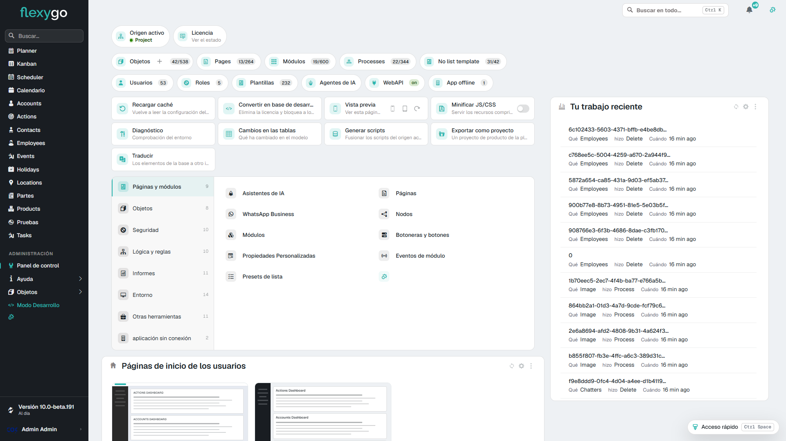
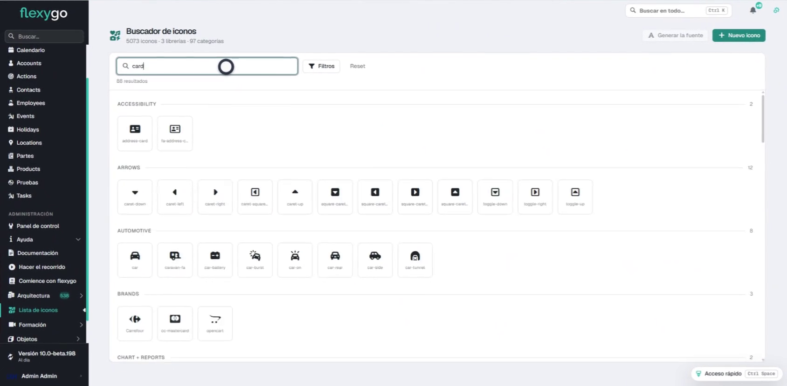
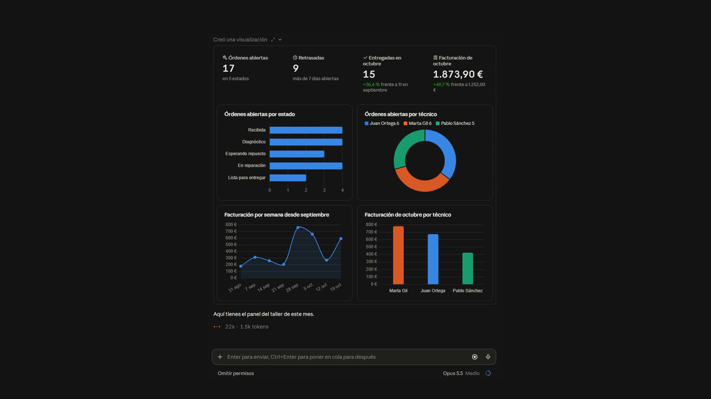
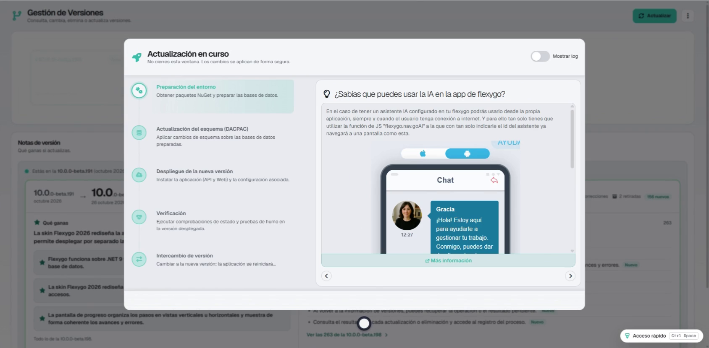
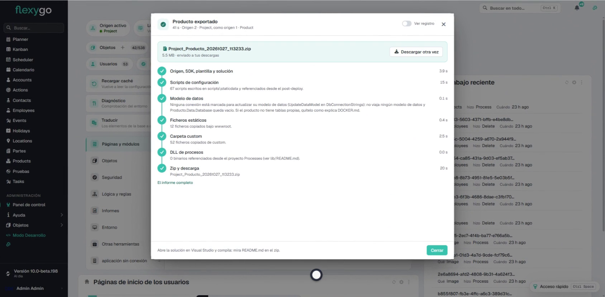
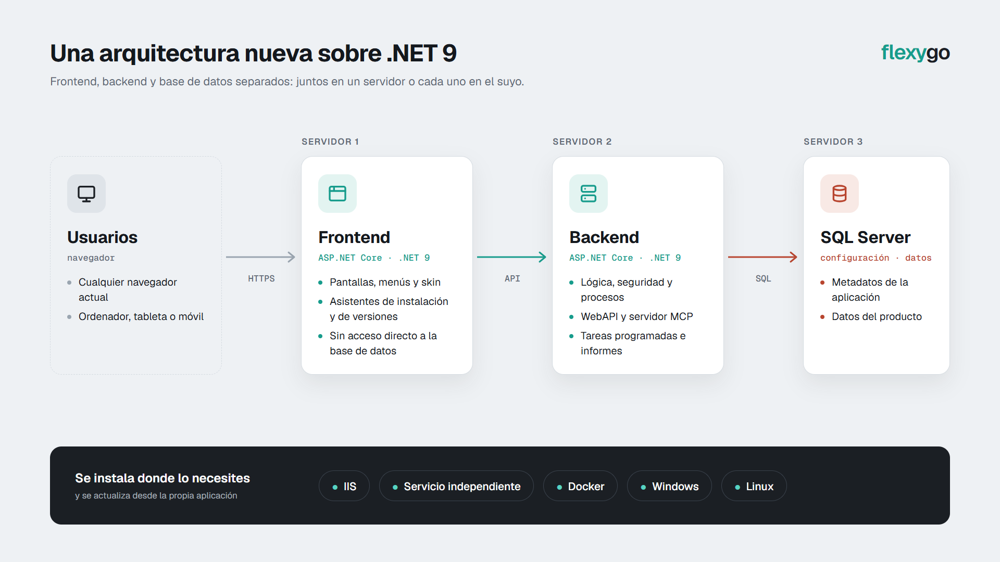

# Versión 10.0

Incluye asistentes para configurar y actualizar la aplicación, crear aplicaciones con IA y consultar datos, además de una nueva skin adaptable y opciones de despliegue y exportación.

## Novedades

### Instalación

- **Configura Flexygo desde la pantalla de inicio de sesión con un asistente que guía la puesta en marcha y permite retomarla.** El asistente reúne la conexión, las bases de datos, el proyecto, el correo y la publicación, y permite configurar conexiones de datos pendientes según cada instalación. Comprueba los valores, muestra el progreso y mantiene cada paso disponible para corregir errores o volver a intentarlo; si sales, podrás continuar desde el primer paso pendiente. Solo está disponible mientras la instalación está pendiente y sustituye al instalador anterior.

    
- **Puedes configurar una instalación desatendida para que se complete automáticamente al iniciar el backend.** Permite crear, actualizar o reutilizar las bases de datos, además de definir el nombre del proyecto y la contraseña de administración. Si falla algún paso, la instalación lo comunica mediante un inicio fallido.
- **Puedes instalar una base de datos y consultar el progreso del despliegue desde el configurador.** El configurador muestra la conexión cuando la base de datos ya está configurada e informa de las etapas del despliegue. Esta opción también funciona en entornos de desarrollo.
- **La configuración inicial estrena un flujo para configurar Flexygo y registrar usuarios.** El proceso incluye los ajustes del proyecto, la base de datos y el correo. También contempla estados sin título y el tratamiento de un nombre de proyecto vacío.
- **Instala y actualiza Flexygo desde las pantallas de configuración, con actualización de la aplicación y la base de datos.** El nuevo proceso de actualización se gestiona desde el configurador y descarga e instala los paquetes necesarios para desplegar la nueva versión. También contempla operaciones afectadas por archivos o recursos bloqueados.
- **Puedes instalar Flexygo y actualizarlo desde las pantallas de configuración inicial.** El asistente reúne las opciones de instalación y actualización de la aplicación. Así puedes realizar estas tareas desde la propia aplicación.

### Skins

- **La skin Flexygo 2026 renueva el diseño de toda la aplicación y añade una barra lateral adaptable.** El rediseño abarca pantallas, menús, listas, formularios, paneles y diálogos, con nueva tipografía, colores, espaciado y controles. La barra lateral agrupa los menús y puede contraerse; también incluye accesos a alertas y perfil, y el atajo Ctrl+K. La skin anterior se mantiene disponible.

    
- **La skin Flexygo 2026 incorpora el menú Import y una sección de conectores en el panel de control.** Import está disponible para usuarios registrados, pero no para invitados. La sección de conectores incluye MailChimp, Ahora ERP y Power BI, entre otros.
- **La publicación de scripts de la base de datos conserva la configuración de la skin 2026.** Se incluyen la apariencia, los menús, los paneles y las páginas de la skin. Esto permite que una instalación nueva arranque con la configuración completa, incluso al publicar desde una base de datos vacía.
- **Puedes personalizar desde tu producto los recursos de las páginas de cuenta.** Es posible adaptar estilos, scripts e iconos en distintos niveles de personalización. Esto permite ajustar las páginas de acceso, registro y recuperación de contraseña a cada producto.
- **Puedes cambiar entre los temas claro, oscuro y del sistema.** La interfaz y algunos elementos integrados adaptan su apariencia al tema seleccionado. Si eliges el tema del sistema, Flexygo sigue la preferencia de apariencia del dispositivo; el selector también adapta sus opciones al tema activo.
- **Puedes utilizar variables CSS personalizadas en tus estilos.** Flexygo admite variables CSS propias al aplicar estilos. Esto amplía las opciones para adaptar la apariencia de la aplicación.

### Herramientas de desarrollo

- **Busca y copia iconos, añade SVG propios y genera fuentes para las bibliotecas de iconos del proyecto.** En Ayuda > Lista de iconos puedes buscar entre más de 5.000 iconos, recorrer sus bibliotecas y categorías, y previsualizarlos antes de seleccionarlos. Los administradores pueden añadir SVG a las bibliotecas del proyecto y generar una fuente para incluirla en el proyecto exportable; también pueden descargar un ZIP como alternativa.

    
- **Crea aplicaciones Flexygo mediante una conversación con un asistente de IA conectado al MCP de Flexygo.** El asistente recoge los requisitos, propone el diseño y organiza el trabajo antes de crear la aplicación. Puedes revisar y probar el resultado en el navegador, mientras un tablero muestra tareas, decisiones, historial y controles de calidad.

    
- **Edita visitas guiadas y sus acciones desde el panel del creador, sin salir de la herramienta.** En cada paso puedes seleccionar una acción existente, crear otra o quitarla desde el formulario. El formulario de la visita permanece disponible mientras abres el diálogo de la acción, y los desarrolladores con permisos pueden acceder a la edición desde la tarjeta de una visita.
- **Previsualiza las tarjetas de los pasos en la página y edita su contenido desde el panel del creador.** Al seleccionar un paso, puedes comprobar cómo se ve su tarjeta en contexto y cómo cambia durante la edición. Los menús de la página permanecen disponibles, y la herramienta indica si una posición no permite mostrar la tarjeta.
- **Gestiona las visitas guiadas desde una lista: consulta sus pasos, edítalas, crea otras o elimínalas.** El creador está disponible en Panel de control > Otras herramientas. La lista muestra el nombre, el número de pasos y si cada visita está activa o desactivada.
- **Crea recorridos guiados señalando directamente los elementos de cada pantalla.** El editor agrupa los pasos por pantalla y permite reordenarlos. Antes de guardar, muestra qué elemento has seleccionado para cada paso.
- **Los objetos externos permiten consultar y actualizar datos mediante REST y amplían su compatibilidad con Flexygo.** El asistente de objetos puede analizar el servicio y proponer propiedades. Puedes utilizar estos objetos en listas, formularios, calendarios, paneles Kanban e informes HTML; además, las listas admiten paginación, los formularios muestran el origen de los campos de selección y las inserciones recogen la clave generada por la WebAPI externa. También se admiten consultas de totales y medidas, y la exportación conserva ajustes modificados en la instalación, excepto los propios del entorno.
- **Incorpora controles deslizantes con un valor visible en tus aplicaciones.** El valor se confirma al soltar el control y también puedes reaccionar mientras se arrastra. El control está disponible entre los elementos compartidos.
- **Crea interfaces con pestañas usando los nuevos controles de pestañas compartidos.** Las pestañas y su contenido se vinculan mediante un valor. Así puedes gestionar qué sección está activa.
- **Crea, nombra y administra pestañas desde la tira de pestañas del diseñador.** La tira aparece aunque el objeto todavía no tenga pestañas y permite añadir la primera directamente. Desde cada pestaña puedes cambiar el nombre o el icono, o eliminarla; la primera agrupa el contenido inicial del objeto.
- **Configura propiedades desde un panel de ajustes rápidos más amplio en el banco de objetos.** Al editar una propiedad, el panel se abre junto al banco y puedes cerrarlo sin volver a desplegar la navegación. Los campos disponen de más espacio y el desplazamiento se mantiene dentro del panel.
- **Abre la lista o un formulario nuevo del objeto desde su espacio de configuración.** El acceso a la lista aparece cuando el objeto tiene una colección asociada. Así puedes abrir esas vistas desde el propio espacio de configuración.
- **Los desarrolladores pueden suscribirse a los mensajes informativos de SQL de DataManager.** La opción permite recibir esos mensajes desde código externo que utilice DataManager. Está disponible para quienes necesiten gestionar esa información desde su código.
- **Los desarrolladores pueden realizar consultas GET con flexygo.ajax.get.** Esta función permite acceder a operaciones que requieren ese tipo de consulta. También vuelve a funcionar la consulta de versiones que utiliza el pie de página.
- **Define en la plantilla de una lista SQL los enlaces a sus registros.** La plantilla puede construir enlaces aunque las filas contengan distintos tipos de objeto. Se mantienen la ordenación y el redimensionado de columnas, sin depender de la detección automática de enlaces de la skin 2026.
- **La operación getView de la WebAPI aplica los valores predeterminados correspondientes.** Al consultar una vista mediante esta operación, se aplican sus valores predeterminados. Se corrige así la respuesta para que no incluya valores predeterminados incorrectos.
- **Se aplican valores predeterminados a las URL amigables.** La resolución de estas direcciones cuenta ahora con valores predeterminados. Así, las URL amigables utilizan esos valores al resolverse.
- **La skin 2026 incorpora pestañas en procesos e informes, asistentes para objetos y gestores de documentos e imágenes.** Los gestores de imágenes permiten presentar el contenido como galería o como lista. Las pestañas amplían la organización de propiedades más allá de la edición de objetos.
- **La skin 2026 permite elegir un origen o cerrar el diálogo sin cambiarlo.** El origen actual queda señalado y las opciones se distinguen mediante una insignia de color. Los cuatro orígenes se muestran en dos columnas, el addon queda fuera de esa lista y puedes cerrar el diálogo con su botón o con Esc; la etiqueta del origen activo se actualiza sin recargar la pantalla.
- **Inicia la creación de un objeto desde el acceso al catálogo de objetos.** El botón de suma abre el asistente sin activar el acceso al catálogo que lo contiene. Al pasar el puntero, el símbolo aumenta su contraste y muestra un fondo propio para diferenciarlo del catálogo.
- **En modo de desarrollo, el menú de un módulo ofrece accesos a la configuración de su objeto.** Las opciones aparecen agrupadas al final del menú. No se muestran en la skin clásica.
- **Organiza los módulos de una página directamente desde la página, sin ir al gestor de módulos.** Puedes mover módulos entre zonas, elegir otro diseño y crear módulos desde el organizador. Antes de guardar, avisa si un cambio de diseño dejaría posiciones sin asignar o si la página procede de una distribución y se revertirá con una actualización.
- **Integra Flexygo con otros sistemas mediante webhooks.** Los desarrolladores pueden utilizar esta funcionalidad para conectar sus aplicaciones con otros sistemas. Así pueden incorporar webhooks en sus integraciones.
- **Cambia la optimización de los paquetes desde el menú de desarrollo.** La opción permite alternar este ajuste sin salir del menú. Puedes modificarlo desde el propio menú de desarrollo.

### Integraciones

- **Conecta asistentes de IA para consultar datos y, si lo autorizas, modificar registros y ejecutar procesos.** El administrador activa MCP en Administración > Seguridad > WebAPI y asigna el permiso a usuarios o roles. Al conectar Claude o ChatGPT desde el menú del perfil, cada usuario autoriza el acceso y decide si será de solo lectura o también podrá cambiar datos. Los asistentes respetan los permisos del usuario, se pueden consultar o desconectar desde «Asistentes conectados» y las herramientas indican si consultan, modifican o permiten reintentos. El endpoint MCP registra asistentes a partir de sus metadatos para evitar duplicados, incluye el emisor en la respuesta de inicio de sesión y mantiene disponible el registro dinámico de clientes. Además, los procesos que superan diez minutos ya no fallan y se mantiene la compatibilidad de la aplicación con MCP.

    

### Actualizador

- **Gestiona actualizaciones, reversiones y versiones desde un asistente que guía el proceso y muestra su progreso.** El asistente permite revisar los requisitos antes de continuar y consultar las novedades de las versiones. También muestra el resultado de cada operación y permite volver a pasos anteriores.

    
- **Consulta las operaciones en curso y sigue las iniciadas por otros administradores.** Puedes ver quién dirige cada operación y seguirla en modo de solo lectura cuando no la hayas iniciado. El actualizador evita operaciones incompatibles simultáneas y permite retomar preparaciones interrumpidas desde otra pestaña, conservando el seguimiento y los pasos completados.
- **Consulta el historial de operaciones desde la información de versiones.** Puedes abrir el resultado y el registro de una operación anterior. Borrar el historial no afecta a las operaciones que siguen en curso.
- **Consulta las notas completas de las versiones y las novedades que recibirás al actualizar.** El historial incluye versiones beta, muestra las novedades respecto a versiones anteriores y permite revisar los cambios entre la versión instalada y la más reciente. También incluye las notas publicadas de Backend y excluye las versiones que no están publicadas.
- **Consulta y gestiona las versiones disponibles, instaladas y descargadas desde la página de versiones.** La página muestra el estado de cada versión y mantiene la información actualizada al cambiarlo o eliminar una versión. Desde el actualizador también puedes aplicar la última versión disponible y eliminar versiones descargadas.
- **Puedes revertir una actualización si el proceso no termina correctamente.** La opción permite volver al estado anterior cuando surgen problemas durante la actualización. Así puedes recuperar la versión previa desde el proceso del actualizador.
- **Consulta los registros en directo y filtra su contenido desde el modo avanzado del asistente.** Puedes buscar en los registros y filtrarlos por nivel y contexto, además de alternar entre el resumen y el registro desde los resultados. Leer o limpiar el registro durante una operación no interrumpe la llegada de nuevos mensajes, y en pantallas pequeñas las vistas se muestran en pestañas.
- **Consulta el resultado de cada actualización o eliminación, con detalles de los errores.** La pantalla indica qué ocurrió y qué versión queda en uso, y permite copiar los detalles técnicos del error junto con su código. Al cerrar el resultado, se actualiza el listado de versiones.
- **Resuelve conflictos de configuración durante una actualización y elige el valor inicial para cada conflicto.** El asistente permite revisar las diferencias pendientes y partir de un valor en blanco, del anterior, de uno personalizado o de la versión nueva. También puedes continuar una actualización interrumpida desde el punto alcanzado y ampliar la ventana a pantalla completa.
- **El actualizador reconoce las versiones preliminares y permite configurar si las busca.** La compatibilidad incluye la búsqueda y comparación correcta de paquetes beta según la versión instalada. Puedes controlar el uso de versiones preliminares desde la configuración.
- **La skin 2026 muestra la versión instalada y puede avisar de las novedades.** La versión aparece en el pie de la barra lateral y el aviso se muestra una vez por versión principal y secundaria. Desde el aviso puedes consultar el detalle de la actualización; los administradores también reciben novedades de cada versión menor.
- **Actualiza la base de datos de Flexygo en entornos Docker y admite credenciales de conexión.** El proceso también permite actualizar la base de datos desde instalaciones que requieren credenciales. Se mejoran los mensajes de error y el tratamiento de problemas de sesión o red durante la actualización.
- **Instala y actualiza la base de datos desde el configurador.** El configurador incorpora estas tareas para que puedas realizarlas desde la herramienta de configuración. La opción facilita la gestión de la base de datos durante la instalación y las actualizaciones.
- **Actualiza Flexygo en una instalación Docker desde la página de mantenimiento.** El proceso muestra información sobre la actualización y permite gestionar el mantenimiento de la instalación.
- **El actualizador consulta repositorios locales y admite rutas de descarga en Linux.** Al finalizar, el proceso vuelve a la aplicación. También se revisan algunos mensajes informativos del flujo de actualización.
- **Puedes revertir una actualización si el proceso no termina correctamente.** La opción está disponible durante el proceso de actualización. Úsala para recuperar el estado anterior si surgen problemas.

### Despliegue

- **Exporta la aplicación instalada como proyecto de producto y configura su contenido, plantilla y opciones desde el área de administración.** El asistente genera un ZIP listo para abrir y compilar en Visual Studio, muestra el progreso y registra las exportaciones y los errores. Puedes elegir carpetas y archivos personalizados y modificar la plantilla; de forma predeterminada usa la del producto instalado y excluye los repositorios de documentos e imágenes y otros archivos grandes. Admite proyectos de más de 2 GB y comprueba que haya espacio suficiente; no incluye usuarios y conserva los secretos en un archivo local que no se comparte. Está disponible para administradores autorizados y muestra la plantilla y la versión elegidas; si el origen activo está reservado, avisa y propone el primer destino disponible.

    
- **En instalaciones con frontend y backend separados, las operaciones con archivos funcionan entre ambos servidores.** La aplicación puede transferir archivos durante las operaciones de carga, descarga y eliminación. Este soporte también cubre el acceso mediante suplantación.
- **Puedes integrar RDS en despliegues con Docker y aplicar cambios de configuración durante las actualizaciones.** La integración con RDS amplía las opciones de despliegue. El flujo de actualización permite aplicar cambios de configuración.
- **Publica bases de datos de datos desde el configurador, incluidas las vacías o sin archivo de definición.** También se corrige un error al actualizar bases de datos en entornos Docker.
- **Puedes desplegar la base de datos de Flexygo con Docker.** Se incluyen los archivos de Docker necesarios para desplegar la base de datos con esta tecnología.
- **Genera imágenes de Flexygo con Docker y configura el inicio conjunto de sus componentes.** Se incluyen los archivos de Docker y una configuración para iniciar conjuntamente las distintas partes de la aplicación. Esto permite preparar el despliegue de Flexygo con Docker.

### Configuración

- **Los administradores pueden consultar y editar la configuración de la instalación desde una pantalla específica, con comprobaciones antes de guardar.** La pantalla reúne opciones, niveles de registro, conexiones y credenciales, y muestra cuántas conexiones hay y cuántas comprobaciones han fallado. Las comprobaciones señalan los campos que necesitan atención y permiten guardar directamente cuando no hay nada que revisar; las contraseñas aparecen enmascaradas.
- **Los administradores pueden activar el modo de mantenimiento y mostrar un aviso mientras la aplicación no está disponible.** El control está en el panel de administración y también se muestra una página pública durante el mantenimiento. Al cambiar el estado, las páginas abiertas se actualizan y, cuando termina, quienes visitan el sitio pueden volver a su página.
- **Configura aplicaciones sin conexión desde una pantalla organizada por secciones, con historial de sincronización y emulador móvil.** La pantalla reúne objetos, menús, páginas, código, recursos y sincronización. Desde la pantalla de aplicaciones sin conexión ya no se ofrece la opción de enlazar un objeto, aunque se mantienen las opciones para crear y clonar objetos.
- **Puedes configurar el separador que se utiliza al exportar archivos CSV.** La opción permite ajustar el formato de los archivos exportados a las necesidades de cada aplicación. Configúrala para que los datos se separen como necesitas al abrir el archivo.
- **Actualiza las pantallas de todos los usuarios conectados o selecciona sesiones concretas.** La acción está disponible en el menú de acciones de la información de versión. Puedes buscar usuarios y seleccionar sus sesiones para enviarles la actualización.
- **Los administradores pueden consultar la configuración y el estado de los procesos en pantallas de solo lectura.** La configuración de la aplicación y la del servidor se muestran por separado. También se puede consultar el estado de los procesos, la base de datos y los recursos disponibles.
- **Puedes abrir la configuración de la página desde un botón junto a la herramienta para organizar módulos.** El acceso está disponible en modo de desarrollo y sigue la página actual al navegar a otra, sin reconstruir la cabecera.
- **Configura la aplicación con valores específicos para cada entorno.** La aplicación puede cargar y guardar los ajustes propios de cada entorno, como desarrollo. Así, esos valores no se mezclan con la configuración general.
- **Publica una base de datos desde el configurador.** La herramienta de configuración incorpora la publicación de bases de datos. Puedes realizar esta tarea desde el propio configurador.

### Correo electrónico

- **La integración con el correo web permite renovar las credenciales de acceso.** Se muestra una notificación para gestionar la autenticación. También se corrige el proceso de renovación de credenciales.

### Filtros

- **La skin 2026 presenta los filtros como chips editables y aplica los cambios automáticamente.** Cada chip muestra el nombre del filtro y su valor; puedes editarlo o limpiar los filtros desde la fila. Los cambios se aplican al terminar de elegir opciones o salir de la fila, y la búsqueda de texto se realiza al terminar de escribir. También puedes cambiar el estado de una casilla pulsando en cualquier parte de su chip; la skin anterior conserva su comportamiento de filtros.

### Formularios

- **Consulta en la lista los registros que otros usuarios acaban de crear, sin recargar la página.** Las nuevas filas aparecen cuando solicitas mostrarlas, aplicando tus permisos y filtros. El aviso indica cuántas filas marcadas siguen visibles, permanece aunque la lista no muestre su cabecera y no elimina las filas si lo descartas. En páginas con varias listas, cada aviso corresponde a su lista y no actualiza listas de otros objetos.

### Gestión de documentos e imágenes

- **Los controles de archivos permiten cargar archivos por partes y seguir el progreso de la carga.** La carga por partes está disponible en los controles de carga y en el campo de archivo. La barra de progreso se muestra en los controles de carga y edición.
- **Puedes gestionar documentos e imágenes desde Flexygo, con los gestores adaptados a la skin 2026.** Los gestores están disponibles para Flexygo y ERP, y muestran correctamente documentos, imágenes y vistas de galería en la skin 2026. También se traducen sus textos y se incluyen cambios en la generación de informes Crystal Reports.
- **Las cargas de archivos pueden gestionarse mediante el proxy de la aplicación.** El proxy evita que una carga sobrescriba incorrectamente otro archivo y conserva la identidad del usuario. Si ambos servicios están en el mismo servidor, la aplicación evita recurrir al proxy.

### Gráficos

- **El módulo ECharts muestra sus opciones de configuración y mantiene la consulta al cambiar el tipo de gráfico.** Al corregir la configuración, el gráfico puede volver a mostrarse sin recargar la página. Si se produce un error, el aviso aparece en inglés. Las opciones JSON siguen disponibles para los componentes que las utilizan, y los módulos HTML no muestran opciones que no les corresponden.
- **Los gráficos ECharts ofrecen más opciones para personalizar series, etiquetas, indicadores y líneas de referencia.** Puedes configurar el apilado, el formato de los valores, las etiquetas finales y los puntos destacados. También puedes mostrar información al pasar sobre el gráfico y añadir líneas de referencia para el promedio o un valor concreto. En gráficos circulares, puedes colocar etiquetas dentro de las porciones, resaltar valores y limitar las etiquetas de las porciones pequeñas; las líneas de referencia se muestran con etiquetas legibles y sin valores automáticos cuando no tienen etiqueta.
- **Los gráficos de anillo pueden mostrar un total central con formato local y distintos cálculos.** El número puede adaptarse a la cultura del usuario, incluidos los separadores y los decimales, o mostrarse sin formato. También puedes elegir si el total representa la suma, la media, el máximo o el recuento, y configurar las etiquetas para cada módulo sin cambiar el tema compartido.
- **Las tarjetas de estadísticas admiten tendencias, estados vacíos y cifras con separador de miles.** Puedes elegir distintos modos de visualización y aplicar colores semánticos. Las tendencias y los objetivos se muestran al incluir sus datos.
- **El nuevo módulo ECharts admite gráficos de radar, burbujas, combinados, circulares, de anillo, semicirculares, de área polar, de líneas y de barras horizontales.** Puedes combinar distintos tipos de serie en un mismo gráfico o elegir una de las nuevas representaciones. El módulo convive con los gráficos actuales basados en Chart.js y permite asignar un tema.
- **Los gráficos ECharts se cargan sin configuración asociada y ajustan su tamaño al mostrarse o cambiar de tamaño.** También se adaptan al abrir una pestaña o cambiar el tamaño del módulo, incluso si se inicializan ocultos o contraídos. Al cambiar opciones anidadas, se conserva el resto de la configuración y se liberan los recursos del gráfico al volver a dibujarlo.
- **Puedes sincronizar las leyendas entre gráficos y mostrar gráficos ECharts con datos de una lista.** La sincronización funciona entre gráficos del mismo grupo. Los gráficos insertados en listas utilizan los datos que ya se han cargado.
- **Los gráficos de burbujas y radar muestran correctamente valores cero, negativos y planos.** Se conservan las etiquetas de las burbujas con valor cero. Los gráficos radar también pueden representar datos sin variación sin fallar en el cálculo.

### Informes

- **Flexygo incorpora temas configurables para gráficos, con nuevas paletas y opciones visuales que se adaptan a la skin y al modo claro u oscuro.** Puedes elegir temas monocromáticos o el tema inspirado en shadcn, y ajustar el espaciado, las etiquetas y la forma de las series. Los gráficos actualizan sus colores al cambiar el tema o el modo claro u oscuro, conservan el contraste de las etiquetas y evitan conflictos entre módulos o páginas compartidas. El tema Flexygo presenta una cuadrícula más despejada, y los gráficos pueden usar la paleta de la skin o un tema configurado. Los administradores pueden gestionar los temas y los desarrolladores consultar el tema de gráficos incrustados; ECharts también está disponible como plugin.
- **Puedes generar informes Crystal desde proyectos de Flexygo y utilizarlos en distintos entornos.** La generación permite incorporar a los proyectos informes creados con Crystal Reports. También se corrigen problemas de compatibilidad entre paquetes y la ubicación necesaria para generarlos. Se mejora la carga de definiciones del editor.
- **Puedes diseñar y personalizar informes desde Flexygo y exportarlos a PDF sin errores.** El diseñador de informes permite crear y editar informes, así como adaptar la presentación y la configuración del diseñador DevExpress. Se corrigen errores de exportación y de lectura de parámetros, que ya no depende de las mayúsculas y minúsculas. La interfaz del diseñador también se muestra correctamente al aplicar traducciones.
- **Puedes obtener informes PDF en formato base64 para Crystal Reports y DevExpress.** Este formato permite utilizar el PDF generado desde otras funciones de la aplicación. También se corrige la carga de parámetros al abrir un informe desde un enlace.

### Inicio

- **La visita guiada de bienvenida se renueva: se ofrece al administrador en su primer acceso y Lowdy acompaña sus pasos.** Se muestra una sola vez y el administrador puede posponerla o elegir que no vuelva a aparecer. Las indicaciones sobre la página de inicio, la búsqueda, las notificaciones y la cuenta son más claras, y se han eliminado dos pasos. Lowdy acompaña las tarjetas y señala cada elemento con un contorno completo; las visitas de proyectos y complementos mantienen su aspecto habitual.
- **En skin 2026, personaliza los módulos de cada página y consulta un panel de inicio renovado con información de la aplicación.** Cada usuario puede ordenar, fijar y contraer módulos, o recuperar la distribución del administrador. El panel reúne tarjetas sobre errores, tareas, usuarios, licencia, actividad y otros datos; además, la tarjeta de licencia muestra correctamente la fecha de caducidad.

### Inicio de sesión

- **Puedes configurar los intentos fallidos que provocan el bloqueo de una cuenta y cuánto dura.** Ajusta el límite de intentos y la duración del bloqueo según las necesidades de seguridad de tu aplicación.
- **Los enlaces de recuperación funcionan bajo rutas base y, al restablecer la contraseña, recibes una confirmación.** Al terminar el restablecimiento se inicia la sesión automáticamente. También se corrigen los enlaces enviados por correo y las redirecciones que incluían la ruta base de forma incorrecta.
- **Puedes consultar las noticias en la página de inicio de sesión o desactivar su visualización.** La opción permite decidir si las noticias aparecen en la pantalla de acceso.
- **Puedes iniciar sesión mediante Cl@ve o SSO, con mejoras en la autenticación y sus mensajes de error.** Con Cl@ve se admiten certificados de personas jurídicas y se corrigen el registro, la carga y la respuesta de autenticación. También se ajustan la configuración y la pantalla de acceso SSO, los errores de acceso y cambio de contraseña, y el cierre de sesión; además, se puede recordar el acceso y se comprueba la licencia de los módulos activos.
- **Puedes iniciar sesión mediante LDAP.** La autenticación LDAP se integra en el proceso de acceso y puede configurarse para usar las credenciales de la organización. También se corrige el flujo para que el acceso se complete correctamente.
- **Puedes iniciar sesión sin conexión mediante SSO con ABH o LDAP.** Esta opción está disponible para los accesos SSO que utilizan esos métodos.
- **Puedes personalizar las páginas de inicio de sesión, recuperación de contraseña y registro.** La personalización también está disponible para las páginas de autenticación y gestión de contraseña de los productos creados con Flexygo.
- **Se comprueban las condiciones de seguridad y la licencia antes de permitir el inicio de sesión.** Las validaciones tienen en cuenta la dirección IP, los bloqueos y la cobertura de licencia, incluidas las licencias antiguas. También se ajustan la recuperación de contraseña y el control de intentos desde una misma IP.
- **Si se produce un error de conexión al iniciar sesión, el sistema vuelve a intentarlo hasta tres veces.** Los reintentos ayudan a completar el acceso cuando se produce un fallo de conexión temporal.
- **Puedes gestionar la contraseña de tu cuenta desde un proceso específico.** La cuenta dispone de una opción dedicada para gestionar la contraseña.
- **Puedes proteger el inicio de sesión con autenticación multifactor.** El acceso puede requerir un paso adicional de verificación. Se adaptan las páginas, los mensajes, las traducciones y los correos electrónicos utilizados en la autenticación multifactor.
- **Puedes crear una cuenta con un proceso de registro renovado.** Se actualizan la página de registro, sus traducciones y los correos asociados.
- **Puedes iniciar y cerrar sesión, recordar el acceso y usar tu dirección de correo para iniciar sesión.** La pantalla de acceso estrena un diseño renovado con el estilo habitual de Flexygo. Se ajustan las cookies y el tratamiento de claves que difieren en mayúsculas y minúsculas, se añaden traducciones y puedes usar Intro para acceder; también se evita cargar recursos inexistentes.
- **El proceso para restablecer la contraseña estrena una experiencia renovada.** Se actualizan la página, los mensajes y los correos relacionados con el restablecimiento.
- **Puedes iniciar sesión y gestionar el acceso a tu cuenta.** Se adaptan las plantillas de acceso, registro y recuperación de contraseña. La selección de idioma queda oculta temporalmente.

### Inteligencia artificial

- **Se amplía la lista de modelos GPT disponibles para las funciones de inteligencia artificial.** Los nuevos modelos se incorporan a la configuración de inteligencia artificial. Desde ahí, quedan disponibles para las funciones que utilizan estos modelos.

### Interfaz

- **En la skin 2026 puedes editar valores directamente en las listas y añadir filas desde la lista o el formulario.** Cada fila guarda los cambios al salir y conserva su menú de acciones. La experiencia se adapta a móviles y tabletas, y está disponible en los modos claro y oscuro; la skin flexy2022 no cambia. Las filas muestran correctamente sus valores y formatos, y admiten redimensionar columnas y desplazarse horizontalmente.
- **Desde el panel de control 2026 puedes consultar y editar la página de inicio de cada perfil.** Cada perfil dispone de una vista previa esquemática basada en su configuración. La vista previa no ejecuta la página ni guarda cambios.
- **La skin 2026 incorpora pantallas de administración y una navegación renovada.** Incluye administración de usuarios, roles, propiedades, procesos, ajustes y otros elementos. La navegación añade acceso rápido, una barra lateral plegable y un panel redimensionable.
- **Los calendarios renovados incorporan vista anual, filtros, selección de rangos y opciones de configuración.** Incluyen una leyenda y opciones para configurar el solapamiento y el horario laboral. En la vista anual puedes consultar los registros de cada día, y los cambios de otras personas se reflejan en la vista mensual. Los colores de las marcas se adaptan a los distintos modos y la línea temporal y el calendario anual muestran con más claridad la selección, el día actual y la actividad.
- **Los administradores pueden ofrecer visitas guiadas por el producto a los usuarios autorizados.** La visita se configura con pasos y se añade a una página como un módulo; su seguridad determina quién puede verla y volver a iniciarla. Puede recorrer pantallas, señalar elementos y realizar acciones predefinidas. Los pasos y sus textos se muestran traducidos, y el recorrido se adapta a las pantallas y a los elementos disponibles sin bloquear la navegación.
- **Los perfiles de administrador e invitado ya tienen avatar, y la foto aparece en la cabecera y el pie de página.** La imagen del perfil se comparte entre ambas skins, incluida la clásica, y se actualiza en la interfaz al cambiarla desde el menú o desde el formulario de usuario. Las iniciales de los avatares y el contenido de los avisos emergentes también se leen con mayor claridad.
- **Los administradores pueden reorganizar y redimensionar módulos directamente en la rejilla de una página.** El modo de diseño permite activar el diseño libre conservando la disposición existente, mover módulos y ajustar su tamaño. Los cambios se pueden guardar o descartar; si sales sin guardar, puedes restaurar la disposición anterior. En pantallas estrechas, los módulos se muestran en una columna y conservan el orden de lectura.
- **Al organizar una página, puedes arrastrar módulos sin cabecera y acceder a la configuración desde la barra de organización.** Los módulos sin cabecera muestran una franja de arrastre mientras está activo este modo. La configuración se abre en un panel lateral para dejar visible el contenido que estás organizando. Si recargas la página sin cambiarla, se reconstruye la organización; al cambiar de página, el modo se cierra y se avisa si hay cambios sin guardar.
- **Puedes mostrar los resultados de búsqueda sobre la página, sin sustituir su contenido.** Este modo de paleta es opcional y agrupa los resultados por criterio, con su título, descripción y destino. La búsqueda responde más rápido y no envía al navegador datos que no necesita mostrar.
- **Las tarjetas de indicadores presentan valores, descripciones y tendencias opcionales en un diseño renovado.** Puedes acompañar el valor principal de una variación, una tendencia o un texto explicativo, sin que esos datos sean obligatorios. Las tarjetas de una misma fila comparten anchura y altura para alinear valores y pies aunque incluyan información adicional. Si aparecen dentro de una lista, evitan duplicar su marco y mantienen su contenido y disposición.
- **El buscador de objetos incorpora paginación en la parte inferior.** El paginador facilita recorrer los resultados cuando ocupan varias páginas y se muestra junto a ellos.
- **La interfaz de Flexygo Core adopta un diseño más actual.** Se renueva la navegación y el menú de usuario, y se actualiza la paleta de colores. También se completan las traducciones que faltaban y la aplicación del nuevo estilo visual en distintas skins.
- **Puedes acceder a las páginas de Flexygo mediante URL amigables.** Esta forma de acceder a las páginas está disponible en Flexygo.

### Licencias

- **Puedes consultar la información de la licencia desde una página específica y ver su estado en una marca de agua.** La marca de agua permite identificar de un vistazo el estado de la licencia mientras utilizas la aplicación. La información de la licencia también está disponible en una página específica.
- **Flexygo puede generar licencias para aplicaciones en producción.** Esto permite disponer de una licencia al ejecutar la aplicación en ese entorno.

### Notificaciones

- **Configura avisos en tiempo real de nuevos registros y limita su envío a los registros que cada usuario puede consultar.** Define filtros para cada objeto; también se tienen en cuenta los filtros y las condiciones de las listas, además de los permisos de cada destinatario. Los avisos aparecen al crear registros desde otra pantalla y permiten abrir el registro o su lista. El guardado no se bloquea al comprobar quién debe recibirlos, incluso cuando hay filtros o seguridad por fila, y se corrige un fallo de conexión que impedía recibirlos correctamente.
- **Activa avisos para las inserciones, modificaciones y eliminaciones de los objetos que quieras seguir.** Cada usuario recibe los avisos con su propia sesión y permisos. Así, la información se ajusta a lo que puede consultar cada persona.
- **La aplicación incorpora un servicio de notificaciones push.** El servicio se integra con las funciones de uso sin conexión de la aplicación.

### Procesos

- **Configura reglas para automatizar acciones al guardar registros y gestiona decisiones y webhooks desde distintos puntos de la aplicación.** Desde el banco de trabajo del objeto puedes configurar acciones de correo, avisos, registros, decisiones, webhooks o procesos, y probarlas con un registro real. Las personas ven sus decisiones y las de sus roles en la bandeja, las notificaciones o el chat; los administradores pueden consultar todas. Solo usuarios autorizados pueden crear, editar o eliminar tareas de decisión, que también pueden abrirse y resolverse mediante la WebAPI; las reglas permiten establecer plazos y escalar, y los webhooks se envían al guardar o eliminar, con reintentos y opción de prueba. Las decisiones se aplican tras un minuto y pueden deshacerse; las reglas de decisión y los webhooks existentes se trasladan al actualizar. Además, el dashboard MCP muestra importes con su moneda y una paleta propia, y se adapta al ancho disponible.
- **El planificador, las vistas de agenda y el tablero kanban muestran las tarjetas nuevas sin cambiar de pantalla.** Las tarjetas aparecen en la celda, el día o la columna que les corresponde, respetando los filtros y permisos del usuario. Se muestran avisos en la barra del módulo y las tarjetas nuevas quedan marcadas; si alguna queda fuera de la zona visible, un indicador permite localizarla. Las actualizaciones conservan la posición, la selección y el desplazamiento, y se limitan a los cambios y al contenido visible cuando corresponde. En la skin 2026, el calendario de planificación se actualiza sin quedarse en blanco y marca temporalmente los eventos nuevos.
- **Los administradores pueden iniciar la creación de un recorrido guiado desde su registro.** La creación abre la página del primer paso y muestra el panel de configuración; si no hay pasos, se informa de ello. Las invitaciones aparecen en la página donde comienza el recorrido y se conservan las respuestas de los usuarios.
- **Los procesos integrados y los módulos activos están disponibles en el contexto de la aplicación.** Esta información puede utilizarse desde el contexto de la aplicación. También se ajustan los colores mostrados y se evitan errores al buscar rutas de procesos que no existen.

### Seguridad

- **Controla quién puede ejecutar cada proceso, incluso sin objeto asociado, mediante permisos y condiciones SQL opcionales.** Los permisos se configuran para usuarios, roles y facultades, desde sus pantallas de seguridad o desde la ficha del proceso. La condición SQL se comprueba cada vez que se valida el permiso y solo permite ejecutar el proceso si devuelve 1 o true; si no se cumple, el proceso queda oculto en menús y barras de herramientas. La pantalla de seguridad permite revisar quién puede ejecutarlo y qué condición limita su uso.
- **Gestiona permisos desde una tabla de seguridad y accede a ella directamente desde usuarios, roles, facultades y objetos.** La tabla muestra permisos por acción y permite añadir condiciones, bloquear o eliminar reglas, filtrar los elementos con reglas y quitar todas las reglas de una familia. Al abrirla desde un usuario, rol, facultad u objeto, ese elemento queda seleccionado. También puedes consultar las acciones disponibles para usuarios y roles y revisar una vista previa de los cambios antes de aplicarlos.
- **Consulta la seguridad de objetos, módulos, propiedades y procesos desde una misma pantalla del workbench.** Puedes abrir la configuración de seguridad de un objeto desde su pantalla en el workbench, manteniendo el objeto seleccionado al cambiar de ámbito. La búsqueda se limpia al introducir una nueva y la skin 2022 conserva su pantalla anterior.
- **Configura condiciones de seguridad de objetos eligiendo una propiedad, un operador y un valor.** El asistente ofrece las propiedades del objeto y permite seleccionar valores de contexto, sin tener que recordar nombres de tablas o marcas especiales. También puedes probar la condición antes de guardarla y ver el SQL ejecutado.
- **La skin 2026 incorpora una pantalla para gestionar reglas y consultar cómo se aplican los permisos a usuarios, roles y facultades.** Desde el área de trabajo puedes consultar reglas de objetos, módulos, campos y elementos de navegación, y comparar los permisos concedidos, denegados o no definidos. La pantalla muestra las condiciones y el orden de aplicación de roles, facultades y usuarios para explicar por qué se puede acceder a un elemento. También permite crear, modificar y eliminar reglas, y muestra las reglas aplicadas junto con la política predeterminada; en módulos, indica cuándo una condición determina el acceso. Para los campos, agrupa los permisos de lectura y edición bajo el objeto al que pertenecen.

### Seguridad de la WebAPI

- **La WebAPI y MCP pueden limitar las respuestas a las propiedades definidas en cada objeto.** La opción está activada de forma predeterminada e incluye las propiedades definidas y las claves. Así, las respuestas y los esquemas omiten columnas que no están disponibles en todas las instalaciones.
- **Flexygo incorpora un servidor MCP para asistentes y aplica los permisos del token en la WebAPI.** MCP está desactivado inicialmente y cuenta con permisos propios por usuario y rol, además de pantallas de administración. La WebAPI rechaza las operaciones no permitidas indicando el motivo y no las muestra en OpenAPI.
- **La barra de navegación incorpora búsqueda y la WebAPI permite operaciones masivas y consultas de relaciones.** La búsqueda facilita localizar contenido desde la navegación. Los desarrolladores pueden trabajar con operaciones masivas y relaciones a través de la WebAPI.
- **Los desarrolladores pueden consultar en Scalar las definiciones de API del backend y la WebAPI.** Scalar ofrece una referencia de las API de Flexygo para quienes desarrollan sobre la plataforma.
- **Puedes exponer entidades de la aplicación mediante la WebAPI.** La WebAPI incorpora autenticación mediante tokens y opciones para definir y consultar entidades. La configuración de orígenes permitidos admite comodines, lo que facilita conectar otras aplicaciones con Flexygo.

### Tareas programadas

- **Puedes desactivar las tareas programadas y los scripts desde la configuración de la aplicación.** Al activar esta opción, el proceso deja de iniciar esos trabajos. También se respeta al insertar o editar una tarea, para evitar que se ejecuten trabajos desactivados.
- **Ejecuta scripts como tareas programadas.** Puedes configurar scripts asociados a tareas y trabajos programados. Así, los scripts configurados se ejecutan como parte de la planificación de tareas de la aplicación.

## Mejoras

### Despliegue

- **Flexygo funciona sobre .NET 9 y permite desplegar por separado la interfaz, el backend y la base de datos.** Puedes instalar la aplicación en IIS, como servicio independiente o en Docker, en Windows o Linux. La interfaz, el backend y la base de datos pueden ejecutarse en el mismo servidor o en servidores distintos; además, el asistente de versiones permite revertir actualizaciones.

    
- **Las traducciones de producto se conservan al publicar los datos de configuración.** El proceso puede incluir las traducciones asociadas a los elementos de producto y excluir las que pertenecen a módulos de prueba.
- **La instalación en Docker obtiene las cadenas de conexión desde la configuración de la aplicación.** Así puedes configurar las conexiones desde la configuración disponible en el entorno de despliegue.
- **Los scripts de despliegue son compatibles con Linux.** Esto facilita el despliegue de Flexygo en entornos Linux.
- **Controla qué archivos JavaScript y CSS se agrupan y mejora la fiabilidad de la optimización en IIS.** La agrupación permite elegir los archivos incluidos, carga correctamente los estilos personalizados y separa los plugins personalizados de los del sistema. También evita errores del plugin de PDF durante la optimización y mejora la compatibilidad con instalaciones alojadas dentro de una aplicación IIS.

### Actualizador

- **La página de versiones presenta una interfaz renovada, ordenada y traducida.** La información se organiza por estado y número de versión, lo que facilita localizar las versiones de la aplicación. También se corrige un fallo que podía producirse al cargar esa información.
- **La pantalla de progreso organiza los pasos en una guía vertical u horizontal y facilita seguir la etapa activa.** La vista básica y la avanzada adaptan la información al formato elegido, y la transición entre ambos se anima. Si una etapa falla, puedes consultar su detalle desde la vista básica.
- **El progreso conserva los pasos completados y no retrocede a estados anteriores.** Si una operación falla, se distingue lo que ya se había ejecutado del paso que ha fallado. También se mantiene correctamente el estado de los pasos durante una reversión.
- **Las pantallas de transición mantienen visible el estado mientras cambia la versión.** La animación sigue activa durante el proceso y el asistente espera a que la aplicación vuelva a estar disponible antes de recargar cuando se prevé una interrupción. Así, el resultado no aparece antes de que termine el cambio.
- **El asistente muestra una pantalla específica antes de eliminar una versión.** La pantalla presenta la operación con un paso y una animación propios. Si cierras el asistente antes de iniciar el borrado, la eliminación no comienza.
- **El actualizador identifica quién mantiene bloqueada la aplicación, incluidos los bloqueos de red.** Cuando se pueden reconocer, se muestran el usuario y el equipo asociados al bloqueo. Esta comprobación se incorpora al proceso antes de continuar con la actualización.
- **Puedes continuar si los requisitos muestran avisos que no bloquean la actualización.** Los errores siguen impidiendo avanzar. También se avisa si la tabla de registros del actualizador supera el límite configurado.
- **Los registros del actualizador se guardan separados por proyecto.** Cada proyecto tiene su propia carpeta de registros. Esto facilita localizar los registros correspondientes a una instalación concreta.
- **La configuración y el mantenimiento muestran el progreso y los errores de actualización.** Puedes seguir las tareas mientras se ejecutan en segundo plano y consultar los detalles si se produce un error. También es posible validar bases de datos ERP desde estas opciones.
- **El actualizador reintenta las operaciones de archivos si se producen fallos temporales.** Los reintentos ayudan a completar la actualización cuando el problema al gestionar archivos es puntual. Si falla el despliegue de la base de datos, se genera un informe para revisar el problema.

### Configuración

- **Los secretos de configuración se mantienen cifrados en IIS y en contenedores Docker de producción.** En otros entornos, los secretos se descifran al iniciar la aplicación. Si falta un secreto de Docker o no se puede leer, la aplicación no inicia creando una clave nueva.
- **El administrador inicia con el perfil 2026admin y solo los administradores ven la opción para cambiar de perfil; «Decisions» ya no aparece en el menú.** El cambio de perfil asignado se aplica al usuario administrador. Los demás usuarios no ven una acción que no pueden ejecutar, y se elimina del menú la entrada de tareas de decisión.
- **Se completan las traducciones del área Connectors del panel de control de 2026 y de las nuevas pantallas administrativas.** Quienes utilizan Flexygo en otros idiomas pueden consultar estas áreas traducidas. También se recuperan traducciones que faltaban y se corrige una lista de registros para que incluya el identificador de cada fila.
- **Los errores de conexión a SQL se identifican correctamente para distintos problemas de red.** Esto ayuda a distinguir los errores de resolución del servidor, los tiempos de espera y las conexiones rechazadas. Así resulta más fácil reconocer el tipo de problema que impide conectar con SQL.
- **El panel de configuración rápida resulta más legible en la skin 2026.** Se mejora la lectura de las etiquetas, los títulos de sección y las ayudas. También se ajusta el aspecto del botón para guardar.
- **Al activar SSL en la configuración del correo, se propone un puerto predeterminado y se aplica el valor SSL seleccionado.** El paso de configuración del correo rellena el puerto para las conexiones con SSL. Así no tienes que introducirlo manualmente en ese caso.
- **Los grupos de configuración muestran cuántas opciones contienen y se presentan en tarjetas más claras.** La nueva disposición ocupa menos espacio y facilita localizar cada grupo. Al pasar el cursor, la acción para editarlo permanece visible.
- **La acción para convertir la base de datos de desarrollo indica claramente su efecto y advierte de sus consecuencias.** El nombre evita confusiones con el modo de desarrollo de la interfaz. Además, la acción aparece marcada como peligrosa.
- **Puedes buscar y configurar los temas de gráficos desde la administración de Flexygo.** Los temas aparecen en la navegación y en las búsquedas de configuración. También pueden asignarse a los módulos de gráfico.
- **Flexygo crea una configuración predeterminada si la aplicación arranca sin archivo de configuración.** Esto permite poner en marcha la aplicación cuando todavía no se ha creado ese archivo. La configuración predeterminada se crea al iniciar.
- **Puedes configurar el puerto, el esquema y la URL de Flexygo.** Estos valores se establecen en la configuración de la aplicación. Así puedes adaptarla al entorno donde se ejecuta.

### Filtros

- **Los filtros y paneles de la interfaz 2026 se adaptan mejor a móviles y muestran información más clara.** Puedes consultar los valores de las etiquetas de filtro en una ayuda emergente y el gestor de filtros cabe en la pantalla del móvil. También se corrigen el panel de selección y la búsqueda del menú de desarrollo.
- **Configura el orden de los resultados añadiendo criterios de campo y dirección.** Puedes buscar campos en la lista y el diálogo ocupa solo el espacio necesario. Los criterios aparecen en el mismo orden en que se aplicarán.
- **Las filas y etiquetas del gestor de dependencias mantienen un contraste legible al pasar el puntero.** El resaltado usa el color de acento y se distingue tanto en el modo claro como en el oscuro.
- **El gestor de filtros genéricos organiza mejor sus paneles y permite consultar las dependencias entre campos.** El árbol de propiedades y las filas de campos aparecen en paneles independientes, y las dependencias se muestran con texto. También puedes abrir la seguridad de los campos, borrar búsquedas y consultar las propiedades después de guardar; el contenido se ajusta al diálogo y puede desplazarse dentro de él en flexy2022 y en la skin 2026.

### Formularios

- **Los formularios se adaptan mejor a pantallas pequeñas y recolocan los campos cuando cambian las dependencias.** En pantallas estrechas, los campos se muestran en una sola columna y los formularios funcionan correctamente en móviles. El banco de propiedades refleja la distribución guardada y se mantienen las alturas mínimas de imágenes y editores al cambiar su tamaño.
- **En la skin 2026, la barra de guardado queda alineada con el cuadro y mantiene el botón Guardar a la vista.** En los formularios modales, la barra permanece junto al borde inferior mientras te desplazas por un formulario largo. La etiqueta del objeto ya no tapa el botón cuando la barra queda fija abajo; en formularios cortos, la barra conserva su posición habitual.
- **Las etiquetas de los formularios de la skin 2026 se muestran ordenadas y sin dos puntos al final.** Las etiquetas largas se acortan visualmente y puedes consultar el texto completo al pasar el cursor. Los interruptores quedan junto a su etiqueta, sin invadir otros campos; el cambio también se aplica a vistas y ajustes rápidos. La skin flexy2022 conserva su presentación anterior.
- **Los campos editables en línea de las listas mantienen el aspecto de los campos del formulario.** El cambio se aprecia, por ejemplo, en las filas de inserción y en las listas editables.
- **El campo de imagen aprovecha el espacio asignado y muestra la fotografía a mayor tamaño.** La imagen y el control para editarla ya no quedan recortados en los campos altos. El campo se adapta al espacio definido, incluso cuando está vacío.
- **En la skin compatible, puedes crear pestañas y el formulario conserva la que tenías abierta al guardar.** La pestaña seleccionada se restaura al actualizar el formulario y queda visible en la tira de pestañas. Los controles para crear pestañas no aparecen en flexy2022, donde no se pueden representar.
- **En la nueva skin, los campos y el botón Guardar quedan alineados con el título de su tarjeta.** La alineación se mantiene aunque cambie cuál es el primer elemento del formulario.
- **Los campos se leen correctamente en más pantallas con la nueva skin en modo oscuro.** El fondo, el texto y los bordes se adaptan en los campos de listas de correo, del visor de modelos de datos y del editor de relaciones. Los formularios de edición mantienen su tamaño y espaciado actuales.
- **El validador SQL reconoce los tipos de datos de Oracle.** Esto permite validar consultas SQL que utilizan tipos de datos propios de Oracle.

### Gráficos

- **Los gráficos de barras y circulares aprovechan mejor el espacio disponible.** En gráficos con muchas categorías, las etiquetas se ocultan cuando no hay espacio suficiente para leerlas. En los gráficos circulares, la leyenda y las etiquetas exteriores no aparecen a la vez, y el tamaño y la posición del gráfico se ajustan para reducir el espacio vacío.

### Herramientas de desarrollo

- **Los recorridos guiados y el configurador de páginas muestran sus textos traducidos.** Los textos de estas herramientas están disponibles en siete idiomas, incluidos los nombres de los anclajes propios de Flexygo. Si falta una traducción, se muestra el texto original en inglés; los textos escritos al configurar un recorrido conservan su contenido.
- **Personaliza la tarjeta de bienvenida de un recorrido con una imagen o la marca de Flexygo.** La marca puede mostrarse con una animación de escritura. Si seleccionas otra imagen, aparece como ilustración estática.
- **Los desarrolladores pueden configurar más opciones en los controles compartidos.** Pueden añadir un botón para borrar la selección, elegir cuándo un diálogo ocupa toda la pantalla y controlar el foco del campo de texto. Las tarjetas de opción también admiten un color de acento.
- **Configura documentos e imágenes y encuentra accesos para abrir listas, formularios y seguridad.** La sección de archivos permite alternar entre documentos e imágenes y carga la configuración correspondiente al objeto. Desde este espacio también tienes a mano los accesos indicados.
- **La sección de diseño de vista del banco de objetos tiene un nombre más claro.** El nombre ya no se confunde con el diseño del registro. El cambio está disponible en los siete idiomas incluidos.
- **Agrupa y pliega los módulos por tipo en el panel de colocación.** Puedes mantener abiertos los grupos que estés utilizando. Al buscar, se despliegan los grupos que contienen resultados.
- **La configuración de objetos muestra sus textos traducidos en los siete idiomas disponibles.** La traducción incluye los títulos de las secciones y sus descripciones. Así puedes consultar la configuración en el idioma disponible que utilices.
- **El administrador de vistas se muestra correctamente y resulta más legible en la skin 2026.** Se corrigen la disposición de los campos, los colores del texto y los estados al pasar el puntero. Las mejoras también se aplican al administrador cuando se abre como plantilla.
- **Al colocar módulos, puedes desplazarte por la página, consultar sus detalles y localizar los que ya están añadidos.** Las tarjetas muestran información del módulo y las páginas donde aparece. Los módulos ya colocados siguen visibles en el panel lateral, y Esc permite cerrar las capas del modo de colocación de una en una.
- **La banda para mover un módulo sin cabecera solo destaca al pasar el puntero.** La zona de arrastre sigue disponible aunque no esté resaltada. Así, los módulos sin cabecera mantienen un aspecto coherente con los demás durante la colocación.
- **Consulta los errores en una lista filtrable, con paginación y detalle desplegable.** Puedes combinar filtros para acotar los resultados y consultar las opciones disponibles para cada criterio. El acceso desde el panel de inicio abre la lista con los errores de las últimas 24 horas.
- **El marketplace de addons presenta cada opción en una fila, en lugar de una tarjeta ancha.** La nueva disposición aprovecha mejor el espacio tanto si hay pocos addons como si hay muchos. La búsqueda queda alineada con la lista, y la información y las acciones de cada addon se mantienen a la vista.
- **Quienes tienen permisos de desarrollo acceden con el modo de desarrollo activado y pueden desactivarlo desde el menú.** El modo conserva el estado elegido al volver a entrar, y desactivarlo no provoca un error si no hay un panel lateral que cerrar. El acceso solo aparece para usuarios con un rol de diseñador; la selección de origen ya no incluye el addon, que se presenta por separado.
- **En la skin 2026, las herramientas de desarrollo están disponibles en sus áreas correspondientes y las vistas previas tienen una tarjeta propia.** Los ajustes de objetos, páginas y catálogos se acceden desde sus ubicaciones específicas, en vez de duplicarse en el panel lateral. El control de giro de las vistas previas prepara la orientación de la siguiente apertura.
- **Las vistas previas de móvil y tableta usan controles para elegir dispositivo y cambiar la orientación.** Puedes cambiar de dispositivo sin perder la orientación actual. El giro afecta a la vista previa abierta y no hace nada si no hay ninguna abierta.
- **Puedes activar o desactivar Minificar JS/CSS desde una tarjeta del panel de control.** La tarjeta se integra con las demás opciones del panel y permite cambiar el ajuste desde toda su superficie. Así no tienes que salir del panel para modificarlo.
- **La comunicación de los procesos con el proxy admite distintos tipos de respuesta.** Esto permite gestionar las respuestas necesarias para las operaciones de documentos de ABH Sign. La mejora está orientada a esos procesos.
- **Los desarrolladores pueden depurar el código de la aplicación con source maps.** Esta mejora facilita localizar el origen de un problema durante la depuración. Está orientada a quienes desarrollan sobre Flexygo.

### Informes

- **Los informes se identifican y se muestran por su nombre, en lugar de por su descripción.** Al consultar un informe, se utiliza su nombre como referencia y como texto visible. Así se recupera la identificación por nombre.

### Inicio

- **La página de inicio y el panel de control aprovechan mejor el espacio y destacan información más útil para actuar.** En la página de inicio, las listas y los bloques informativos se distribuyen para reducir los huecos, y los errores se agrupan por causa. En el panel, los accesos y la actividad reciente quedan más compactos; también se muestran recuentos de objetos y módulos y se revisan los indicadores.
- **Los indicadores de estado de la página de inicio abren las listas relacionadas y muestran recuentos coherentes.** Puedes acceder desde los indicadores a sus registros, incluidos los resultados de ejecución de trabajos. Los enlaces de las listas llevan al destino correspondiente y sus totales coinciden con el contenido mostrado.

### Inicio de sesión

- **Las páginas de cuenta no se quedan bloqueadas al volver atrás y muestran información más clara al recuperar la contraseña.** También se distingue entre una cuenta cuyo correo no está confirmado y un problema de configuración del envío de correo.
- **Las redirecciones y direcciones de las páginas de acceso y gestión de contraseña llevan al destino correcto.** Tras restablecer la contraseña, se vuelve a la pantalla de inicio de sesión. También se corrigen los destinos después de cambiarla y la generación de direcciones para estas páginas.
- **Los mensajes de error de los procesos de cuenta aparecen traducidos.** Se incluyen traducciones para las excepciones que pueden producirse durante esos procesos.
- **Puedes crear usuarios con barras invertidas en el nombre de usuario.** La validación del nombre de usuario acepta este carácter al crear una cuenta.

### Inteligencia artificial

- **Se limita el tiempo de espera de las solicitudes de inteligencia artificial.** Las llamadas que no reciben respuesta dejan de quedar pendientes indefinidamente. Así, las solicitudes finalizan al alcanzar el límite establecido.

### Interfaz

- **Las listas de la skin 2026 distribuyen mejor el espacio entre datos, columnas y acciones.** La columna de acciones queda ajustada a sus botones y no se expande con el espacio sobrante. Las listas editables permanecen dentro de su columna, y los combos de las filas se ajustan al ancho disponible.
- **Las vistas de la skin 2026 muestran campos, etiquetas y encabezados con más claridad.** Los valores largos se mantienen en una línea y se recortan cuando no caben. También se mejora la separación entre filas y se muestran las fotos indicadas mediante rutas relativas.
- **Flexygo muestra sus iconos con los nombres actualizados de Font Awesome 7.** La actualización abarca iconos de pantallas, vistas, navegación y otros elementos de la aplicación.
- **Las ventanas del asistente, el actualizador y otras áreas comparten una cabecera y una presentación coherentes.** La cabecera reúne el icono, el título, el subtítulo y las acciones disponibles. Los diálogos de instalación y actualización mantienen un tamaño uniforme, y sus pantallas de resultados y errores comparten estilo; la opción de reintentar se distingue como destructiva.
- **La skin 2026 renueva el correo, las notificaciones y el chat de IA para facilitar su uso.** En el correo puedes consultar carpetas junto a la lista, filtrar por mensajes leídos, buscar por asunto y abrir mensajes en un panel lateral. Las notificaciones incluyen filtros y la opción de marcarlas todas como leídas, mientras que el chat de IA ocupa un panel compacto. La skin flexy2022 mantiene su aspecto actual.
- **El menú de acceso rápido de la skin 2026 permite volver al panel de control o al cuadro de mando desde cualquier página.** Los accesos aparecen en una sección de administración del menú, aunque el menú del proyecto no incluya ese grupo.
- **Las nuevas instalaciones comienzan con la interfaz 2026 y los nuevos usuarios heredan el perfil de quien los crea.** Las instalaciones existentes conservan su perfil y los productos no se ven afectados. El perfil de administración 2026 solo se ofrece a usuarios con rol de administrador.
- **Puedes copiar los detalles técnicos de un error sin mostrar avisos adicionales.** El botón confirma visualmente la copia mediante un cambio de icono. También está disponible como elemento compartido para desarrolladores.
- **La skin 2026 mejora la presentación y el uso de ventanas, listas, combos y asistentes.** Se recuperan las ayudas de los botones y se ordenan mejor las listas y las pestañas. También vuelve el asistente de plantillas, se facilita la creación de objetos sin conexión y se mejora la visualización de combos y ajustes de propiedades.
- **La skin 2026 mejora las listas, el uso en móviles y varias herramientas de trabajo.** Las agrupaciones y los encabezados de las listas se mantienen a la vista, y la edición resulta más rápida. En móviles, la navegación lateral se adapta a una hoja y las filas y controles son más cómodos al tacto. También mejoran los calendarios, los gráficos y la sincronización sin conexión.
- **Las pantallas de carga utilizan una nueva animación.** La animación muestra el logotipo o el indicador predeterminado según el contexto de carga.
- **La agenda y el calendario mensual de la skin 2026 ayudan a distinguir eventos, fechas y categorías.** Los eventos se muestran como tarjetas con una marca lateral de color, visible en los modos claro y oscuro. La agenda mensual muestra el mes junto a los eventos del día seleccionado, facilita consultar todos los eventos de ese día y adapta el selector al idioma y al modo de color.
- **Los menús desplegables se muestran sin quedar recortados por el área que los contiene.** Su posición se ajusta respecto al control que los abre, incluso dentro de zonas con desplazamiento.
- **El emulador sin conexión mantiene visible el dispositivo y representa modelos actuales de iPhone y Samsung.** El marco del iPhone se muestra a la misma altura que el del Samsung y la aplicación respeta las dimensiones del modelo seleccionado. La pantalla reorganiza sus secciones en ventanas estrechas, y la navegación lateral permanece accesible en la skin 2026.
- **Los logotipos pueden adaptarse al tema claro u oscuro sin recargar la página.** Puedes configurar una variante para el tema oscuro; si no existe, se conserva el logotipo configurado. También se muestran correctamente logotipos e imágenes de perfil cuyas rutas incluyen barras invertidas, y la preferencia de tema se aplica al actualizar la página.
- **La pantalla de seguridad ofrece una presentación más clara y espaciada en la skin 2026.** Los títulos, las etiquetas, los controles y el botón de guardado se distinguen mejor dentro del módulo.
- **Las ramas del panel de navegación muestran si están abiertas o cerradas y pueden desplegarse sin cerrar el panel.** El indicador cambia de orientación al abrir una rama que contiene opciones; las opciones sin elementos no lo muestran. Al desplegar grupos, el panel permanece abierto y se cierra cualquier otro menú que estuviera abierto; los iconos de la cabecera mantienen el orden esperado.
- **El menú de la skin 2026 conserva sus accesos al actualizarse y permite abrir las opciones de perfil.** El pie del menú no desaparece al refrescarlo y la opción de idioma vuelve a abrir su formulario. Los usuarios que no son diseñadores también pueden abrir el menú de módulos.
- **Las opciones de administración de los módulos se abren en paneles laterales más cómodos de usar.** Los paneles de configuración, seguridad, eventos y relación con la página disponen de más espacio sin cubrir toda la pantalla. Sus controles quedan ordenados en una sola fila y el panel de eventos ajusta su altura al contenido; el engranaje abre la configuración del módulo y las demás opciones se agrupan en otro menú en modo de desarrollo.
- **Los avisos y las indicaciones del configurador de páginas se leen mejor en la skin 2026.** Se aumenta el contraste del aviso sobre el origen de la página y de la indicación que aparece al situar el cursor sobre un módulo.
- **La interfaz muestra traducidos los textos disponibles en menús, asistentes, plantillas y listas.** Se traducen opciones de la nueva skin, mensajes de la página de inicio, nombres de temas de gráficos, tipos de elemento y encabezados de listas cuando hay traducción disponible. También se corrigen títulos y botones que aparecían como claves internas o en inglés, el texto del buscador en alemán y la traducción de «View Name». Se respetan los nombres definidos por cada cliente y los identificadores necesarios para ordenar y guardar anchos.
- **Las etiquetas, enlaces y textos de la skin 2026 se leen mejor en los modos claro y oscuro.** Se ajusta el contraste de las etiquetas, los textos secundarios y los colores de acento cuando se usan como texto, sin cambiar los fondos ni los botones. Los enlaces se distinguen por su color y subrayado, mientras que las etiquetas pulsables se subrayan al pasar el cursor; las etiquetas de las tarjetas mantienen un contraste adecuado.
- **La aplicación aprovecha mejor el espacio de los módulos y se adapta a columnas estrechas en la skin 2026.** Las barras de herramientas pueden ocupar varias líneas para evitar el desplazamiento horizontal. También se equilibran los márgenes, se reduce el espacio vacío sobre las páginas y se deja espacio bajo el último módulo.
- **El modo de diseño de la rejilla se abre desde la navegación y mantiene visibles los títulos de los módulos.** El acceso integrado conserva el atajo de teclado y permanece disponible al actualizar la navegación. Las zonas de arrastre no tapan los títulos, se reducen los huecos vacíos al final de la página y los controles de las filas no se desplazan al interactuar; la página aprovecha mejor el espacio junto al panel lateral.
- **Los enlaces a objetos, procesos e informes se muestran como etiquetas compactas y fáciles de recorrer.** Los elementos relacionados ocupan menos espacio y se distinguen mejor al pasar el cursor. Los títulos que no realizan ninguna acción no se resaltan como interactivos.
- **La skin 2026 reúne las acciones del módulo junto al título y oculta las opciones secundarias en un menú.** La acción principal queda a mano y la barra ocupa menos espacio, especialmente en módulos estrechos. Las opciones menos frecuentes siguen disponibles en el menú de tres puntos; los botones de actualizar y contraer se mantienen en las cabeceras.
- **La búsqueda de la paleta muestra cuándo está cargando y diferencia los resultados vacíos de los errores.** Mientras se cargan los resultados, la pantalla conserva su espacio y muestra una indicación de espera. En modo de desarrollo, la paleta también permite abrir la configuración de la búsqueda global.
- **La vista de parámetros se integra mejor con la skin 2026.** La nueva presentación se aplica únicamente a esta vista y no altera cómo se muestra en Flexygo 2022.
- **Las acciones de cada fila se muestran al final de la lista, en una columna ajustada a sus botones.** Así, los datos se leen antes que las acciones y las columnas quedan alineadas en ambas skins. En las listas editables, los botones para añadir datos también aparecen en la columna final.
- **La nueva skin muestra una barra de progreso durante la carga de las páginas, en lugar del indicador giratorio.** La barra permite seguir el avance de la navegación mientras se carga una página.
- **El tablero Kanban presenta columnas y tarjetas más claras, también al mover o archivar tarjetas y en modo oscuro.** Las tarjetas se distinguen mejor del fondo y las columnas se integran con el módulo. Al arrastrar una tarjeta, el área de archivo queda dentro de su franja y las zonas para soltar ocupan toda la columna, incluso si está vacía.
- **Los menús emergentes de filtros, procesos y notificaciones comparten una apariencia más coherente.** El mismo estilo de sombra y borde ayuda a integrar visualmente estos menús.
- **El planificador presenta una barra de herramientas y un panel lateral más ordenados y fáciles de leer.** Los controles comparten una apariencia coherente y los botones distinguen mejor la opción activa, reservando el rojo para acciones de peligro. Las etiquetas y los tipos se alinean con la cuadrícula y ocupan solo el espacio necesario; además, el panel se pliega sin retardo visual.
- **Las pestañas de los módulos se distinguen mejor y pueden recorrerse cuando no caben en pantalla.** Las pestañas largas se desplazan dentro del módulo y no se salen de sus límites. El selector de módulos también adopta el estilo de los demás controles.
- **Los mapas, los gráficos de red y la agenda se muestran correctamente en modo oscuro.** Sus áreas de visualización se integran con el aspecto oscuro de la aplicación, en lugar de depender de un fondo claro.
- **En la nueva skin, los controles y elementos de navegación se integran mejor con el modo oscuro.** Se corrigen fondos claros que dificultaban la lectura de algunos elementos. La skin clara no cambia.
- **Los submenús conservan la jerarquía de sus opciones y la última columna puede ocupar el espacio libre de la tabla.** Al redimensionar una tabla, la columna final se ajusta para evitar que quede un hueco. Los menús contextuales mantienen anidadas sus opciones.
- **Los cambios de versión actualizan los archivos web afectados y el acceso gestiona mejor las interrupciones del servicio.** Los archivos que no han cambiado pueden conservarse en el navegador. También se traducen las etiquetas de acceso mediante SSO.
- **Los errores de la aplicación se muestran de forma más coherente y con mensajes más claros.** Se unifica su presentación en distintas operaciones de la aplicación.

### Licencias

- **La página de licencias presenta con más claridad el nivel, el estado de las extensiones y el código de solicitud.** El nivel de tarifa, como PRO o LITE, aparece junto al tipo de licencia cuando corresponde. Si falta el código de solicitud, se indica y no se ofrece copiarlo; también se confirma cuándo se ha copiado el identificador.
- **La gestión de licencias reconoce nuevas tarifas para más productos.** Se amplían las tarifas de producto compatibles. Así, la gestión de licencias puede reconocer tarifas de licencia adicionales para productos compatibles.
- **Puedes validar una licencia que incluya varios nombres de equipo.** Escribe los nombres en la lista de equipos de la licencia y sepáralos con el carácter «|».

### Notificaciones

- **La tarjeta de decisión aparece cuando corresponde y la campana refleja al momento los cambios y los correos no leídos.** Puedes abrir desde la campana los correos no leídos. Al hacerlo, la campana se cierra y el contador disminuye sin esperar a una tarea posterior.
- **Los avisos de error y de advertencia pueden permanecer en pantalla hasta que el usuario los cierre.** Esta opción resulta útil cuando el mensaje necesita leerse con atención y no debe desaparecer automáticamente.

### Procesos

- **ABH Sign interpreta la información de créditos de firma y puede leer documentos a través del proxy de la aplicación.** La gestión de créditos recibidos por el servicio de firma evita errores. También puedes gestionar documentos cuando el proceso de firma y la aplicación están en servidores distintos.
- **Al revisar errores, puedes consultar también las excepciones encadenadas de los procesos.** La traza del error incluye la información de las excepciones que se producen dentro de procesos encadenados. Esto ayuda a revisar el error junto con su origen encadenado.
- **Los parámetros de procesos e informes se conservan al guardar su configuración.** Se mantienen los valores asociados a procesos e informes al guardar la configuración. Esto ayuda a conservar los parámetros establecidos.

### Rendimiento

- **Las páginas con muchos componentes cargan más rápido al leer la skin una sola vez.** Si se recargan las hojas de estilo de la skin sin recargar la página, se vuelve a leer para aplicar los cambios.
- **La aplicación comprime los recursos que sirve y refleja los cambios de estilo en su versión.** La compresión reduce el volumen de datos que se descarga al cargar la aplicación, especialmente en conexiones lentas. Además, los cambios en las hojas de estilo quedan reflejados en la dirección de los archivos.
- **La recarga silenciosa de la caché actualiza también los datos almacenados en memoria.** Al realizar esta recarga, los datos en memoria se actualizan junto con el resto de la caché.

### Seguridad

- **La configuración de la aplicación cifra en disco las contraseñas y las claves sensibles.** Se protegen, entre otros datos, las cadenas de conexión, las contraseñas de correo y NuGet, y las claves JWT y Data Protection. El ejecutable permite gestionar la clave de cifrado y trasladarla a otro servidor sin necesitar el SDK.
- **La API de licencias separa la consulta y la actualización del estado, y envía el código de activación en la solicitud.** Este cambio afecta a las integraciones que consultan o actualizan el estado de la licencia, o envían un código de activación.
- **Los cambios de roles y permisos se aplican sin que el usuario tenga que volver a iniciar sesión.** La actualización se refleja en las siguientes solicitudes del usuario. Abarca los permisos asociados a roles y los de objetos, páginas e informes.
- **La descarga de archivos incorpora la suplantación de usuario.** El cambio afecta a las descargas cuando se utiliza la suplantación.
- **La pantalla de seguridad está traducida a los siete idiomas disponibles.** Sus etiquetas y opciones dejan de depender de textos alternativos en inglés.
- **Los objetos nuevos muestran su nombre en singular y se incorpora una vista para las facultades de página.** La vista permite consultar las facultades de página mediante la capa de seguridad. Al crear un objeto, se deja de usar como nombre el título plural de la colección.
- **La página de cambio de contraseña muestra los errores y las validaciones del formulario.** Así puedes identificar los problemas al introducir o actualizar la contraseña.
- **El catálogo de reglas de seguridad incluye páginas, plantillas e informes.** También identifica las familias que no tienen una vista disponible y evita repetir plantillas en los resultados.

### Seguridad de la WebAPI

- **La WebAPI bloquea temporalmente las IP con demasiados intentos fallidos y las identifica correctamente incluso a través del frontend.** El valor predeterminado es de 50 intentos fallidos de token por minuto, y los administradores pueden cambiarlo. La protección se aplica también a los accesos mediante contraseña, LDAP, SSO y renovación de token; además, rechaza a los usuarios bloqueados.
- **Las herramientas de Flexygo sin una licencia válida ya no pueden acceder a la WebAPI.** La comprobación de licencia también se aplica cuando esas herramientas intentan acceder a la WebAPI.
- **La definición OpenAPI de la WebAPI es más clara, rápida y se limita a los objetos habilitados y expuestos.** La documentación organiza mejor las operaciones, respuestas, modelos de error y esquemas compartidos, e incluye la descripción del objeto cuando está disponible. También explica desde qué valor empiezan las páginas y cómo escribir fechas en los filtros; para generarla, solo procesa objetos con permisos de acceso a la WebAPI.
- **Consulta desde la WebAPI la fecha, la hora y la zona horaria del servidor.** Esta información se añade a los datos de contexto existentes, sin sustituirlos.
- **Los contadores de los nodos de navegación se calculan sin enviar sus consultas al navegador.** La aplicación envía los identificadores de los nodos y recibe los valores de los contadores. El cambio se aplica a los nodos que tengan un contador configurado.
- **La WebAPI devuelve las fechas con un formato actualizado.** El nuevo formato permite que las aplicaciones consumidoras traten las fechas de forma coherente al integrar la WebAPI.
- **Flexygo vuelve a comprobar las condiciones de seguridad de los usuarios que ya han iniciado sesión.** Si esas condiciones dejan de cumplirse, el acceso no se mantiene como si siguieran vigentes.

### Skins

- **Los controles de campos y conmutadores de la skin 2026 mantienen un aspecto coherente fuera de los formularios de edición.** Los campos conservan el estilo adecuado al mostrarse en otras pantallas. Además, los conmutadores desactivados que están encendidos mantienen un color de acento sólido.
- **Puedes mostrar un logotipo distinto según el modo de interfaz.** La aplicación selecciona la variante correspondiente al modo activo. Así puedes adaptar la apariencia del logotipo a cada modo.
- **La skin 2026 mejora el contraste y la legibilidad de distintos controles y textos.** Se distinguen mejor el botón Aplicar del diálogo de ordenación y el botón para ejecutar procesos. También se ajustan los textos de las opciones de peligro, las tarjetas, los pasos de los asistentes y los avisos y controles del planificador, en los modos claro y oscuro.
- **La skin 2026 utiliza la tipografía Geist en lugar de IBM Plex.** El cambio modifica la apariencia del texto de esta skin. También reduce el tamaño de los archivos tipográficos que utiliza.
- **En la skin 2026, los procesos con texto visible permanecen en la barra de herramientas.** Los procesos sin texto siguen agrupados en el menú de tres puntos. Así se mantiene la barra ordenada sin ocultar los procesos que incluyen una descripción visible.
- **En la skin 2026, los filtros y el menú de acciones ocupan menos espacio sobre el contenido.** Los controles se sitúan junto al título del módulo. Si no hay filtros que mostrar, desaparece la fila vacía.
- **Los campos que no superan la validación se distinguen mejor en la skin 2026.** El mensaje de error aparece junto a la etiqueta del campo. Así no queda cortado ni invade la fila siguiente.
- **Puedes abrir el organizador de módulos desde la cabecera de la skin 2026, con un botón o un atajo de teclado.** El botón está junto a las notificaciones y el atajo es Ctrl+Mayús+M. El acceso respeta los permisos de diseño.
- **El logotipo predeterminado de Flexygo muestra un fondo gris en lugar de blanco.** El cambio se aplica a la imagen del logotipo incluida de forma predeterminada.
- **Puedes acceder a las variables de las skins sin distinguir mayúsculas y minúsculas.** La búsqueda encuentra una variable aunque se escriba con un uso distinto de mayúsculas. No es necesario respetar ese formato al localizarla.

### Tareas programadas

- **Los iconos del planificador mantienen un contraste legible en los modos claro y oscuro.** Los iconos de configuración y actualización cambian de color según el modo de visualización. Así, se distinguen mejor en ambos fondos.

## Correcciones

### Actualizador

- **El actualizador muestra un error si no puede consultar la última versión disponible.** Así puedes distinguir una consulta fallida de una situación en la que no hay una versión más reciente disponible.

### Configuración

- **Se corrigen los errores al guardar dependencias y obtener valores de licencia.** Las operaciones para guardar dependencias y consultar valores de licencia vuelven a funcionar correctamente. Ya puedes completar estas tareas sin los errores anteriores.
- **El script de tablas de configuración incluye las columnas que faltaban.** La creación o actualización de estas tablas cuenta ahora con las columnas previstas. Esto evita que falten columnas al aplicar el script.

### Conversaciones

- **Se corrige el funcionamiento de las menciones y de sus notificaciones en las conversaciones.** Ahora puedes mencionar a otras personas correctamente. La notificación que reciben incluye los valores predeterminados de la página correspondiente.
- **Puedes enviar correos con archivos adjuntos aunque la aplicación utilice servidores distintos.** Se corrige el tratamiento de los archivos adjuntos cuando la aplicación está configurada para usar servidores diferentes.

### Correo electrónico

- **Las invitaciones de calendario usan la cuenta de correo del sistema si el usuario no tiene una propia.** La dirección del sistema también se establece como dirección del organizador.

### Despliegue

- **La publicación local copia al frontend las claves compartidas necesarias para iniciar sesión.** Si el backend todavía no ha generado esas claves, la publicación avisa de que aún no están disponibles. Así se evita que una instalación recién publicada quede atrapada entre la página de inicio y el inicio de sesión.
- **El despliegue de la base de datos evita un error relacionado con los cambios en los iconos.** Durante el despliegue se preparan los cambios en las tablas de iconos.

### Filtros

- **Las listas con descripciones ya no fallan en ciertos casos de búsqueda o conexión de datos.** Se corrigen las búsquedas que usan columnas no seleccionadas y las que se ejecutan en otra conexión. Si no se puede obtener una descripción, la lista sigue mostrando el resto de los datos.
- **Las dependencias de los filtros se ejecutan al cargar los valores preestablecidos.** Al cargar el filtro, se actualizan los controles dependientes sin que tengas que cambiar ningún valor. Se conservan tanto el valor seleccionado como su texto mientras se actualizan las opciones relacionadas.
- **Puedes guardar dependencias de filtros y recibir una confirmación clara cuando se guardan.** Los mensajes están disponibles en inglés, catalán, alemán, español, francés, italiano y portugués. Además, en el modo de lista del gestor, las opciones visibles y sus acciones quedan mejor identificadas.
- **En la skin clásica, la lista de opciones de un filtro de selección múltiple vuelve a abrirse debajo del campo correspondiente.** La lista deja de aparecer desplazada a la izquierda del campo.
- **Los filtros funcionan correctamente cuando se aplican con un valor vacío.** La corrección evita que la aplicación del filtro falle cuando el valor está vacío.

### Formularios

- **Al eliminar un registro desde el menú Más de un formulario en un diálogo, el diálogo se cierra correctamente.** Antes, el formulario quedaba abierto y vacío tras eliminarlo. Ahora el diálogo se cierra igual que cuando usas el botón de eliminación de la barra.
- **Al crear un registro desde una celda del calendario, se conserva el día seleccionado.** La fecha ya no se desplaza al día anterior al abrir el registro. La corrección afecta al planificador y al calendario mensual.
- **La posición y el tamaño de los módulos se gestionan desde el configurador de páginas, no desde su formulario.** Los campos de fila, columna, ancho y alto dejan de aparecer en el formulario de relación entre página y módulo. Así, guardar un formulario que ya estaba abierto no sobrescribe la posición configurada; los campos homónimos de otros formularios no cambian.
- **Puedes guardar valores booleanos en propiedades de tipo byte sin que falle la conversión.** El problema se producía al insertar los datos. La conversión corregida permite completar ese guardado correctamente.
- **Los procesos y los informes sin descripción muestran «General» como nombre de su pestaña principal.** Así, la pestaña tiene un nombre reconocible aunque el proceso o el informe no incluya una descripción. También se corrigen textos relacionados con la apertura de informes.
- **El control de código de barras gestiona correctamente sus dependencias.** El ajuste afecta al uso de este control en formularios.
- **El selector de base de datos funciona aunque no se haya definido el tamaño de página.** No es necesario definir un tamaño de página para utilizar el selector.
- **Se corrige un error al utilizar valores decimales.** El ajuste permite volver a trabajar con valores decimales sin que se produzca ese error.

### Gestión de documentos e imágenes

- **Se corrigen varios problemas al gestionar documentos e imágenes.** La gestión de documentos e imágenes funciona de forma más fiable.
- **Las descargas mediante el proxy respetan la configuración de eliminación y funcionan entre servidores distintos.** Si está activada la opción correspondiente, el archivo se elimina después de descargarse. También se corrige el cifrado de las solicitudes cuando la aplicación y el servicio están en servidores distintos.
- **Los documentos conservan el nombre y la ruta correctos al gestionarse mediante el proxy.** También se corrigen las rutas utilizadas al gestionar documentos e imágenes, para conservar la ruta original al guardar los archivos. Así se evitan errores al localizarlos en los procesos que los reciben o gestionan.
- **El control de imágenes funciona al guardar archivos en una carpeta externa.**

### Gráficos

- **Los módulos EasyInfo sin objeto pueden utilizar variables de contexto.** Esto permite usar valores como el usuario o la fecha actuales en las consultas. Así, las variables de contexto también están disponibles cuando el módulo no tiene un objeto asociado.

### Herramientas de desarrollo

- **Al exportar un proyecto, se excluyen usuarios y secretos y se generan scripts compatibles con datos de cualquier tipo y tamaño.** Los secretos se guardan en un archivo local ignorado por Git y solo se aplican al publicar en Debug. La publicación ya no sobrescribe los secretos configurados en cada instalación.
- **Selecciona el origen Addon desde el selector de orígenes de la skin 2026.** Cuando Addon está activo, el panel de control también muestra su nombre y su indicador de color. Así puedes identificar el origen seleccionado en ambas zonas.
- **Puedes volver a mover módulos después de cancelar un arrastre con Escape.** Se corrige el fallo de movimiento que podía producirse al cancelar la operación con esa tecla. No es necesario volver a cargar la página para intentarlo de nuevo.
- **Los cambios en propiedades se guardan correctamente y el asistente abre el administrador adecuado.** Mover propiedades entre pestañas y reordenarlas funciona también en procesos e informes. Al editar la configuración de un proceso, informe u objeto, ya no se abre un administrador vacío o sin título.
- **Los controles de redimensionado aparecen alineados con las esquinas de los módulos.** Las marcas se dibujan en el borde visible de la tarjeta y ya no parecen un segundo contorno. Los laterales conservan su zona de redimensionado.
- **El menú de un módulo ya no queda tapado por los controles de redimensionado.** Los elementos del menú conservan sus clics aunque coincidan con la zona de los controles. La corrección se aplica a la skin 2026.
- **El marketplace de addons deja de quedarse cargando cuando falla una consulta.** También se corrigen los controles de las tarjetas de addons instalados. Cuando no hay resultados, se elimina el espacio sobrante.
- **Se corrigen las variables LESS personalizadas y la ruta de los archivos exportados con cambios de base de datos.** Los estilos personalizados se procesan correctamente. Además, la exportación de cambios de base de datos utiliza la ruta corregida.
- **Se corrigen errores de análisis y carga del editor Monaco.** También se corrige la carga de definiciones TypeScript en el editor. Estos ajustes evitan fallos al procesar contenido y al cargar Monaco.
- **Puedes cambiar el orden de los nodos sin errores al cargar sus propiedades.** Se corrige el comportamiento durante la edición de nodos y la carga de sus propiedades. Así puedes reordenarlos sin que se produzca el fallo.
- **Se corrige el clonado de barras de herramientas.** Al clonar una barra de herramientas, se conservan correctamente sus datos. Así el clon mantiene la información de la barra original.

### Informes

- **Los proyectos existentes pueden seguir generando PDF con el código que ya utilizan.** Se mantiene la forma de generación empleada por los proyectos existentes, para que puedan seguir creando PDF sin cambios en su código.

### Inicio de sesión

- **Si faltan claves compartidas del backend, el inicio de sesión indica qué configuración debes copiar.** El aviso identifica las secciones de configuración necesarias para que el frontend pueda iniciar sesión. Después de copiarlas, basta con reiniciar para que se comprueben de nuevo.
- **El proceso posterior al inicio de sesión se ejecuta una sola vez y sus errores no impiden acceder.** Se ejecuta también para usuarios invitados y en accesos con SSO o segundo factor. Si falla, el error se registra y se muestra en la primera página, pero puedes entrar en la aplicación; en esos accesos también se genera correctamente el token.
- **Puedes iniciar sesión aunque tu cuenta no tenga un alias.** La búsqueda del usuario ya no falla cuando ese dato está vacío.
- **Al confirmar el correo, no tienes que configurar de nuevo una contraseña que ya existe.** La confirmación muestra el resultado adecuado tanto si la cuenta ya tiene una contraseña como si todavía no la tiene.
- **Después de restablecer la contraseña, puedes iniciar sesión con la nueva contraseña.** El proceso de recuperación permite continuar el acceso con la contraseña que acabas de establecer.

### Instalación

- **La instalación de addons reconoce correctamente las versiones beta.** Se interpreta correctamente el sufijo «-beta» de la versión del addon.

### Inteligencia artificial

- **Se corrige la referencia de configuración utilizada en las búsquedas vectoriales de la IA.** La corrección afecta a las consultas que recuperan información para generar respuestas. Estas búsquedas vuelven a utilizar la referencia de configuración correcta.
- **Se corrige la visualización de la interfaz de inteligencia artificial en distintos tamaños de pantalla.** La disposición de la interfaz se ajusta según el tamaño de la pantalla. Así, sus estilos se muestran correctamente en diferentes formatos.
- **Los procesos de inteligencia artificial vuelven a ejecutarse cuando falta el contexto global.** Se corrige el fallo que podía impedir su ejecución si el contexto necesario no estaba disponible. De este modo, la falta de contexto global ya no bloquea estos procesos.
- **Se corrige el procesamiento de las solicitudes a ChatGPT.** El fallo podía impedir interpretar correctamente algunas respuestas de ChatGPT. Con la corrección, esas respuestas se procesan correctamente.

### Interfaz

- **Al borrar la última fila de una lista, se muestra la última página disponible y los tooltips no quedan flotando.** En ambas skins, la paginación se ajusta cuando desaparece la última fila de la última página. En la skin 2026, además, los encabezados no se superponen a las filas durante la confirmación del borrado.
- **Las acciones de cada fila aparecen en la posición esperada y los encabezados quedan alineados con las filas.** En flexy2022, las acciones aparecen antes de las columnas; en la skin 2026, después. También se corrige el fallo intermitente al ordenar desde el menú de opciones.
- **Se corrigen la visualización del kanban y del editor HTML, el logo del menú y otros detalles de la interfaz.** También se ajusta la respuesta de los días del calendario anual y de las celdas de información al interactuar con ellas. Vuelven a funcionar las opciones para desactivar tareas programadas y tareas de script.
- **EasyInfo y los gráficos se cargan correctamente para usuarios que no son diseñadores.** Estos módulos dejan de fallar cuando el usuario no tiene acceso a las herramientas de depuración. Así, pueden utilizar EasyInfo y consultar gráficos sin ser diseñadores.
- **Los calendarios de flexy2022 recuperan una presentación similar a la anterior.** Se ajustan las vistas mensual y anual, la posición de los avisos emergentes y la alineación de la vista de planificación. El cambio solo afecta a esta skin.
- **La aplicación vuelve a cargar los archivos JavaScript y CSS cuando se actualizan.** Así se evita que el navegador siga utilizando versiones anteriores de esos archivos.
- **Las vistas de la aplicación sin conexión y las descripciones de sus módulos se muestran correctamente.** También se traducen las descripciones de los módulos y las páginas en los idiomas incluidos en la aplicación.
- **Se corrigen detalles de presentación en los grupos de ajustes y las tarjetas informativas de flexy2022.** En la skin 2022, los contadores sin formato quedan ocultos y las tarjetas informativas recuperan su ancho, la posición de los iconos y el contraste de los datos. Las fichas informativas independientes mantienen su tamaño habitual; las marcas de tarjetas nuevas se distinguen mejor en la skin 2026.
- **El menú de perfil de la skin 2026 permite acceder a las opciones de usuario y cerrar sesión.** Desde el menú puedes cambiar el idioma, la contraseña y la foto de perfil, y consultar tu ficha cuando tienes permisos de administración. También puedes cambiar entre tema claro y oscuro; el idioma muestra su bandera cuando corresponde y las opciones responden correctamente en los idiomas disponibles.
- **Las páginas de la skin 2026 muestran menos barras de desplazamiento innecesarias y controles de redimensionado mejor colocados.** Se ajustan los márgenes y la altura de los módulos para que el contenido encaje mejor en el espacio asignado. Las ayudas del modo de colocación no cubren títulos ni contenido, y los cursores de redimensionado solo aparecen en las zonas habilitadas.
- **La rejilla libre muestra los módulos y gráficos completos y evita barras de desplazamiento vacías.** Los bloques de formularios dejan de aparecer contraídos y los gráficos se adaptan al espacio disponible. Las barras solo aparecen cuando el contenido realmente necesita más espacio, y la página no alarga innecesariamente la zona vacía al final.
- **Los menús del objeto dejan de repetir procesos y acciones que ya aparecen en la barra.** Se conserva la opción configurada expresamente en la barra, incluidas las acciones que abren una ventana nueva. Además, el menú vuelve a abrirse en la posición correcta sin desaparecer.
- **Las tarjetas de plantillas de flexy2022 se leen correctamente en modo oscuro.** El color del texto se adapta al fondo oscuro sin alterar la apariencia en modo claro.
- **Se corrigen problemas de distribución en formularios, panel de control, calendario anual e iconos.** Los campos de los formularios vuelven a distribuirse correctamente y el panel de control conserva sus módulos. El calendario anual se adapta al ancho disponible y permite abrir los días con un toque. También se corrigen la apariencia del calendario y la visualización de algunos iconos.
- **La copia de excepciones al portapapeles funciona con caracteres especiales.** Ciertos caracteres del texto de una excepción ya no interrumpen la acción de copia.
- **Se corrigen problemas de traducción causados por claves duplicadas.** Las cadenas afectadas se traducen correctamente aunque compartan una clave primaria. El cambio se aplica a los textos traducidos cargados desde los datos de la aplicación.
- **Se corrige la compatibilidad de fechas y se evita que los estilos de páginas Blazor alteren otras páginas.** Las fechas mantienen el formato esperado por la interfaz existente. Además, los estilos de las páginas Blazor quedan aislados.

### Notificaciones

- **El sonido de las notificaciones deja de repetirse continuamente cuando llegan muchas a la vez.** La corrección evita que el timbre suene sin parar durante la ejecución de procesos programados.

### Procesos

- **El proceso ERP posterior al inicio de sesión también se ejecuta para el usuario invitado.** Los accesos de invitados siguen así el mismo flujo posterior al inicio de sesión que los demás usuarios. Esto permite que el proceso ERP se ejecute también en esos accesos.
- **Los procesos anteriores y posteriores conservan los valores de las propiedades separadas.** Los valores se mantienen al ejecutar estos procesos sobre una entidad. Así, la ejecución no los elimina ni los sustituye por la pérdida corregida en esta versión.
- **El botón de proceso sigue visible en la barra de herramientas aunque sus botones secundarios estén deshabilitados.** La acción principal se mantiene disponible en la barra en esa situación. No depende de que estén habilitados sus botones secundarios.
- **La plantilla de importación de Excel se descarga y la importación funciona correctamente.** El icono de descarga del proceso vuelve a ofrecer la plantilla para preparar los datos. También se corrige el fallo que impedía cargar datos desde Excel.
- **Los trabajos en estado de error se reinician para volver a ejecutarse.** Los trabajos que no terminaron correctamente pueden ponerse de nuevo en marcha. Así se pueden volver a ejecutar tras quedar en estado de error.
- **Se corrigen errores de traducción y serialización al usar la aplicación sin conexión.** Los datos se procesan correctamente en el modo sin conexión. La corrección afecta a la traducción y la serialización durante ese uso.
- **Se corrige el funcionamiento de la integración de Redsys.** La integración vuelve a procesar correctamente sus operaciones. Esto corrige los problemas de funcionamiento detectados.
- **Los procesos de creación de parámetros encuentran las bibliotecas aunque estén en distintas rutas.** Se corrige la búsqueda de la biblioteca necesaria cuando no está en la ruta esperada. Así, el proceso puede localizarla en las distintas rutas admitidas.
- **Se corrigen errores al ejecutar procesos con código C#.** Los procesos que incorporan código C# pueden ejecutarse sin los errores corregidos en esta versión. La mejora afecta a su ejecución.
- **Las descargas desde procesos integrados gestionan correctamente la descodificación y las referencias.** La corrección afecta a la gestión de documentos cuando se descargan desde un proceso integrado.

### Rendimiento

- **La aplicación evita las recargas repetidas tras reiniciar el grupo de aplicaciones.** Así se reducen las recargas simultáneas y se mejora la estabilidad mientras se recupera el servicio. También se evitan reconstrucciones innecesarias de datos al cargar páginas.

### Seguridad

- **Los registros, las plantillas y las vistas de objetos aplican los permisos de lista y los filtros del rol.** Al consultar un registro sin una vista, se deniega el acceso si el rol no puede verlo. Los filtros no pueden ampliar los datos accesibles y se rechazan si contienen comentarios, punto y coma, paréntesis desequilibrados o comillas sin cerrar. Los administradores y las vistas configuradas como «No filter» mantienen su comportamiento.
- **Los usuarios autenticados ya no pueden obtener la clave con la que se firman los tokens.** La clave se sigue generando en la configuración durante el primer inicio, pero deja de estar disponible en una dirección accesible para cualquier usuario autenticado. Así se evita que puedan utilizarla para crear tokens propios.
- **Se validan las direcciones externas y los destinos de retorno para evitar conexiones o redirecciones no seguras.** La obtención de metadatos de clientes MCP se limita a direcciones públicas. Los retornos de inicio de sesión y cambio de contraseña se restringen a páginas de la aplicación, y las llamadas de decisión se limitan a direcciones públicas o permitidas.
- **Puedes iniciar sesión y acceder a descargas e informes mediante un token incluido en la URL.** El token se conserva durante los redireccionamientos, incluso cuando se solicita iniciar sesión antes de abrir el enlace.

### Seguridad de la WebAPI

- **IIS permite usar PUT y DELETE en la WebAPI y muestra en la página los errores del Backend.** Las respuestas de error se conservan tal como las devuelve el Backend, incluso cuando Frontend y Backend están en servidores distintos.
- **Las listas de la WebAPI ya no muestran el texto asociado a propiedades ocultas.** También se omite la descripción de un valor de búsqueda cuando la propiedad está marcada como oculta.
- **Los filtros por rol se aplican a los registros correctos y se rechazan condiciones no válidas en la WebAPI y MCP.** Las búsquedas relacionadas ya no hacen que las listas dejen de aplicar el filtro de seguridad. Las condiciones que podrían eludirlo se rechazan en lugar de devolver resultados no autorizados.
- **Las inserciones por la WebAPI ejecutan los procesos asociados a propiedades aunque no tengan dependencias.** Los valores calculados por esos procesos quedan disponibles para las dependencias que se evalúan después.
- **Se muestran errores detallados al definir la WebAPI y se evita una pantalla en blanco para invitados sin permiso.** Los usuarios invitados sin autorización ya no se quedan ante una página vacía. Cuando falla una definición de la WebAPI, los desarrolladores reciben información más clara.
- **Se corrige la redirección de la WebAPI.** Al acceder a la WebAPI, la redirección vuelve a funcionar correctamente.
- **Se corrige un error al validar tokens de la WebAPI.** Las solicitudes que utilizan tokens pueden superar correctamente la validación corregida.
- **La WebAPI acepta correctamente las peticiones que se envían sin contenido.** Se corrige el envío de este tipo de peticiones para que no falle cuando el cuerpo está vacío.

### Skins

- **En la skin 2026, los botones del pie de edición del correo ya no tapan Guardar.** Al editar un correo, puedes acceder al botón Guardar sin que los controles del pie lo cubran.
- **En la skin 2026, los enlaces de las listas respetan el color atenuado definido por su plantilla.** El ajuste mejora la lectura de textos atenuados, como «Sin dirección». Se aplica tanto al modo claro como al oscuro.
- **Se evitan errores al cargar estilos cuando falta una variable.** La carga de estilos ya no falla si falta una variable LESS en las variables CSS. Esto evita errores al aplicar los estilos afectados.
- **Se corrige la ruta para que se muestre el logotipo principal.** Flexygo utiliza la ruta corregida para localizar el logotipo. Así puede mostrarse el logotipo principal configurado.

### Tareas programadas

- **Se corrige el procesamiento de la información de las tareas programadas.** El cambio evita los fallos anteriores al gestionar la información de las tareas. Esto permite que su funcionamiento sea correcto.
- **Los objetos relacionados con tareas programadas aplican correctamente la seguridad configurada.** La seguridad configurada se aplica a estos objetos. Así, conservan las restricciones previstas.

## Obsoleto

### Seguridad de la WebAPI

- **Se retiran funciones obsoletas de comprobación de conexión y mantenimiento.** El cambio elimina el endpoint de comprobación de conexión y el proceso para activar el modo de mantenimiento.
