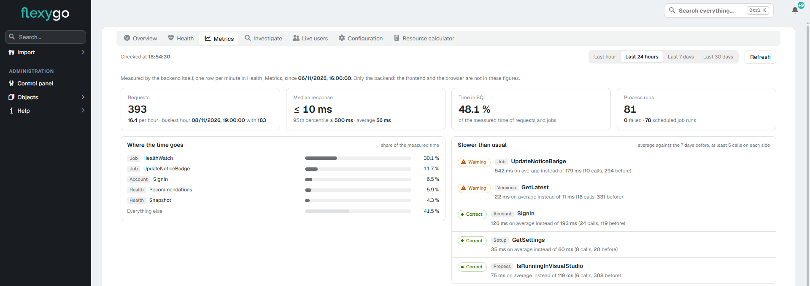

# Version 10.1

Flexygo 10.1 adds a panel for checking application health and resources. It also makes updates easier and brings improvements to configuration, deployment, development, and the interface.

## Highlights

### Health and resources

Check alerts, recommendations, connected users, metrics, and settings from a single panel. You can also review suggestions to optimize the application: changes are recorded, and you can undo suggested indexes. The panel is available to administrators and from the skin 2026 dashboard.

[More information: application health](../../Help/Administration/HealthPanel.md)

## Other new features

### Updates

- **Scheduled updates:** you can schedule, change, or cancel updates; they run in the background with notifications and a coordinated maintenance mode. [More information](../../1Deployment/3Updater/UpdateFlow.md)
- **Updater:** it can update itself and complete delegated preparations and updates even when they exceed the usual timeout. [More information](../../1Deployment/3Updater/UpdateFlow.md)
- **Docker updates:** follow a five-step wizard and end with a summary of the result. [More information](../../1Deployment/3Updater/DockerUpdate.md)
- **Nightly preparation:** a task prepares the next project version in the background and records the result. [More information](../../1Deployment/3Updater/UpdateFlow.md)

### Deployment

- **Resource calculator:** compare your installation with its recommendations and calculate the recommended servers based on expected usage.
- **Product export:** when exporting a project as a product, you can choose whether to include its data database. [More information](../../2ProductDevelopment/8ExportProject/2Reference.md)
- **Docker:** the documentation explains how to update using images and how to keep customizations on the maintenance page. [More information](../../1Deployment/3Updater/DockerUpdate.md)

### Configuration and security

- **Application settings:** administrators can view and change configuration, including the maximum duration of frontend-to-backend calls. [More information](../../Help/Administration/AppSettings.md)
- **Database connections:** the configuration explains what the “encrypt” attribute means. [More information](../../1Deployment/2ConfigWizard/Configuration.md)
- **Skin 2022:** the configuration and health panels have a clear design adapted to its colors. [More information](../../Help/Administration/HealthPanel.md)
- **Role-based visibility:** restrictions apply when viewing and saving records. [More information](../../Help/Administration/RolesAndPermissions/1Overview.md)

### Development tools

- **Collections:** configure their settings from the object workbench.
- **Tour editor:** markers follow the selected item as you scroll through the page.
- **Module layout:** place modules with the right mouse button or by dragging them, and change the layout from a clearer toolbar. [More information](../../Help/Modules/ModuleManagement.md)

### Interface

- **Skin 2026 menu:** manage menu nodes with the right mouse button. [More information](../../Help/Administration/Skin2026.md)
- **Skin 2026 search:** use / to search the visible list and Ctrl+K to view favorites and recent pages. [More information](../../Help/Administration/Skin2026.md)
- **Startup notices:** they appear in an orderly way, and version updates also include patches and betas.
- **Sidebar:** Import appears only when an import configuration is active.
- **Designers:** when they sign in, they enter development mode without having to open it from the menu.

### Integrations and reports

- **Brevo:** add or remove contacts from a list using only their email address. [More information](../../Help/Connectors/SendinBlue.md)
- **Excel export:** you can export reports and lists at the same time without the files getting mixed up.

### Processes

- **Generic buttons:** you can leave process buttons without an icon.

## Fixes

??? note "See the fixes in this version"

    - **Reports:** related reports once again apply the current record’s data and filters; Crystal Reports works with databases that use Windows authentication.
    - **MCP integration:** the application uses a corrected version of its SDK.
    - **Interface:** new records display an appropriate title, pages without permission show a security notice, and five page designs display correctly again on Linux and Docker.
    - **Notifications:** in skin 2022, unread notifications once again appear with a white background, blue bar, and blue text.
    - **WebAPI and MCP:** processes run only on the object they are defined for. [More information](../../Help/Administration/RolesAndPermissions/4WebAPIMCP.md)
    - **Scheduled tasks:** they stop correctly when the application restarts or updates in IIS.
