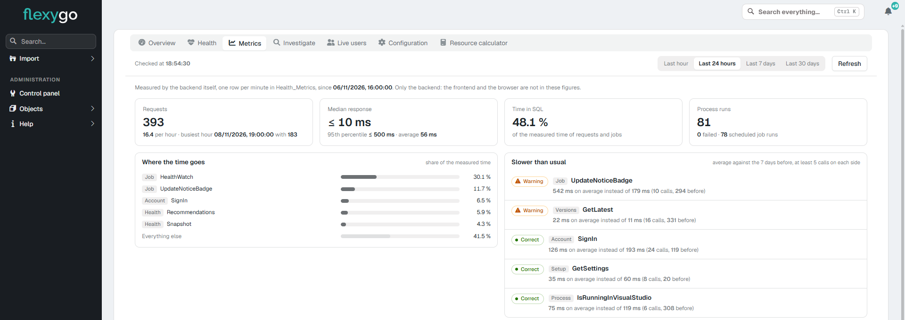

# Version 10.1

Flexygo 10.1 brings the application’s health, metrics and settings together in one panel, and makes updates easier to manage. It also improves development tools, the interface, performance and security.

## Highlights

### Health and resources panel

View alerts, recommendations, connected users and metrics, alongside application settings, in one panel. You can also review optimization suggestions, undo suggested indexes and check the change log. The panel is available to administrators and from the skin 2026 dashboard.

[More information: health panel](../../Help/Administration/HealthPanel.md)

## Other new features

### Updates and deployment

- **Schedule updates:** schedule, change or cancel them; they run in the background with notifications and a coordinated maintenance mode. [More information](../../1Deployment/3Updater/UpdateFlow.md)
- **Background preparation:** the Updater can update itself and complete delegated preparations and updates even when they exceed the usual timeout; the nightly task prepares the next version and records the result. [More information](../../1Deployment/3Updater/UpdateFlow.md)
- **Docker updates:** a wizard guides the update in five steps and shows a summary of the result. The version page explains how to update using images, and the maintenance page preserves customizations. [More information](../../1Deployment/3Updater/DockerUpdate.md)
- **Resource calculator:** work out the recommended servers for a deployment based on expected usage, and check how your installation matches its recommendations.
- **Export as a product:** when exporting a project, choose whether to include its data database. [More information](../../2ProductDevelopment/8ExportProject/2Reference.md)

### Settings

- **Changes during development:** configuration changes take effect on the next request without reloading the cache.
- **Timeout:** set how long frontend calls to the backend can last in the application settings. [More information](../../Help/Administration/AppSettings.md)
- **Application settings:** administrators can view and change settings from the application settings screen. [More information](../../Help/Administration/AppSettings.md)
- **Database connections:** the settings explain what the `encrypt` attribute means. [More information](../../1Deployment/2ConfigWizard/EncryptedSettings.md)

### Development tools

- **C# 14:** built-in processes and views recompiled at runtime support this version.
- **Collections:** configure them from the object workbench.
- **Skin 2026 menu:** manage menu nodes with the right mouse button. [More information](../../Help/Administration/Skin2026.md)
- **Designer and MCP:** their changes take effect on the next request, without clearing the cache when data is saved.
- **Tour editor:** markers follow the selected element as you scroll through the page.
- **Module placement:** place modules with the right mouse button or by dragging them, and change the layout from a clearer toolbar. [More information](../../Help/Modules/ModuleManagement.md)

### AI and integrations

- **Views for AI assistants:** assistants can query views with typed parameters and check that submitted values are valid. [More information](../../Help/AIAssistants/2Reference.md)
- **Chat interactions:** the assistant can interact with Flexygo screens when the user approves. [More information](../../Help/AIAssistants/3Decisions.md)
- **Brevo:** add or remove contacts from a list using only their email address. [More information](../../Help/Connectors/SendinBlue.md)

### Interface

- **Quick search:** brings together favorites, recent pages and shortcuts; in skin 2026, search the active list with /. [More information](../../Help/Administration/Skin2026.md)
- **Sidebar:** shows Import only when an import configuration is active.
- **Skin 2022:** displays the settings and health panels with a clear design adapted to its colors. [More information](../../Help/Administration/HealthPanel.md)
- **Skin 2026:** pages refresh and navigate with fewer delays and jumps; development mode starts automatically when designers sign in. [More information](../../Help/Administration/Skin2026.md)

### Reports and performance

- **Report designer text:** more text is translated into Spanish, Catalan, French, Italian, Portuguese and German.
- **Excel export:** export reports and lists at the same time without the files getting mixed up.
- **Page and process loading:** they open faster by reusing their definitions in memory.
- **Loading and updates:** settings and several screens load faster; database updates show progress through their stages and tables.

### Security

- **Role-based editing:** role restrictions also apply when saving values. [More information](../../Help/Administration/RolesAndPermissions/1Overview.md)
- **Visibility filters:** they apply when reading records by key from any screen or call. [More information](../../Help/Administration/RolesAndPermissions/1Overview.md)

### Processes and scripts

- **Process buttons:** generic process buttons can be set up without an icon.
- **Scripts:** respect the user's culture settings and can wait for processes to finish.

## Fixes

??? note "See the fixes in this version"

    - **Settings:** database connection handling, immediate saving when the cache is disabled, and sending diagnostic and product logs are corrected.
    - **Form designer:** you can resize fields again after adding or removing them, or switching tabs.
    - **Reports:** related reports use the correct record and filters; Crystal Reports also works with Windows authentication.
    - **Home:** the Health, Version and License cards keep their content while refreshing.
    - **Sign-in:** LDAP validates the password against the directory again.
    - **Integrations:** external connections to MySQL 8.0 and later, an issue with the certificate key password, and a security vulnerability in the MCP application SDK are fixed.
    - **AI assistants:** filtering and sorting by columns work again, including calculated and shared columns.
    - **Interface:** issues with pages, menus and views after a busy sign-in, notification counts, titles, security notices, and several images and styles are fixed.
    - **Security:** entered data is displayed as safe text and does not run template code; the WebAPI and MCP only run processes on the objects they are defined for. [More information](../../Help/Administration/RolesAndPermissions/4WebAPIMCP.md)
    - **Processes and scheduled tasks:** processes on filtered lists with composite keys work again, and scheduled tasks stop correctly when the application is restarted or updated in IIS.
