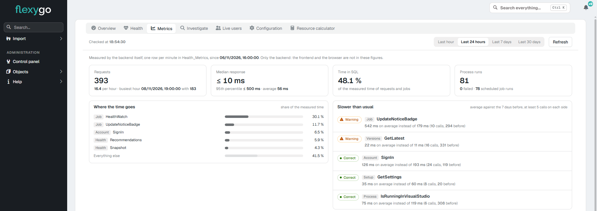

# Versión 10.1

Flexygo 10.1 te ayuda a conocer y optimizar el estado de tu aplicación, y facilita la gestión de actualizaciones y despliegues. También mejora la seguridad, el trabajo de desarrollo y la experiencia en la interfaz.

## Lo más destacado

### Salud y recursos de la aplicación

Consulta en un único panel las alertas, recomendaciones, usuarios conectados, métricas y configuración de la aplicación. También puedes revisar sugerencias de optimización, deshacer los índices propuestos y consultar los cambios registrados; está disponible para administradores y desde el dashboard de la skin 2026.

[Más información: salud de la aplicación](../../Help/Administration/HealthPanel.md)

## Otras novedades

### Instalación y actualizaciones

- **Actualizaciones programadas:** prográmalas, cámbialas o cancélalas; se ejecutan en segundo plano con avisos y un modo de mantenimiento coordinado. [Más información](../../1Deployment/3Updater/UpdateFlow.md)
- **Preparación de versiones:** el Actualizador puede actualizarse a sí mismo, completar tareas delegadas que superen el tiempo de espera habitual y preparar en segundo plano la siguiente versión del proyecto. [Más información](../../1Deployment/3Updater/UpdateFlow.md)
- **Actualización en Docker:** sigue un asistente de cinco pasos y consulta un resumen del resultado al terminar. [Más información](../../1Deployment/3Updater/DockerUpdate.md)

### Despliegue

- **Recursos recomendados:** calcula los servidores recomendados para un despliegue según el uso y comprueba cómo se ajusta tu instalación a esas recomendaciones.
- **Exportación de productos:** al exportar un proyecto como producto, puedes elegir si incluyes su base de datos de datos. [Más información](../../2ProductDevelopment/8ExportProject/2Reference.md)

### Configuración y administración

- **Aplicación de cambios:** en desarrollo, los cambios de configuración, del diseñador y de MCP se aplican en la siguiente solicitud, sin recargar la caché. [Más información](../../Help/Administration/AppSettings.md)
- **Ajustes de la aplicación:** configura cuánto pueden durar las llamadas del frontend al backend y consulta o modifica los ajustes desde su pantalla. [Más información](../../Help/Administration/AppSettings.md)
- **Conexiones de bases de datos:** al configurarlas, se explica qué implica el atributo `encrypt`.

### Herramientas de desarrollo

- **C# 14:** los procesos integrados y las vistas recompiladas en tiempo de ejecución admiten esta versión.
- **Colecciones:** configúralas desde el banco de trabajo del objeto.
- **Scripts:** respetan la cultura del usuario y pueden esperar a que terminen los procesos.
- **Diseñador de recorridos y módulos:** las marcas siguen al elemento seleccionado al desplazarte; coloca módulos con el botón derecho o arrastrándolos y cambia su distribución desde una barra más clara.

### IA e integraciones

- **Brevo:** añade o quita contactos de una lista indicando solo su correo electrónico. [Más información](../../Help/Connectors/SendinBlue.md)
- **Consultas con IA:** los asistentes pueden consultar vistas con parámetros tipados y validar que los valores enviados sean correctos. [Más información](../../Help/AIAssistants/2Reference.md)
- **Acciones desde el chat:** el asistente puede interactuar con las pantallas de Flexygo si el usuario aprueba la acción. [Más información](../../Help/AIAssistants/3Decisions.md)

### Interfaz y skins

- **Búsqueda rápida:** reúne favoritos, páginas recientes y atajos; en la skin 2026, pulsa / para buscar en la lista activa. [Más información](../../Help/Administration/Skin2026.md)
- **Menú de la skin 2026:** gestiona sus nodos con el botón derecho. [Más información](../../Help/Administration/Skin2026.md)
- **Navegación y desarrollo:** las páginas de la skin 2026 navegan con menos esperas y saltos, y su modo de desarrollo se activa automáticamente al iniciar sesión para los diseñadores. [Más información](../../Help/Administration/Skin2026.md)
- **Avisos de inicio:** se muestran de forma ordenada y las actualizaciones de versión incluyen parches y betas.

### Informes y rendimiento

- **Exportaciones a Excel:** exporta informes y listados al mismo tiempo sin que sus archivos se mezclen.
- **Carga más rápida:** páginas, módulos, procesos, ajustes y varias pantallas reutilizan definiciones en memoria para abrir antes.
- **Actualización de la base de datos:** muestra el avance de sus fases y tablas.

### Seguridad y procesos

- **Parámetros de proceso:** se conservan los valores configurados en los parámetros ocultos o bloqueados.
- **Permisos de edición:** las restricciones del rol también se aplican al guardar valores. [Más información](../../Help/Administration/RolesAndPermissions/1Overview.md)
- **Visibilidad de registros:** los filtros se aplican al leer registros por clave desde cualquier pantalla o llamada. [Más información](../../Help/Administration/RolesAndPermissions/1Overview.md)

## Correcciones

??? note "Ver las correcciones de esta versión"

    - **Configuración:** deja de mostrar y aceptar conexiones a bases de datos, guarda los ajustes al instante con la caché desactivada y vuelve a enviar los registros de diagnóstico y producto.
    - **Filtros y condiciones:** filtros, búsquedas y condiciones aceptan valores con comillas, tildes o llaves; las condiciones adicionales de listas, gráficos, kanban, planificadores y registros se validan antes de aplicarse.
    - **Formularios:** vuelve a funcionar el cambio de tamaño de los campos del diseñador tras añadir, eliminar o cambiar de pestaña.
    - **Informes:** los informes relacionados usan el registro y los filtros correctos, y Crystal Reports se genera en bases de datos con autenticación de Windows.
    - **Inicio de sesión:** el acceso mediante LDAP vuelve a validar la contraseña en el directorio.
    - **Integraciones:** las conexiones externas funcionan con MySQL 8.0 y posteriores, se corrige un problema con la contraseña de la clave del certificado y MCP incorpora una versión del SDK con una corrección de seguridad.
    - **Asistente de IA:** permite filtrar y ordenar por las columnas de cada vista, incluidas las calculadas y compartidas.
    - **Interfaz y notificaciones:** páginas, menús y vistas funcionan tras un inicio con mucha actividad; se corrigen el recuento de avisos, las columnas duplicadas, los títulos de registros nuevos, los avisos de seguridad, las imágenes de diseños y el aspecto de las notificaciones sin leer en la skin 2022.
    - **Procesos y tareas programadas:** los procesos de listas filtradas admiten objetos con clave compuesta y sin identificador único; las tareas se detienen correctamente al reiniciar o actualizar la aplicación en IIS.
    - **Seguridad:** los datos introducidos en registros se muestran como texto seguro y no ejecutan código de plantilla; la WebAPI y MCP solo ejecutan cada proceso sobre el objeto para el que está definido. [Más información](../../Help/Administration/RolesAndPermissions/4WebAPIMCP.md)
