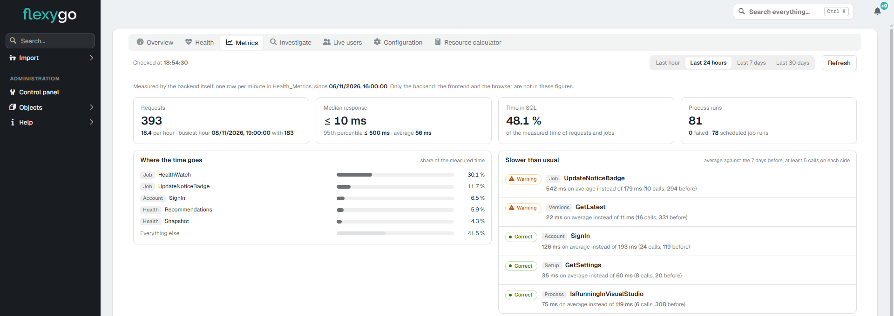

# Versión 10.1

Flexygo 10.1 reúne en un solo panel información para supervisar la salud y los recursos de tu aplicación. También facilita las actualizaciones y añade ajustes prácticos a las herramientas de desarrollo y a la interfaz.

## Lo más destacado

### Salud y recursos en un panel

Consulta alertas, recomendaciones, usuarios conectados y métricas desde un único panel. También puedes revisar los ajustes de la aplicación y las sugerencias para optimizarla; los cambios quedan registrados y puedes deshacer los índices sugeridos. Está disponible para administradores y desde el panel de control de la skin 2026.

[Más información: panel de la aplicación](../../Help/Administration/HealthPanel.md)

## Otras novedades

### Actualizaciones

- **Programación:** programa, modifica o cancela actualizaciones, que se ejecutan en segundo plano con avisos y un modo de mantenimiento coordinado. [Más información](../../1Deployment/3Updater/UpdateFlow.md)
- **Preparación:** el Actualizador puede actualizarse y completar preparaciones y actualizaciones delegadas que superen el tiempo de espera habitual. La tarea nocturna prepara la siguiente versión del proyecto y registra el resultado. [Más información](../../1Deployment/3Updater/UpdateFlow.md)
- **Idiomas:** la descripción del proceso de precarga del Actualizador está disponible en más idiomas. [Más información](../../1Deployment/3Updater/UpdateFlow.md)

### Docker

- **Asistente de actualización:** en Docker, la actualización sigue cinco pasos y termina con un resumen del resultado. [Más información](../../1Deployment/3Updater/DockerUpdate.md)
- **Documentación:** la página de versiones explica cómo actualizar mediante imágenes y la página de mantenimiento conserva las personalizaciones. [Más información](../../1Deployment/3Updater/DockerUpdate.md)

### Configuración

- **Colecciones:** configura sus ajustes desde el banco de trabajo del objeto.
- **Conexiones de bases de datos:** la configuración explica el atributo «encrypt». [Más información](../../1Deployment/2ConfigWizard/Configuration.md)

### Herramientas de desarrollo

- **Editor de recorridos:** las marcas siguen al elemento seleccionado mientras te desplazas por la página.
- **Distribución de módulos:** coloca módulos con el botón derecho o arrastrándolos, y cambia la distribución desde una barra más clara. [Más información](../../Help/Modules/ModuleManagement.md)

### Interfaz y navegación

- **Menú de la skin 2026:** gestiona sus nodos con el botón derecho. [Más información](../../Help/Administration/Skin2026.md)
- **Búsqueda en la skin 2026:** usa / para buscar en la lista visible y Ctrl+K para consultar favoritos y páginas recientes. [Más información](../../Help/Administration/Skin2026.md)
- **Menú lateral:** muestra Importar solo cuando hay una configuración de importación activa.

### Skins y procesos

- **Skin 2022:** los paneles de configuración y salud adaptan el diseño a sus colores. [Más información](../../Help/Administration/HealthPanel.md)
- **Diseñadores:** al iniciar sesión entran en modo de desarrollo automáticamente, sin tener que abrirlo desde el menú.
- **Botones de proceso:** puedes dejar sin icono los botones genéricos.

## Correcciones

??? note "Ver las correcciones de esta versión"

    - **Informes:** los informes relacionados aplican el registro actual y sus filtros; Crystal Reports funciona con bases de datos que usan autenticación de Windows.
    - **Seguridad e integraciones:** la aplicación MCP incorpora una versión del SDK con una corrección de seguridad.
    - **Interfaz:** los registros nuevos muestran un título adecuado, las páginas sin permiso avisan de ello y vuelven a mostrarse las imágenes de cinco diseños de página en Linux y Docker.
    - **Notificaciones:** en la skin 2022, las notificaciones sin leer vuelven a mostrarse con fondo blanco, barra azul y texto azul.
    - **Tareas programadas:** en IIS, se detienen correctamente al reiniciar o actualizar la aplicación.
