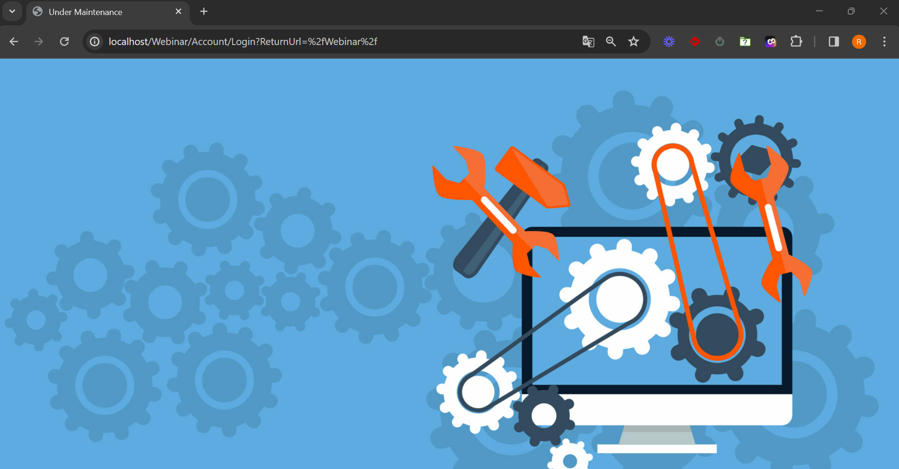

# ¿Sabías que Flexygo tiene un modo de parada de emergencia?

Flexygo ofrece dos modos para gestionar la disponibilidad de la aplicación.

## Modo de mantenimiento

Los administradores pueden mantener la aplicación operativa mientras se realizan tareas de actualización. Consulta [¿Sabías que existe un modo para realizar labores de mantenimiento en la aplicación?](MaintenanceMode.md).

## Modo de parada de emergencia

Para detener completamente una aplicación publicada en IIS, crea un archivo `app_offline.htm` en la carpeta del sitio del Frontend (y en la del Backend, si está en un sitio o aplicación aparte). Su contenido es la página que verá el usuario. Esto generará:

* **Bloqueo de conexiones**: se pararán todas las conexiones del sistema
* **Mensaje en navegador**: se mostrará una página indicando el estado offline

## Restauración del servicio

Una vez finalizado el mantenimiento, elimina o renombra el archivo `app_offline.htm` y el servicio se restablece automáticamente.

!!! note "Nota"
    El archivo `app_offline.htm` es un mecanismo del módulo de ASP.NET Core para IIS. No sirve en Docker ni cuando la aplicación se ejecuta directamente con Kestrel: en esos casos, detén el contenedor o el servicio.

!!! warning "Advertencia importante"
    Esta acción dejará la aplicación completamente inaccesible.
