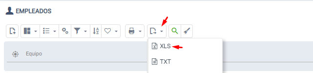
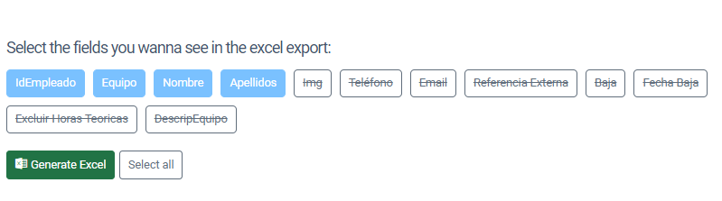

# Did you know you can choose which columns to export to Excel?

Just click the Excel export option on any list and it will automatically ask which fields you want to use in the report.

## Procedure

1. Select the Excel export option from any listing
2. The system will automatically ask which fields you want to include in the report
3. Choose the desired fields to customize the exported document

## Exporting to CSV: the separator 10.0+

When a list is exported to **CSV**, the fields are separated with the character of the **ExportCsvSeparator** setting (*System* group): a comma by default. If your Excel opens the CSV in a single column, set `;`, the separator Excel expects in languages that use the comma as decimal mark.
