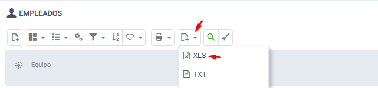
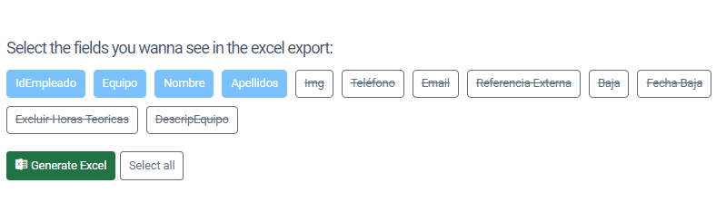

# ¿Sabías que puedes elegir las columnas que quieres exportar a Excel?

Tan solo haz clic en la opción de exportar a Excel de cualquier lista y automáticamente te preguntará qué campos quieres usar en el informe.

## Procedimiento

1. Selecciona la opción de exportar a Excel desde cualquier listado
2. El sistema solicitará automáticamente qué campos deseas incluir en el informe
3. Elige los campos deseados para personalizar el documento exportado

## Exportar a CSV: el separador 10.0+

Al exportar una lista a **CSV**, los campos se separan con el carácter del ajuste **ExportCsvSeparator** (grupo *System*): una coma por defecto. Si tu Excel abre el CSV en una sola columna, pon `;`, que es el separador que espera Excel en español.
