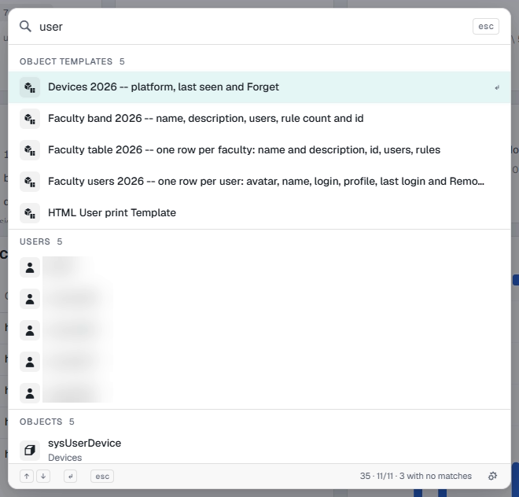
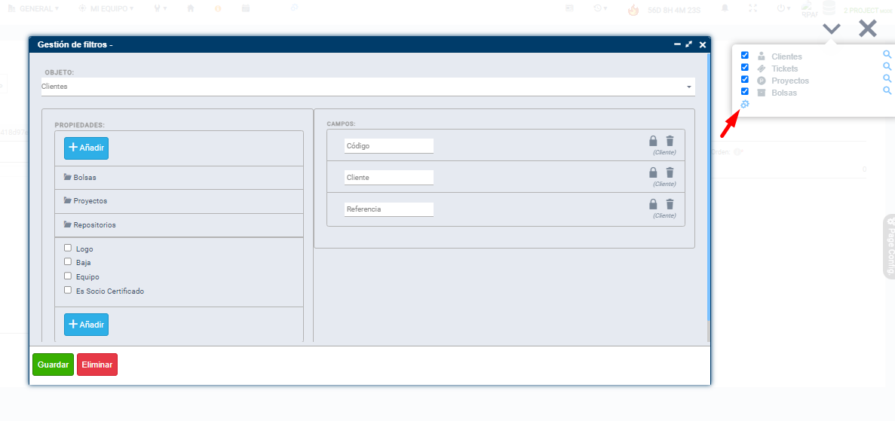

# Did you know Flexygo has a generic search for every object?

Flexygo lets you configure a generic search for any object in the application, a feature that is often overlooked during development.

## How to use it

In the Flexygo 2026 skin:

1. Enable developer mode
2. Open the search with **Ctrl + K** or from the search box in the sidebar
3. Click the **Search settings** gear at the bottom of the search (it's only visible in developer mode)
4. Set every search field you want for any object in the application

<figure markdown="span">
  
  <figcaption>The search (Ctrl + K) groups the results by object; the gear at the bottom right opens its settings</figcaption>
</figure>

In the flexy2022 skin, the settings are in the magnifying-glass icon in the top bar:

