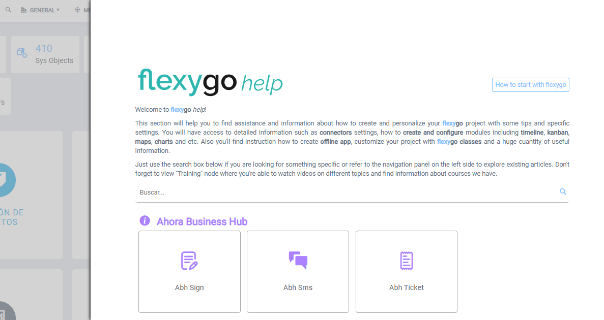

# Did you know Flexygo has keyboard shortcuts?

Flexygo includes several useful keyboard shortcuts:

* **F1**: opens the tool's help
* **F2**: opens the configuration parameters
* **Ctrl + S**: saves changes when the focus is on an edit form

In the Flexygo 2026 skin, also:

* **Ctrl + K**: opens the search, with your favourites and your recent pages
* **?**: shows the list of keyboard shortcuts
* **/**: goes to the search box of the list you are looking at
* **Ctrl + B**: folds or unfolds the sidebar
* **Ctrl + Shift + M**: opens **Place modules**, to arrange the page's modules
* **Ctrl + Space**: opens developer mode's **Quick access**. See [Did you know you can access any object's configuration from the sidebar?](SidebarObjectConfig.md)

On a Mac, use **Cmd** instead of **Ctrl** for the Ctrl shortcuts.

## Screenshots

