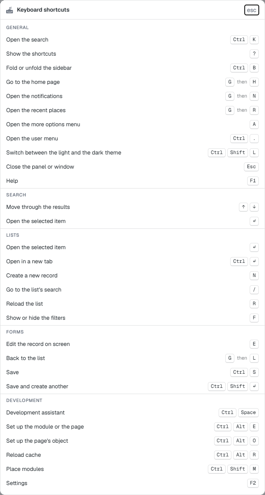

# Did you know Flexygo has keyboard shortcuts?

Flexygo includes several useful keyboard shortcuts:

* **F1**: opens the tool's help
* **F2**: opens the configuration parameters
* **Ctrl + S**: saves changes when the focus is on an edit form
* **Ctrl + Shift + Enter**: saves and opens a blank form to add another record

In the Flexygo 2026 skin, also:

* **Ctrl + K**: opens the search, with your favourites and your recent pages
* **?**: shows the list of keyboard shortcuts
* **G** then **H**: goes to the home page; **G** then **N** opens the notifications
* **Ctrl + .**: opens the user menu, and **Ctrl + Shift + L** switches between the light and the dark theme
* **/**: goes to the search box of the list you are looking at; **R** reloads it and **F** shows or hides its filters
* **E**: from a record's view, opens its edit form
* **Ctrl + B**: folds or unfolds the sidebar
* **Ctrl + Shift + M**: opens **Place modules**, to arrange the page's modules
* **Ctrl + Space**: opens developer mode's **Quick access**. See [Did you know you can access any object's configuration from the sidebar?](SidebarObjectConfig.md)
* **Ctrl + Alt + E**, **O** and **R**, in develop mode: set up the module or the page, set up the page's object and reload the cache

The single keys do nothing while you are typing in a field. On a Mac, use **Cmd** instead of **Ctrl** for the Ctrl shortcuts.

The full list, with what each one does and when, is in [Keyboard shortcuts](../../Help/Information/KeyboardShortcuts.md).

## Screenshots

