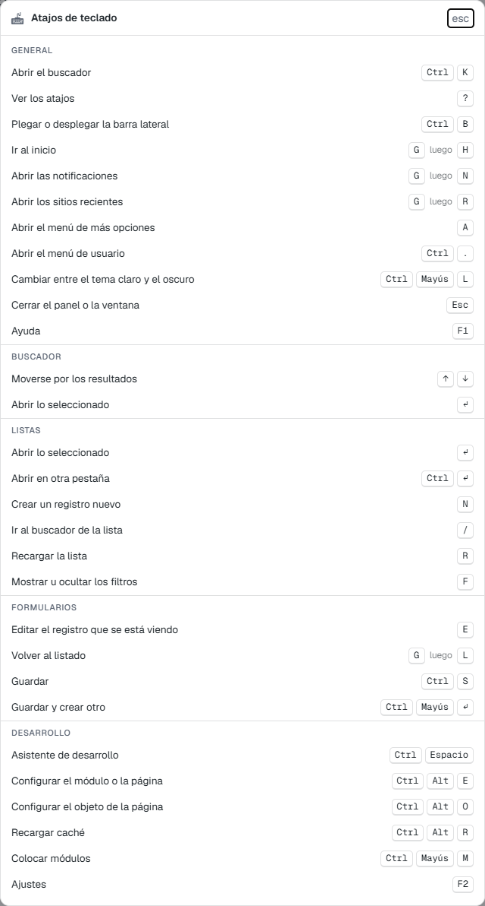

# ¿Sabías que Flexygo dispone de atajos de teclado?

Flexygo cuenta con varios atajos de teclado útiles:

* **F1**: abre la ayuda de la herramienta
* **F2**: accede a los parámetros de configuración
* **Ctrl + S**: guarda cambios cuando el foco está en un formulario de edición
* **Ctrl + Mayús + Intro**: guarda y abre un formulario en blanco para dar de alta otro registro

En la skin Flexygo 2026, además:

* **Ctrl + K**: abre el buscador, con tus favoritos y tus páginas recientes
* **?**: enseña la lista de atajos de teclado
* **G** y luego **H**: va a la página de inicio; **G** y luego **N** abre las notificaciones
* **Ctrl + .**: abre el menú de usuario, y **Ctrl + Mayús + L** cambia entre el tema claro y el oscuro
* **/**: lleva al buscador de la lista que estás viendo; **R** la recarga y **F** enseña u oculta sus filtros
* **E**: desde la vista de un registro, abre su formulario de edición
* **Ctrl + B**: pliega o despliega el menú lateral
* **Ctrl + Mayús + M**: abre **Colocar módulos**, para organizar los módulos de la página
* **Ctrl + Espacio**: abre el **Acceso rápido** del modo desarrollador. Consulta [¿Sabías que puedes acceder a la configuración de cualquier objeto desde la barra lateral?](SidebarObjectConfig.md)
* **Ctrl + Alt + E**, **O** y **R**, en modo desarrollo: configuran el módulo o la página, configuran el objeto de la página y recargan la caché

Las teclas sueltas no hacen nada mientras escribes en un campo. En Mac, usa **Cmd** en lugar de **Ctrl** para los atajos con Ctrl.

La lista completa, con lo que hace cada uno y cuándo, está en [Atajos de teclado](../../Help/Information/KeyboardShortcuts.md).

## Capturas

