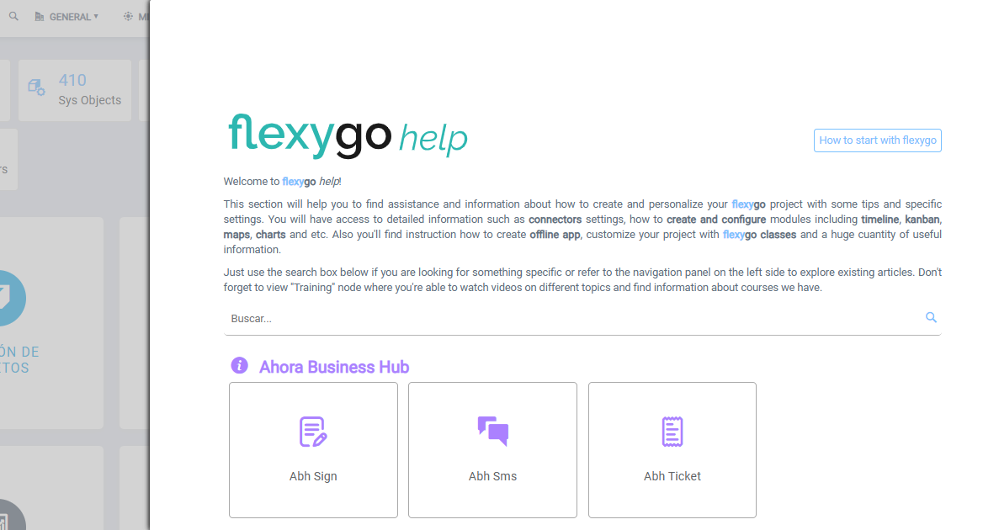

# ¿Sabías que Flexygo dispone de atajos de teclado?

Flexygo cuenta con varios atajos de teclado útiles:

* **F1**: abre la ayuda de la herramienta
* **F2**: accede a los parámetros de configuración
* **Ctrl + S**: guarda cambios cuando el foco está en un formulario de edición

En la skin Flexygo 2026, además:

* **Ctrl + K**: abre el buscador
* **Ctrl + Mayús + M**: abre **Colocar módulos**, para organizar los módulos de la página
* **Ctrl + Espacio**: abre el **Acceso rápido** del modo desarrollador. Consulta [¿Sabías que puedes acceder a la configuración de cualquier objeto desde la barra lateral?](SidebarObjectConfig.md)

En Mac, usa **Cmd** en lugar de **Ctrl** para los tres últimos.

## Capturas

