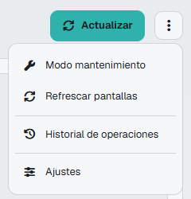
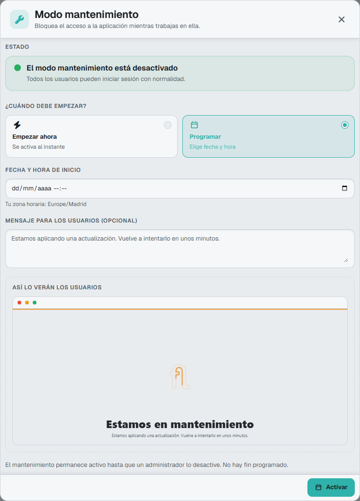

# Did you know there is a mode for performing maintenance work on the application?

Maintenance mode blocks access to the application while you work on it. Starting with version 10 it's managed from the **Version Management** screen, which only administrators can open. In the Flexygo 2026 skin, open it by clicking the **Version** row at the bottom of the sidebar.

## Enabling or scheduling maintenance

1. In **Version Management**, open **More actions** (the three dots next to **Update**) and choose **Maintenance mode**.

    <figure markdown="span">
      
      <figcaption>More actions: Maintenance mode and Refresh screens</figcaption>
    </figure>

2. In **When should it start?**, choose **Start now** or **Schedule** and set the **Start date and time**.
3. Optionally, write a **Message for users (optional)**. **This is what users will see** shows how the maintenance page will look.
4. Click **Activate** and confirm.

<figure markdown="span">
  
  <figcaption>The panel with <b>Schedule</b> chosen: start date and time, message and preview of the maintenance page (Spanish interface)</figcaption>
</figure>

While it's on or scheduled, **Version Management** shows a notice with a **Manage** button to change it. For a scheduled maintenance you can use **Reschedule** or **Cancel schedule**; otherwise it turns on by itself on the scheduled date.

## Who can still get in

* **The administrator who enabled it** keeps using the application normally.
* **Other administrators** can open **Version Management** to turn it off, even if whoever enabled it isn't available.
* **Every other user** is redirected to the maintenance page, with the message you entered. Open pages update when the state changes and, when maintenance ends, users can go back to their page.

To finish, click **Maintenance mode** and then **Deactivate**. Maintenance stays on until an administrator turns it off: it has no scheduled end.

!!! note "Note"
    During an application update, maintenance is controlled by the update process itself, with no exemptions for anyone, and it can't be turned off manually until the update finishes.

## Refreshing users' screens

In **Version Management**, open **More actions** and choose **Refresh screens**. You can reload the screen of **All users** connected or of **Specific users**, whom you can search for and select.

!!! warning "Removed processes"
    The system processes `EnableMaintenanceMode` and `DisableMaintenanceMode` were removed in version 10. If you called them from a button or an integration, use the **Version Management** screen.
