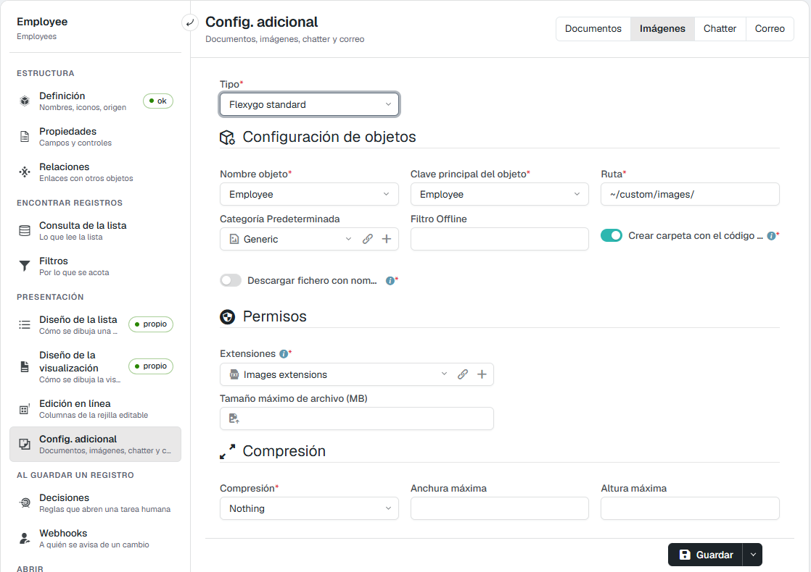

# Did you know you can resize images coming from offline?

Since Flexygo version 4.6.0.1 you can configure image compression for an object, so the pictures coming from the offline app are not stored at excessive sizes.

## Steps to configure compression

In skin 2026, with development mode on:

1. Open the configuration of the object that stores the images. The quickest way is **Quick access** (**Ctrl Space**) → **Extra settings**.
2. In **Extra settings**, choose **Images** in the selector at the top right (next to Documents, Chatter and Mail).
3. In the **Compression** section, fill in:
    * **Compression**: *Nothing*, *Low*, *Medium* or *High*. The last three reduce the size, but also the quality.
    * **Max width** and **Max height**: the maximum size of the image. The proportions are kept without exceeding those values.
4. Click **Save**.

<figure markdown="span">
  
  <figcaption><b>Extra settings</b> → <b>Images</b>, with the <b>Compression</b> section at the bottom (Spanish interface)</figcaption>
</figure>

In the flexy2022 skin you get there from the object wizard: in the last step, **Image settings**.

This way the application automatically resizes the images captured in offline mode and they take less space in the database.
