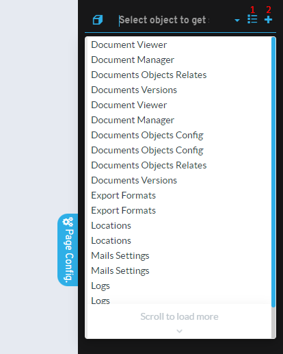

# ¿Sabías que puedes acceder a la configuración de cualquier objeto desde el acceso rápido?

En la skin Flexygo 2026, con el modo desarrollador activado, aparece el botón flotante **Acceso rápido**. Ábrelo pulsándolo o con **Ctrl + Espacio** (**Cmd + Espacio** en Mac) desde cualquier página. Puedes recorrer sus opciones con las flechas y elegir con **Intro**.

## Funcionalidades principales

* **Objeto**: muestra el objeto de la página que estás visualizando.
    * **Cambiar** (o **Elegir**, si la página no tiene objeto) despliega un filtro para saltar a cualquier otro objeto. La elección dura hasta que cambias de página.
    * El icono **+** (**Objeto nuevo**) abre el asistente para crear un objeto.
    * **Lista**, **Edición** y **Seguridad** abren el listado del objeto, su formulario de inserción de registros y su seguridad.
    * **Asistente**, **Configuración** y **Ver objeto** abren la configuración del objeto, y **Config. adicional** la de documentos, imágenes y chatter.
* **Página**: **Colocar módulos** (**Ctrl + Mayús + M**) para organizar los módulos de la página. No aparece en pantallas táctiles.
* **Procesos**: **Recargar caché**, **Generar scripts** y **Cambiar origen**, con el origen en uso debajo.
* **Administración**: **Panel de control** y **Cuadro de mando**, desde cualquier página.

Esta característica proporciona una forma eficiente para que los desarrolladores naveguen y accedan rápidamente a diferentes secciones de la aplicación sin necesidad de recorrer múltiples niveles de menú.

## Skin flexy2022

En la skin flexy2022 se mantiene la barra lateral **Page Config**. Funciona de manera predeterminada para configurar el objeto que estés visualizando, pero permite modificar su valor para acceder rápidamente a cualquier otro objeto:

* **Acceso rápido a configuración**: modifica el valor en la barra lateral para cambiar entre diferentes objetos
* **Icono de lista**: permite acceder directamente al listado del objeto
* **Icono de más (+)**: facilita el acceso directo a la inserción de nuevos registros

