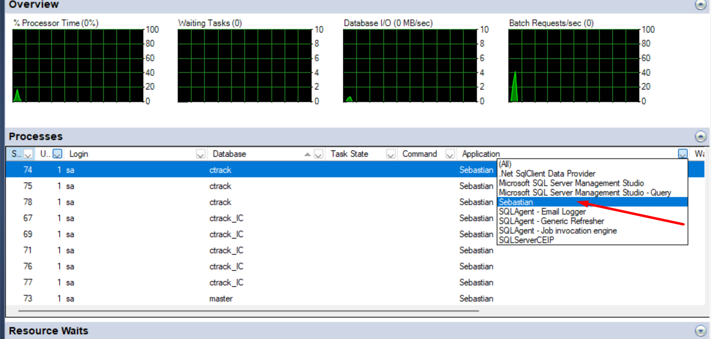

# ¿Sabías que puedes identificar el origen de una conexión SQL por aplicación?

Para analizar el origen de las conexiones a tu base de datos, es posible filtrar utilizando el nombre de la aplicación.



El asistente de configuración no añade este atributo: si no lo indicas, SQL Server muestra el nombre genérico del proveedor de datos. Para identificar tu aplicación, añade el atributo **Application Name** a cada cadena de conexión de la sección `ConnectionStrings` del `appsettings.json` del Backend:

```json
"ConnectionStrings": {
  "ConfConnectionString": "Data Source=MiServidor;Initial Catalog=MiApp_IC;User ID=sa;Password=...;TrustServerCertificate=True;Application Name=MiApp",
  "DataConnectionString": "Data Source=MiServidor;Initial Catalog=MiApp_Data;User ID=sa;Password=...;TrustServerCertificate=True;Application Name=MiApp"
}
```

Reinicia el Backend (en IIS, recicla el grupo de aplicaciones) para que use las cadenas nuevas.

!!! note "Cadenas cifradas"
    En IIS y en un contenedor de producción, las cadenas de conexión se guardan cifradas (`enc:v1:...`). Para cambiarlas, consulta [Cambiar un valor cifrado a mano](../../1Deployment/2ConfigWizard/EncryptedSettings.md#cambiar-un-valor-cifrado-a-mano).
