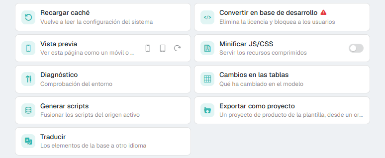

# Did you know you can set up a test environment without worrying about the license?

The **Convert to dev database** action (process `SetDbDevelopMode`; in earlier versions, *Set Single User Mode*) gets a copy of the configuration database ready for testing.

## What it is for

It is useful when you move the production database to a test environment: the license does not work there, because the server and the environment change, and you do not want every production user to be able to sign in.

## What it does

* **Deletes the license** from the database. You then have to activate a new one, for example an evaluation license.
* **Blocks every user** except `admin`, `guest` and the one you choose in **Enable user to perform tests**.
* Reloads the cache and the page.

This way you can develop with `admin` and test with the chosen user, with their profile and roles. The chosen user keeps their own password.

!!! warning "Use it only on a copy"
    It deletes the license and blocks users in the database the application is connected to. Before running it, make sure you are working in a test environment that is distinct from production: server, database, configuration and project name.

## Where it is

Only administrators can run it. In skin 2026, open the [control panel](../../Help/Administration/ControlPanel.md) and, in the actions, click **Convert to dev database**. It asks for the test user and for a confirmation before doing anything.

<figure markdown="span">
  
  <figcaption>Control panel actions, with <b>Convert to dev database</b> (Spanish interface)</figcaption>
</figure>

In the flexy2022 skin it is the **Set Db to Development Mode** process of the object collection (*Admin Area → Object Collection*).
