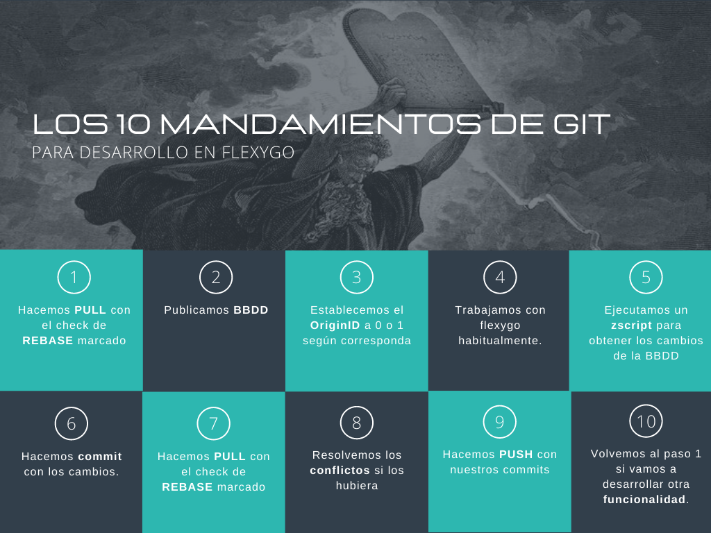

# ¿Cómo desarrollar en GIT?



## Prefijos de commit para las notas de la release

El asunto de cada commit empieza por un prefijo. Con él, el texto del commit se incluye automáticamente en las notas de la versión (de la aplicación, de la ayuda y del paquete NuGet):

* **FT:** designa una funcionalidad nueva o una mejora que el usuario puede ver
* **FIX:** indica la corrección de un problema identificado; se describe el síntoma que veía el usuario
* **HL:** marca uno de los destacados de la versión (unos pocos por versión). Además de la nota, abre el resumen y la noticia de la versión y genera una página de la ayuda
* **DEP:** marca características que quedan obsoletas o fuera de catálogo, y qué usar en su lugar
* **INT:** trabajo interno (refactorizaciones, compilación, tests, herramientas, documentación interna). **Nunca** aparece en las notas de la versión

Las notas se escriben solo a partir del asunto y del cuerpo del commit, nunca del código: hay que contar qué cambia **para el usuario**, no qué clases se han tocado.

### Reglas que comprueba el repositorio

El hook `commit-msg` del repositorio de Flexygo (`.githooks/commit-msg`) rechaza el commit si no las cumple:

* El asunto **empieza por uno de los prefijos** anteriores (salvo los merges y los reverts).
* El asunto tiene **más de 50 caracteres** (conviene no pasar de unos 72).
* Ninguna línea contiene `...` como relleno.
* Un commit `HL:` **añade al menos una imagen** (`.png`, `.jpg`, `.jpeg` o `.gif`) en `release-notes/images/`.

### Commits HL:

El cuerpo de un `HL:` sigue una estructura fija, porque con él (y con su captura) se escriben la nota destacada, la noticia y la página de la ayuda:

```
HL: Update Flexygo from a guided wizard with automatic rollback

What: A wizard updates the frontend, the backend and the database in one go, checks the
requirements and the locks first, and rolls the update back when it does not finish.
Where: Admin > Maintenance > Versions, button "Update".
How:
1. Open the Versions page and choose the version to install.
2. Review the requirements and the locks the wizard detects.
3. Start the update and follow its progress; the log can be filtered.
Settings: Repository and credentials of the packages in the updater settings.
Permissions: Administrators only.
Help: Maintenance and updates
```

* `What`, `Where` y `How` son obligatorios; `Settings`, `Permissions` y `Help`, solo cuando aplican.
* La captura es **obligatoria** y va en el mismo commit, en `release-notes/images/`, con un nombre descriptivo en minúsculas y con guiones (`update-wizard.png`).
